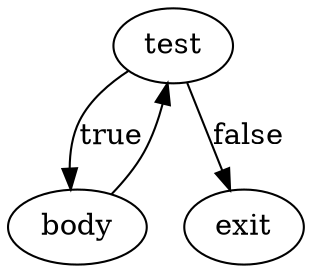
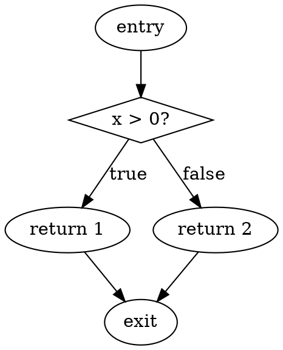

# C 语言代码与控制流图的表达能力分析

## 1. 问题与结论

Scientific Toolworks Understand 可以分析函数，并将其控制流显示为流程图；其 API 也提供控制流图对象和图形导出能力。那么，文字代码是否与“图元加连接线”严格同构？是否所有 C 程序都有对应的控制流图？

**结论需要分成三个层次：**

1. **通常可以构建控制流图**。对于确定了预处理配置、目标语言和分析范围的有限 C 程序，通常可以为受支持的函数构建有限的静态控制流图。`if`、循环、`switch`、`goto`、`return` 等控制转移都可以用节点和有向边表示。但函数指针、跨函数跳转、外部库、信号和并发等情况可能需要额外建模或保守近似；不同工具的覆盖范围也不同。
2. **普通控制流图与源代码不严格同构**。控制流图主要回答“控制可能从哪里转到哪里”。它通常不会完整保留源代码的语法形式、注释、宏、变量名称和格式等，因而一般不能唯一还原原始代码。可转换为图，不等于存在一一对应且可逆的映射。
3. **图形语言能否表达同样的程序，取决于图形语言的语义和运行环境**。如果图元操作、数据类型、存储、控制转移、调用、外部交互等足够完整，并定义了与 C 相匹配的执行规则，那么可以对选定的 C 子集实现行为保持的转换。一个只能画框和箭头、或者只提供有限业务元件的系统，并不自动具有全部 C 语言表达能力。

所以，更准确的说法是：

> C 程序的控制转移通常可以用控制流图建模；源代码和普通控制流图一般不是严格同构的。图形程序能否与某段 C 程序行为等价，需要分别定义两种语言的语义、运行环境和观察范围，并证明转换保持这些语义。

## 2. Understand、DOT 和控制流图分别是什么

### 2.1 Understand 做了什么

Understand 的 Control Flow 图以函数等对象为目标，展示条件、循环、分支及控制转移。其 Python API 将控制流节点和节点间的后继关系暴露为 `CFGraph`；部分节点可能从入口不可达。官方资料还说明，图可以通过 API 导出为 DOT 等格式；某些使用 Understand 自定义布局的 DOT 文件带有专用属性，未必都适合直接交给 Graphviz 使用。[1][2]

因此，一个典型链路是：

```text
C 代码 + 预处理及项目配置
    → Understand 解析并建立程序模型
    → 选择函数及图的分析/显示规则
    → 生成控制流图
    → 导出为 DOT 等格式，或绘制成图片
```

图上显示的内容和细节取决于工具及配置。**能导出一张 DOT 图，不等于该图包含了源文件和运行语义的全部信息。**

### 2.2 DOT 是图的描述格式

Graphviz 的 DOT 使用文本描述图、节点、边和属性；`digraph` 使用 `->` 表示有向边。[3] 例如：



这段 DOT 描述的是一个有向图。图可以被解释为循环：在 `test` 判断，满足条件时执行 `body`，否则离开。但这种解释来自我们对节点和边的约定，不是 DOT 自动赋予程序的执行语义。

即使节点的标签中写着 `x = x + 1`，Graphviz 通常也只是把它当作显示文本，并不会执行赋值、验证整数溢出或检查该程序是否合法。DOT 文件**可以携带**更多属性或外部元数据；这些信息如何解释，仍要由使用它的工具另行定义。

### 2.3 控制流图是对程序的特定抽象

控制流图，简称 CFG（Control Flow Graph），一般由以下部分构成：

- **节点**：一个语句、一个条件，或若干顺序执行的指令组成的基本块；具体粒度取决于建图规则。
- **有向边**：控制可能从一个节点转移到另一个节点。
- **入口与出口**：表示函数或分析区域的开始，以及正常返回或其他结束方式。

例如 LLVM IR 使用基本块组织函数，每个基本块以描述后续控制转移的终结指令结束。[4] 这是 LLVM 的具体规则；其他工具绘制的一个流程框不一定恰好对应一个 LLVM 基本块。

## 3. 用一个具体例子区分代码与图

### 3.1 C 代码

```c
int select_value(int x)
{
    if (x > 0)
    {
        return 1;
    }

    return 2;
}
```

### 3.2 一种可能的控制流图

```text
          入口
           │
           ▼
       [ x > 0 ? ]
        /       \
      真         假
      ▼           ▼
 [ return 1 ]  [ return 2 ]
      \           /
       └──► 出口 ◄┘
```

相应 DOT 可以写成：



这个例子展示了如何记录控制分支，但有几点需要区分：

1. 图中带 `return 1` 等标签时，人可以读懂操作；如果去掉标签，只保留节点和边，就不能区分返回 `1`、`2`，还是返回其他值。
2. 节点标签本身只是文本。若要让图成为可执行程序，还需规定如何解析条件、求值、返回，以及 `x` 的类型和取值。
3. 此图只是某一种分块结果。另一个工具可能把条件或返回方式分成不同数量的节点，但仍然描述相近的控制行为。
4. 根据这张图通常无法知道原代码是否有 `else`、原来的缩进是什么、是否有注释，或者条件原本来自哪个宏。

## 4. 为什么不能说二者“严格同构”

### 4.1 同构比“能互相转换”要求更强

图论中的图同构，要求先明确两边的节点、边及其类型，然后存在节点之间的**双射**：既不丢失节点，也不把多个节点合成一个，并且映射前后的连接关系要保持。若图有节点类型、边类型或其他属性，还要说明哪些属性也必须保持。

源代码原始文本本身不是一张控制流图；即使将它解析为抽象语法树（AST），AST 表示的是语法的嵌套关系，而 CFG 表示的是控制转移关系。两者的节点及边含义不同，一条源语句可能对应多个控制节点，一个基本块也可能包含多条指令。因此通常不能直接说源代码与 CFG 图同构。

可以专门设计一种图，把完整语法树、注释、格式甚至源文件原文都保存进去，再定义可逆映射；但可逆性来自**额外保存的信息和特定转换设计**，不是普通 CFG 天生具有的性质。把整份 C 源码塞进一个图节点，虽然能保存文字，也不等于已经用可视化图元独立表达了每一步程序语义。

### 4.2 多种代码可能对应相同的控制结构

例如，下面两段代码可以按同样的“初始化 → 条件 → 循环体 → 递增 → 回到条件”的方式建模：

```c
for (int i = 0; i < 3; ++i)
{
    consume(i);
}
```

```c
int i = 0;
while (i < 3)
{
    consume(i);
    ++i;
}
```

在限定调用和变量使用范围、按相同粒度建图时，这两段的控制结构可以相同；但原来的 `for`、`while`、声明位置及源代码文本不同。是否完全行为等价，还要考虑变量作用域以及具体上下文。由此可见：**控制结构相同，不等于源代码相同；能生成行为等价的另一段代码，也不等于恢复了原文。**

### 4.3 可表示、行为等价和精确还原不是一回事

| 要求 | 要回答的问题 |
|---|---|
| 控制流可表示 | 在选定粒度下，能否描述可能的控制转移？ |
| 行为等价 | 相同环境和输入下，是否保持约定的输出、副作用、终止行为和允许的不确定结果？ |
| 可生成代码 | 能否从图生成目标语言中满足所需行为的某个程序？ |
| 精确还原源码 | 能否恢复原来的语法、宏、注释、名称、格式和文件组织？ |

这些要求依次涉及更多信息，但不是所有场景都需要最高一项。例如，分析某条执行路径时可能只需 CFG；修改后生成可运行程序则需要额外的操作语义；要求源码往返无损时，还需完整保存源文本及构建相关信息。

## 5. 所有 C 程序都有控制流图吗

### 5.1 对“有图”的合理理解

在固定 C 版本、预处理配置、编译实现及目标环境后，一个有限的 C 函数通常可以用有限个静态程序位置和控制边构建 CFG。条件产生分支，循环产生回边，`goto`、`break`、`continue` 和 `return` 可以按其目标表示为转移。[5]

**有限的静态图不要求把每次循环执行都画成一个新节点**。一次循环的多次执行可以重复经过同一节点；即使一张静态图是有限的，也可能描述任意长的候选执行路径或不终止的执行。

但“存在一种建模方式”不等于“任意具体工具都能准确构图”：分析器可能不支持某种 C 方言、编译器扩展或目标平台，也可能选择隐藏、合并或近似某些边。项目中有条件编译时，一张针对某一宏配置生成的图，也不自动代表其他宏配置。

### 5.2 图上存在的路径未必真的可执行

CFG 的边通常表示控制转移的可能性。把边任意拼接得到的路径，可能因为数据条件相互矛盾而无法发生。

例如，若两次判断之间 `x` 没有变化：

```c
if (x > 0) { /* A */ }
if (x <= 0) { /* B */ }
```

纯粹按图走边，似乎可以先进入 A 再进入 B；但同一个 `x` 不可能同时满足这两个条件。要判断该路径是否可行，还需要分析数据和条件约束。跨函数路径还要保证调用和返回正确匹配：从调用点 A 进入函数，不应仅因为图中存在一条边就把控制返回到另一个调用点 B。

### 5.3 一张函数内 CFG 不等于完整程序模型

以下情况说明为什么要注明范围，而不能无条件说“一张函数图已经表达了整个程序”：

| 情况 | 需要额外考虑的内容 |
|---|---|
| 预处理与链接 | 宏、`#if`、头文件、其他翻译单元及库会影响最终程序。 |
| 函数与递归调用 | 调用目标、参数、返回位置、调用栈及被调用函数的状态变化；函数指针目标可能依赖运行时数据。 |
| `setjmp` / `longjmp` | 控制可以恢复到已保存的调用环境，不一定遵循普通的“调用后返回到下一句”。[5] |
| 表达式求值 | `&&`、\|\|、`?:` 有条件求值；其他表达式的求值顺序也不能一律假定为从左到右。 |
| 共享状态和外部交互 | 指针、别名、内存、文件、设备、`volatile` 访问等，需要与控制边一起建模。 |
| 并发和信号 | 多线程还涉及原子性、同步和内存顺序；单线程 CFG 的简单拼接不能代替完整并发语义。 |
| 行为边界 | 需要区分未定义行为、未指定行为和实现定义行为，并说明分析器如何处理。 |

例如，在 C 中 `p && *p > 3` 的右侧只在 `p` 为真时求值。若图形转换器把“读取 `*p`”无条件提前，当 `p` 为空指针时就改变了原有行为。即使画出来的主流程很像，转换仍然不正确。[5]

## 6. 控制流、数据流和程序状态的关系

### 6.1 两种线回答的问题不同

```text
数据流：读取温度 ──数值──► 比较器
控制流：比较器 ──真分支──► 打开风机
                 └假分支──► 关闭风机
```

- **数据流边**说明某个输入值来自哪个生产者，或存在什么数据依赖。
- **控制流边**说明执行控制可以沿哪个分支转移。

一个真实程序通常同时需要两者，还需要规定变量或内存的**状态**。例如 `count = count + 1` 既读取旧值，又产生新值；如果它位于循环中，就必须说明每次迭代读取的是哪一次更新后的值。

### 6.2 有数据连线也不自动保证等价

考虑下面的伪代码：

```c
write_output(1);
write_output(0);
```

若这两个调用具有对外可观察的副作用，把它们画成两个不受控制顺序约束的节点，即使都存在于图上，也不能保证先写 `1` 再写 `0`。图形语言必须说明：哪些节点执行、执行几次、何时执行，以及有副作用的操作之间如何排序。

同样，在条件分支内的“读取实时设备”不能仅因为数据依赖关系就任意提前到分支外：这可能改变读取时刻、读取次数和实际得到的值。

## 7. 图形语言能否与 C 具有相同表达能力

### 7.1 理论上可以构造足够强的图形语言

图形与文字只是不同的表示媒介。可以定义一种带有以下语义的图形语言：

1. 图元表示计算、读写状态、条件判断、调用和返回等操作；
2. 数据端口具有明确类型、取值规则和生命周期；
3. 控制连接规定执行先后、分支、循环及转移；
4. 有明确的存储、调用栈和外部环境模型；
5. 对异常情况、并发、未定义行为等指定与目标 C 环境相适应的规则。

在这些条件下，可以针对选定 C 子集构造从 C 到图、再从图到某种代码的转换，并验证行为保持。甚至可以把程序执行位置作为一个状态变量 `pc`：每个图节点对应一个 `pc` 值，在循环中根据 `pc` 执行相应操作并选择下一个值。这个思路说明**图形结构与文字形式可以编码相同的控制过程**；但要保持完整行为，仍然要正确实现图节点中的计算、存储和环境交互。

在抽象计算模型中，如果两种语言都具有足够的计算、条件转移和可扩展存储能力，它们可以具有相同的通用计算能力。这是一种**表达能力或计算能力上的等价**，并不要求程序的文字与图节点严格一一对应。真实 C 实现及设备的整数、内存、栈和运行时间等都有实际限制，不能把理想化的“无限存储”直接当作产品能力。

### 7.2 具体图形工具可能只支持其中一部分

一个工具即使能够显示 IF、循环和数据连线，也可能缺少某些操作、复杂类型、指针、动态内存、函数调用、并发或特定 I/O。它也可能限制：

- 图元端口的类型和连接数；
- 循环和分支的嵌套、汇合或跨区域跳转；
- 值的持久性、输入读取时机与执行周期；
- 允许生成的指令或目标设备的协议；
- 图规模、内存、执行时间和实时性。

因此，要比较某段 C 策略与某套图形系统，首先应约定 C 子集、目标设备和等价标准，再检查该系统的**编辑器、编译器、序列化协议和运行时**是否共同提供所需能力。

## 8. 对本项目图形配置的具体启示

以下结论依据当前编辑器与编译器源码，不把提案文档视为已经实现的功能，也不替代设备端验证。

1. **本项目的边带有领域语义和约束**。输出是否允许扇出由元件类别和端口属性决定；控制流和数据流并不只是颜色不同的线。见 `LogicEngineConfigTool/Models/ConnectionRules.cs:20-81`。
2. **编辑器中的 JUMP 与运行投影不是同一个层次**。编辑态 JUMP 有固定的一个控制输入和一个控制输出；不能因为运行 JSON 使用 `NextID`，就认为画布端口也可以省略。见 `LogicEngineConfigTool/Elements/ElementControlFlowJump.cs:20-38`。
3. **编辑图要经过领域校验和编译**。当前编辑器图的编译链包括规范化、控制描述提取、跳转解析、结构区域构建、突转和 JOIN 解析、线性化及计划校验；错误会阻止返回成功计划。见 `LogicEngineConfigTool/Services/ControlFlow/ControlFlowCompilationService.cs:27-32,53-101`。
4. **编辑图不等于运行 JSON**。运行投影前会核对任务顺序、`NextID` 和 JOIN/突转的降级决策；序列化阶段再将相关伪元件映射为运行形式。见 `LogicEngineConfigTool/Services/ControlFlow/RuntimeJumpLowerer.cs:8-16,28-53`。

据此，不能因为某个 C 函数能被 Understand 画成 DOT，就推断这张图能直接导入本项目、通过编译并在设备上等价执行。也不应把“所有环都被禁止”作为结论：**是否支持某种转移应看具体元件、图结构、编译约束和运行时契约。**

例如，判断一个具体 C 策略能否迁移到画布，可以逐项回答：

1. 控制分支、循环、提前退出和汇合是否有受支持的图元与连接方式？
2. 使用的数据类型、数值精度、溢出处理和比较规则是否一致？
3. 数据生产者的执行顺序、条件分支读取范围和多次执行语义是否一致？
4. 状态变量、定时器、实时采样及设备输出的读取/更新时机是否一致？
5. 外部调用、异常情况、任务调度与设备接口是否有明确对应？
6. 编译后的分支目标、普通 `NextID`、循环回边和汇合目标是否正确？
7. 是否通过保存与读回、典型输入/边界输入对照，以及目标设备测试？

只有对具体策略和已约定的观察范围完成这些检查，才能有依据地说两种实现等价；单凭图看起来相似、节点数量一致或编译成功，都不足以证明等价。

## 9. 最终回答

- **“文字代码和图元加连接线严格同构吗”**？一般不应这样认为。可以设计可逆表示，但普通 CFG 通常会抽象掉源码信息；而图形语言与文字语言的行为等价，也不要求节点与源语句一一对应。
- **“凡是能用 C 写的程序，都有对应控制流图吗”**？在明确语言配置、分析范围和建图约定后，通常可以为受支持函数建立表示其控制转移的静态 CFG；完整程序和复杂特性可能需要跨过程、状态、并发及环境模型，工具也可能只能给出近似结果。
- **“有 CFG 就一定能在当前图形配置工具中实现吗”**？不能。需要检查图元、端口、编译、协议及设备执行语义；这些限制与 DOT 能否画出该图是不同问题。

## 10. 参考资料

1. Scientific Toolworks Understand，[Control Flow](https://docs.scitools.com/graphs/Control_Flow.html)，以及 [CFGraph Python API](https://docs.scitools.com/python/api/understand.CFGraph.html)。
2. Scientific Toolworks Understand，[Graphs Python API：生成和导出](https://docs.scitools.com/python/graph.html)。官方说明某些 DOT 输出包含自定义布局属性。
3. Graphviz，[DOT Language](https://graphviz.org/doc/info/lang.html)。
4. LLVM，[LLVM Language Reference Manual](https://llvm.org/docs/LangRef.html)，函数结构、基本块与终结指令。
5. ISO C 工作组 WG14，[N1570：C11 委员会草案](https://www.open-std.org/jtc1/sc22/wg14/www/docs/n1570.pdf)，尤其是 5.1.2.3、5.1.2.4、6.5、6.8、7.13。本文以该草案为举例依据，它不是对所有 C 版本或具体编译器扩展的穷尽说明。

本次文档分析未运行 C 到图的转换实验，也未对本项目设备端执行行为作新的测试。

## 11. 本项目区域分析与 Roslyn 的比较

### 11.1 先区分三种“区域”

这里至少有三个名字相近、目标不同的概念：

1. **本项目的控制分支区域**：推断 IF、SWITCH、WHILE 等控制头所拥有的节点、嵌套关系及汇合边界，供编译和线性化使用。
2. **Roslyn 的 `ControlFlowRegion`**：把 Roslyn CFG 中的基本块按局部生命周期和异常处理结构组织成嵌套树。公开 `ControlFlowRegionKind` 包含 `Root`、`LocalLifetime`、`Try`、`Catch`、`Filter`、`Finally` 等种类，并没有 `IfThen`、`IfElse`、`SwitchCase` 一类分支体种类。[6][7]
3. **Roslyn 的 `AnalyzeControlFlow` / `AnalyzeDataFlow` 分析区域**：调用方先选定同一方法中的一个语法节点或连续语句范围，Roslyn 再分析这个给定范围的控制入口、出口、可达性和变量读写等信息。这里的 `Inside` / `Outside` 是相对于调用方选区定义的；API 不会自动推断某个画布节点归哪个 IF 分支。[8][9]

因此，Roslyn 的 region tree 不能直接当成本项目分支区域算法的现成实现；Roslyn 的选区分析也不是自动发现 IF/SWITCH 归属的算法。

### 11.2 Roslyn 如何构建 CFG 及其 `ControlFlowRegion`

按 Roslyn 当前公开 API 和所查源码浏览快照，其大致过程如下。具体内部实现可能随版本调整；下面不是 API 对每个版本的形状保证。[6][10][11]

1. `ControlFlowGraph.Create` 从函数体等可执行代码块取得根 `IOperation`，作为 CFG 构建输入。
2. builder 创建入口和出口基本块以及根 `Root` 区域，并在构建过程中跟踪当前区域。
3. builder 按 `IOperation` 结构访问语句和表达式，生成基本块、分支及条件值。进入/离开局部块时可建立 `LocalLifetime`；访问 `try`、`catch`、`filter`、`finally` 时，则按异常结构建立相应嵌套 region。
4. 求值栈上需要跨控制转移保存的中间值可以变为 capture；这些 capture 也可能影响 region 内容。因此 region 与源码花括号“松散相关”，并非逐一对应。
5. 检查未解析的分支并执行 `Pack`：可能合并基本块、移除没有 locals/captures 等内容的生命周期 region，或压缩嵌套结构。初建时存在的 region 不保证原样出现在最终树中。
6. 将 region builder 固化为不可变 `ControlFlowRegion`，记录嵌套关系、块序号范围、locals/captures 等；再标记可达块，固化基本块及其显式后继和前驱。
7. 分支跨越 region 边界时，可从 `ControlFlowBranch` 读取 `EnteringRegions`、`LeavingRegions` 和 `FinallyRegions`。它们分别记录边进入、离开以及需要经过的 finally 区域，不是某个 IF 分支拥有的全部节点。异常传播还包含隐式语义，不能只遍历普通 successor 就完整重建。

概念上，含有 catch 和 finally 的代码会形成反映 `Try`、`Catch`、`Filter`、`Finally` 组合关系的区域树。实际嵌套受源码、捕获值和压缩过程影响，调用方应遍历实际 CFG，而不应硬编码某个固定树形。

### 11.3 Roslyn 如何分析调用方选定的语法区域

`SemanticModel.AnalyzeControlFlow` 和 `AnalyzeDataFlow` 与 CFG 的 region tree 是另一组 API。它们的输入是用户指定的语法范围，不负责为任意图推断结构化控制区域。[8][9]

以概念步骤说明：

1. **验证选区**：确认节点或首尾语句构成 API 支持的有效范围；无效范围会得到失败结果，调用方必须先检查 `Succeeded`。
2. **分析控制边界**：在所属方法的绑定语义中分析选区，报告进入点、离开点、退出选区的分支，以及起点/终点可达性等。选区边界是调用方提供的，不是区域发现算法的输出。
3. **分析数据流**：对选区中的符号读写和赋值执行数据流分析，报告诸如 `VariablesDeclared`、`DataFlowsIn`、`DataFlowsOut`、`ReadInside`、`WrittenInside`、`DefinitelyAssignedOnEntry`、`DefinitelyAssignedOnExit` 等结果。
4. **分开处理不同事实**：控制是否能进出选区，与某个值是否在内定义、在外使用，是不同问题；数据流结果不会自动决定节点应移入哪个 IF 分支，也不证明移动后副作用顺序不变。

对应到画布分析，这类 API 的启发更像“给定候选区域后，检查边界和变量依赖是否满足条件”，而不是“从 CFG 自动产生候选 IF/SWITCH 区域”。例如，某个计算节点虽然依赖分支外的值，但这只说明它有数据输入；若把节点搬入分支会改变设备读取时机、写入次数或其他副作用，就不能据此认定移动安全。

### 11.4 当前项目算法实际在做什么

项目的编译链先规范化物理边和控制描述，再由 `StructuredRegionBuilder` 构建区域；之后解析 BREAK/CONTINUE、验证显式 JOIN，最后线性化和校验计划。分析失败会产生诊断，而不是把未经验证的区域写回任务图。[12]

当前区域构建可概括为：

1. **形成用于区域分析的后继图**：合并物理边和有效控制分支目标，排除运行时 JUMP 出边；给没有后继的节点接虚拟出口，并由无物理入边节点构造虚拟入口。
2. **计算支配和后支配信息**：通过迭代的集合交与并计算。实现对不可达节点或不能到出口的闭环有明确限制，不能把所有节点上的结果都当作常规路径语义。
3. **检测控制汇合点**：先采用非负的 `JoinNextID` 元数据；若只有一个去重后的分支目标且它是显式 JOIN，也将其作为边界。否则尝试从图推断：优先用共同可达的最近公共后支配点；找不到时会退化为共同可达候选中 BFS 距离总和最小的节点。目标不足两个或部分分支直接终止等情况可能返回无汇合点。由此可知，项目的 join 检测并不保证每个结果都是后支配点。
4. **逐分支收集候选区域**：`CollectUntil` 先沿后继遍历到指定 join、显式 JOIN 或出口边界；其结构后继并非只含控制边。随后还会沿 Data 入边反向加入依赖生产者，因此候选集合可能包含为分支计算提供值的节点。
5. **剔除允许共享的依赖并检查重叠**：选择类控制的共享项取所有分支集合的交集；控制元件、JOIN、突转和 JUMP 不作为可共享依赖剔除。若仍有同级区域重叠则报错。循环不走这类共享剔除。
6. **构建嵌套 membership**：按区域包含关系寻找唯一父分支，计算深度；将子区域裁剪到父区域，验证 membership 是唯一包围链，并拒绝绕过控制头的非数据入口（`CFG077`）。
7. **单独验证显式 JOIN 和突转**：区域 membership 只提供 JOIN 候选所有者；显式 JOIN resolver 还验证到达来源、路径覆盖、续接及唯一所有者。BREAK/CONTINUE 在冻结的 membership 上选择最近的合格控制者。

这里有两个需要保留的实现细节：旧的分支区域并集服务于既有线性化，而 `BuildMembership` 会重新收集逐分支集合、补充嵌套控制的续接段，并按不同规则处理循环 Exit；两者不保证相同。其次，共享依赖是**所有**分支的交集，不等同于任意两个分支有共同节点就可提升到分支外。[12]

### 11.5 可借鉴之处与不能照搬之处

**值得借鉴的工程做法：**

- 像 Roslyn 一样，把 region 作为显式、可查询的结构数据：保留所属头、分支类型/端口、父级、深度、边界和成员来源，而不要只在遍历期间临时算出一个节点并集。
- 把 CFG 本身、控制分支归属、局部/异常作用域、数据依赖和执行效果分开表示。数据依赖进入候选区域，不应自动等于控制归属；边的进入/离开区域也可成为诊断和线性化验证的输入。
- 采用“先构建不可变分析快照，再验证，再生成编译计划”的边界。失败诊断可说明候选区域、绕行入口、冲突分支、JOIN 所有者和触发的路径，减少只报“结构不合法”带来的定位困难。
- 对每个分析结果注明语义及证据来源：元数据指定的 join、由后支配推断的 join、共同可达 fallback 应可区分；不可达节点和无出口循环应有明确定义，候选平局应有稳定次级排序。
- 把区域识别和合法性检查拆开：先生成候选区域与父子关系，再检查重叠、入口绕行、循环入口支配、显式 JOIN 全路径覆盖及突转所有权。对边界异常返回诊断，而不是静默扩大区域。
- 为“提升共享计算”另设保守效果条件：除值依赖外还要考虑读写状态、实时采样、I/O、副作用、执行次数和短路条件。只有纯、确定且移动不改变可观察行为的操作，才可能安全跨分支共享。

**不宜直接照搬：**

- Roslyn `ControlFlowRegion` 的 `LocalLifetime`/异常 region 不等于本项目 IF/SWITCH 分支区域，不能映射枚举后就替代 `StructuredRegionBuilder`。
- Roslyn 选区流分析的输入是源码语法选区；画布没有与源码语法树等价的连续语句选区，也不能把某一分支集合直接宣称为 Roslyn 的 AnalyzeDataFlow。
- Roslyn 的 region tree 假设和 C# 绑定后的操作图服务于编译器分析；本项目还有物理端口、控制元数据、运行 `NextID`、旧版 mirror、显式 JOIN 和设备运行契约。图上的边优先级与终止规则必须服从本项目协议。
- 后支配或数据流事实都不能单独证明控制区域结构良好、分支动作可移动或最终设备行为等价。特别是“集合相交”不代表可消除重复操作。

**建议的渐进方向：**先给现有区域快照补足可解释的边界和来源信息，并为不可达环、部分分支终止、多个共同可达候选、嵌套 Exit、显式 JOIN 缺席分支及副作用依赖补回归；再根据实际失败案例评估后支配 fallback 和共享依赖规则。若未来考虑持久化区域，需要另行设计旧配置升级、读回验证及运行投影兼容，不能把分析缓存直接写成新的运行协议。

以上建议是对当前实现和 Roslyn 公开抽象的比较，不是已实施的代码改动，也未证明现有算法完整或行为正确。

### 11.6 Roslyn 与项目实现的参考资料

6. Microsoft Learn，[ControlFlowRegionKind Enum](https://learn.microsoft.com/en-us/dotnet/api/microsoft.codeanalysis.flowanalysis.controlflowregionkind)；[ControlFlowRegion Class](https://learn.microsoft.com/en-us/dotnet/api/microsoft.codeanalysis.flowanalysis.controlflowregion)。
7. Roslyn 源码浏览，[ControlFlowGraphBuilder.cs](https://source.dot.net/Microsoft.CodeAnalysis/Operations/ControlFlowGraphBuilder.cs.html)；[RegionBuilder.cs](https://source.dot.net/Microsoft.CodeAnalysis/Operations/ControlFlowGraphBuilder.RegionBuilder.cs.html)；[ControlFlowBranch.cs](https://source.dot.net/Microsoft.CodeAnalysis/Operations/ControlFlowBranch.cs.html)。源码浏览页未在本文中固定到 commit，因此实现步骤是所查快照的描述，不是跨版本契约。
8. Microsoft Learn，[SemanticModel.AnalyzeControlFlow](https://learn.microsoft.com/en-us/dotnet/api/microsoft.codeanalysis.semanticmodel.analyzecontrolflowcore)；[ControlFlowAnalysis Class](https://learn.microsoft.com/en-us/dotnet/api/microsoft.codeanalysis.controlflowanalysis)。
9. Microsoft Learn，[DataFlowAnalysis Class](https://learn.microsoft.com/en-us/dotnet/api/microsoft.codeanalysis.dataflowanalysis)；[CSharpExtensions.AnalyzeControlFlow](https://learn.microsoft.com/en-us/dotnet/api/microsoft.codeanalysis.csharp.csharpextensions.analyzecontrolflow)。
10. Microsoft Learn，[ControlFlowGraph Class](https://learn.microsoft.com/en-us/dotnet/api/microsoft.codeanalysis.flowanalysis.controlflowgraph)；[ControlFlowRegionKind Enum](https://learn.microsoft.com/en-us/dotnet/api/microsoft.codeanalysis.flowanalysis.controlflowregionkind)。
11. Roslyn 源码浏览，[ControlFlowGraphBuilder.RegionBuilder.cs](https://source.dot.net/Microsoft.CodeAnalysis/Operations/ControlFlowGraphBuilder.RegionBuilder.cs.html) 和 [ControlFlowBranch.cs](https://source.dot.net/Microsoft.CodeAnalysis/Operations/ControlFlowBranch.cs.html)，用于核对不可变 region 与边界元数据的实现。
12. 本项目源码：`LogicEngineConfigTool/Services/ControlFlow/ControlFlowCompilationService.cs`、`StructuredRegionBuilder.cs`、`GraphAnalysis.cs`、`ExplicitJoinResolver.cs`、`AbruptControlTransferResolver.cs`。文件及方法以本仓库当前版本为准。

本节是 API 和源码的静态研究；本次没有运行 Roslyn 示例、编译 Roslyn，也没有执行本项目构建、回归或设备测试。
