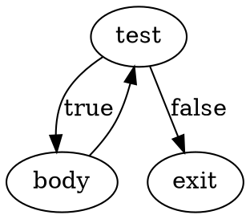
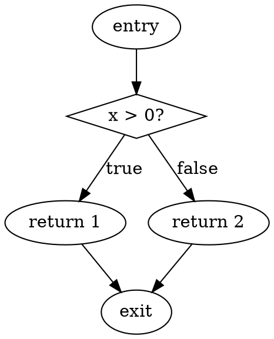

# C 语言代码与控制流图的表达能力分析

## 1. 问题与结论

Understand 能把 C 函数的控制转移画成图，也能导出 DOT。这回答的是**如何分析和展示代码**，不是**这张图能否作为微电网策略执行**。本文先区分这两个问题，再以 `LogicEngineConfigTool` 为例说明：什么图能通过桌面编译，保存时保留了什么，以及哪些行为必须到目标设备上验证。

**结论需要分成三个层次：**

1. **受支持的 C 函数通常可以构建静态控制流图（CFG）**。给定预处理配置、C 方言和分析范围，`if`、循环、`switch`、`goto` 和 `return` 等可以表示为有限的节点与有向边。函数指针、非局部跳转、信号与并发等则需要额外建模，分析工具有时只能近似。
2. **普通控制流图与源代码不严格同构**。控制流图主要回答“控制可能从哪里转到哪里”。它通常不会完整保留源代码的语法形式、注释、宏、变量名称和格式等，因而一般不能唯一还原原始代码。可转换为图，不等于存在一一对应且可逆的映射。
3. **行为等价要单独验证**。给定一个 C 子集，图形语言只有在能表达所需的操作、类型、状态、调度和外部交互，并保持约定的可观察行为时，才是等价实现。箭头能画出来，既不代表目标工具接受这张图，也不代表设备会按同样的时序执行。

## 2. Understand、DOT 和控制流图分别是什么

### 2.1 Understand 做了什么

Understand 的 Control Flow 图以函数等对象为目标，展示条件、循环、分支及控制转移。其 Python API 将控制流节点和节点间的后继关系暴露为 `CFGraph`；部分节点可能从入口不可达。官方资料还说明，图可以通过 API 导出为 DOT 等格式；某些使用 Understand 自定义布局的 DOT 文件带有专用属性，未必都适合直接交给 Graphviz 使用。[1][2]

因此，一个典型链路是：

```text
C 代码 + 预处理及项目配置
    → Understand 解析并建立程序模型
    → 选择函数及图的分析/显示规则
    → 生成控制流图
    → 导出为 DOT 等格式，或绘制成图片
```

图上显示的内容和细节取决于工具及配置。**能导出一张 DOT 图，不等于该图包含了源文件和运行语义的全部信息。**

### 2.2 DOT 是图的描述格式

Graphviz 的 DOT 使用文本描述图、节点、边和属性；`digraph` 使用 `->` 表示有向边。[3] 例如：



这段 DOT 描述的是一个有向图。图可以被解释为循环：在 `test` 判断，满足条件时执行 `body`，否则离开。但这种解释来自我们对节点和边的约定，不是 DOT 自动赋予程序的执行语义。

即使节点的标签中写着 `x = x + 1`，Graphviz 通常也只是把它当作显示文本，并不会执行赋值、验证整数溢出或检查该程序是否合法。DOT 文件**可以携带**更多属性或外部元数据；这些信息如何解释，仍要由使用它的工具另行定义。

### 2.3 控制流图是对程序的特定抽象

控制流图，简称 CFG（Control Flow Graph），一般由以下部分构成：

- **节点**：一个语句、一个条件，或若干顺序执行的指令组成的基本块；具体粒度取决于建图规则。
- **有向边**：控制可能从一个节点转移到另一个节点。
- **入口与出口**：表示函数或分析区域的开始，以及正常返回或其他结束方式。

例如 LLVM IR 使用基本块组织函数，每个基本块以描述后续控制转移的终结指令结束。[4] 这是 LLVM 的具体规则；其他工具绘制的一个流程框不一定恰好对应一个 LLVM 基本块。

## 3. 用一个具体例子区分代码与图

### 3.1 C 代码

```c
int select_value(int x)
{
    if (x > 0)
    {
        return 1;
    }

    return 2;
}
```

### 3.2 一种可能的控制流图

```text
          入口
           │
           ▼
       [ x > 0 ? ]
        /       \
      真         假
      ▼           ▼
 [ return 1 ]  [ return 2 ]
      \           /
       └──► 出口 ◄┘
```

相应 DOT 可以写成：



这个例子展示了如何记录控制分支，但有几点需要区分：

1. 图中带 `return 1` 等标签时，人可以读懂操作；如果去掉标签，只保留节点和边，就不能区分返回 `1`、`2`，还是返回其他值。
2. 节点标签本身只是文本。若要让图成为可执行程序，还需规定如何解析条件、求值、返回，以及 `x` 的类型和取值。
3. 此图只是某一种分块结果。另一个工具可能把条件或返回方式分成不同数量的节点，但仍然描述相近的控制行为。
4. 根据这张图通常无法知道原代码是否有 `else`、原来的缩进是什么、是否有注释，或者条件原本来自哪个宏。

## 4. 为什么不能说二者“严格同构”

### 4.1 同构比“能互相转换”要求更强

图论中的图同构，要求先明确两边的节点、边及其类型，然后存在节点之间的**双射**：既不丢失节点，也不把多个节点合成一个，并且映射前后的连接关系要保持。若图有节点类型、边类型或其他属性，还要说明哪些属性也必须保持。

源代码原始文本本身不是一张控制流图；即使将它解析为抽象语法树（AST），AST 表示的是语法的嵌套关系，而 CFG 表示的是控制转移关系。两者的节点及边含义不同，一条源语句可能对应多个控制节点，一个基本块也可能包含多条指令。因此通常不能直接说源代码与 CFG 图同构。

可以专门设计一种图，把完整语法树、注释、格式甚至源文件原文都保存进去，再定义可逆映射；但可逆性来自**额外保存的信息和特定转换设计**，不是普通 CFG 天生具有的性质。把整份 C 源码塞进一个图节点，虽然能保存文字，也不等于已经用可视化图元独立表达了每一步程序语义。

### 4.2 多种代码可能对应相同的控制结构

例如，下面两段代码可以按同样的“初始化 → 条件 → 循环体 → 递增 → 回到条件”的方式建模：

```c
for (int i = 0; i < 3; ++i)
{
    consume(i);
}
```

```c
int i = 0;
while (i < 3)
{
    consume(i);
    ++i;
}
```

在限定调用和变量使用范围、按相同粒度建图时，这两段的控制结构可以相同；但原来的 `for`、`while`、声明位置及源代码文本不同。是否完全行为等价，还要考虑变量作用域以及具体上下文。由此可见：**控制结构相同，不等于源代码相同；能生成行为等价的另一段代码，也不等于恢复了原文。**

### 4.3 可表示、行为等价和精确还原不是一回事

| 要求 | 要回答的问题 |
|---|---|
| 控制流可表示 | 在选定粒度下，能否描述可能的控制转移？ |
| 行为等价 | 在约定的环境和输入范围内，是否保持输出、副作用、终止行为和允许的结果集合？ |
| 可生成代码 | 能否从图生成目标语言中满足所需行为的某个程序？ |
| 精确还原源码 | 能否恢复原来的语法、宏、注释、名称、格式和文件组织？ |

这些问题不是逐级蕴含的。分析转移路径可以只用 CFG；生成行为等价的目标程序不要求保留原文；把原文作为附件无损保存，也不证明目标图可以独立执行。若要重现当时的编译结果，还应同时记录构建配置，而不是只保存一份源文本。

## 5. 所有 C 程序都有控制流图吗

### 5.1 对“有图”的合理理解

在固定 C 版本、预处理配置、编译实现及目标环境后，一个有限的 C 函数通常可以用有限个静态程序位置和控制边构建 CFG。条件产生分支，循环产生回边，`goto`、`break`、`continue` 和 `return` 可以按其目标表示为转移。[5]

**有限的静态图不要求把每次循环执行都画成一个新节点**。一次循环的多次执行可以重复经过同一节点；即使一张静态图是有限的，也可能描述任意长的候选执行路径或不终止的执行。

但“存在一种建模方式”不等于“任意具体工具都能准确构图”：分析器可能不支持某种 C 方言、编译器扩展或目标平台，也可能选择隐藏、合并或近似某些边。项目中有条件编译时，一张针对某一宏配置生成的图，也不自动代表其他宏配置。

### 5.2 图上存在的路径未必真的可执行

CFG 的边通常表示控制转移的可能性。把边任意拼接得到的路径，可能因为数据条件相互矛盾而无法发生。

例如，若 `x` 是普通整数，且两次判断之间没有变化：

```c
if (x > 0) { /* A */ }
if (x <= 0) { /* B */ }
```

纯粹按图走边，似乎可以先进入 A 再进入 B；但同一个 `x` 不可能同时满足这两个条件。要判断该路径是否可行，还需要分析数据和条件约束。跨函数路径还要保证调用和返回正确匹配：从调用点 A 进入函数，不应仅因为图中存在一条边就把控制返回到另一个调用点 B。

### 5.3 一张函数内 CFG 不等于完整程序模型

以下情况说明为什么要注明范围，而不能无条件说“一张函数图已经表达了整个程序”：

| 情况 | 需要额外考虑的内容 |
|---|---|
| 预处理与链接 | 宏、`#if`、头文件、其他翻译单元及库会影响最终程序。 |
| 函数与递归调用 | 调用目标、参数、返回位置、调用栈及被调用函数的状态变化；函数指针目标可能依赖运行时数据。 |
| `setjmp` / `longjmp` | 控制可以恢复到已保存的调用环境，不一定遵循普通的“调用后返回到下一句”。[5] |
| 表达式求值 | `&&`、\|\|、`?:` 有条件求值；其他表达式的求值顺序也不能一律假定为从左到右。 |
| 共享状态和外部交互 | 指针、别名、内存、文件、设备、`volatile` 访问等，需要与控制边一起建模。 |
| 并发和信号 | 多线程还涉及原子性、同步和内存顺序；单线程 CFG 的简单拼接不能代替完整并发语义。 |
| 行为边界 | 需要区分未定义行为、未指定行为和实现定义行为，并说明分析器如何处理。 |

例如，在 C 中 `p && *p > 3` 的右侧只在 `p` 为真时求值。若图形转换器把“读取 `*p`”无条件提前，当 `p` 为空指针时就改变了原有行为。即使画出来的主流程很像，转换仍然不正确。[5]

## 6. 控制流、数据流和程序状态的关系

### 6.1 两种线回答的问题不同

```text
数据流：读取温度 ──温度值──► 比较器 ──布尔值──► 条件判断
控制流：条件判断 ──真分支──► 打开风机
                  └假分支──► 关闭风机
```

- **数据流边**说明某个输入值来自哪个生产者，或存在什么数据依赖。
- **控制流边**说明执行控制可以沿哪个分支转移。

比较器产生的布尔值是数据；条件判断选中了哪条出口，则是控制。程序还需要定义**状态**：例如 `count = count + 1` 既读取旧值，又写入新值；若它位于循环中，要说明下一次迭代何时能看到这次更新。

### 6.2 有数据连线也不自动保证等价

考虑下面的伪代码：

```c
write_output(1);
write_output(0);
```

若这两个调用具有对外可观察的副作用，把它们画成两个不受控制顺序约束的节点，即使都存在于图上，也不能保证先写 `1` 再写 `0`。图形语言必须说明：哪些节点执行、执行几次、何时执行，以及有副作用的操作之间如何排序。

同样，在条件分支内的“读取实时设备”不能仅因为数据依赖关系就任意提前到分支外：这可能改变读取时刻、读取次数和实际得到的值。

## 7. 图形语言能否与 C 具有相同表达能力

### 7.1 理论上可以构造足够强的图形语言

图形与文字只是不同的表示媒介。可以定义一种带有以下语义的图形语言：

1. 图元表示计算、读写状态、条件判断、调用和返回等操作；
2. 数据端口具有明确类型、取值规则和生命周期；
3. 控制连接规定执行先后、分支、循环及转移；
4. 有明确的存储、调用栈和外部环境模型；
5. 对异常情况、并发、未定义行为等指定与目标 C 环境相适应的规则。

在这些条件下，可以针对选定 C 子集构造从 C 到图、再从图到某种代码的转换，并验证行为保持。甚至可以把程序执行位置作为一个状态变量 `pc`：每个图节点对应一个 `pc` 值，在循环中根据 `pc` 执行相应操作并选择下一个值。这个思路说明**图形结构与文字形式可以编码相同的控制过程**；但要保持完整行为，仍然要正确实现图节点中的计算、存储和环境交互。

即使两种抽象语言具有相同的通用计算能力，也不能据此断定某一具体移植可行。例如，在不考虑时间的模型中能算出相同结果，并不意味着两种实现会在同一扫描周期内完成，也不意味着设备输出的先后顺序相同。真实设备的数值范围、内存和执行时间都应作为等价条件单独检查。

### 7.2 具体图形工具可能只支持其中一部分

一个工具即使能够显示 IF、循环和数据连线，也可能缺少某些操作、复杂类型、指针、动态内存、函数调用、并发或特定 I/O。它也可能限制：

- 图元端口的类型和连接数；
- 循环和分支的嵌套、汇合或跨区域跳转；
- 值的持久性、输入读取时机与执行周期；
- 允许生成的指令或目标设备的协议；
- 图规模、内存、执行时间和实时性。

因此，要比较某段 C 策略与某套图形系统，首先应约定 C 子集、目标设备和等价标准，再检查该系统的**编辑器、编译器、序列化协议和运行时**是否共同提供所需能力。

## 8. 当前策略配置工具的表达边界

以下讨论的是 `LogicEngineConfigTool` 的桌面编辑、编译和保存契约，不是 DOT 的能力，也不替代设备端验证。文中的项目源码引用均相对于 `visualconfig` 仓库根目录，核对版本见第 10 节。

### 8.1 画布能表达哪些结构

| 结构 | 当前桌面代码的边界 |
|---|---|
| 条件和选择 | `IF` 的条件是布尔数据输入，`TRUE`、`FALSE` 是控制输出。`SWITCH` 走配置的 `Case` / `Default` 分支，不能只按名字假定它具有 C `switch` 的 case 贯穿语义。 |
| 循环 | `WHILE`、`FOR`、`DO_WHILE` 有各自的循环编译规则，但当前工具箱未开放 `FOR`、`DO_WHILE` 的新建按钮。能生成循环回边也不代表接受任意闭环或跨区域转移。 |
| 提前退出和继续 | 当前解析器只把 `WHILE` 的 `Body` 作为 `CONTINUE` 的合格归属；`BREAK` 的合格归属是 `WHILE` 的 `Body` 或 `SWITCH` 的 `Case` / `Default`。不能把 C 中 `FOR`、`DO_WHILE` 的 `break` / `continue` 规则直接套到这里。 |
| 汇合 | `JOIN` 表示受校验的显式汇合，不是可以任意将若干箭头合并到一点的通用节点。编译器还要检查分支来源、归属和后续去向。 |
| 跳转 | 编辑态 `JUMP` 有一个控制输入和一个控制输出，编译器根据有效的物理连线解析它，而不是把任意数字 `NextID` 当成 C 的目标标签。 |

这张表也不替代端口检查。数据连线看端口属性和类型位掩码；输入端只记录一个来源，输出端能否扇出由 `OutputConnectionRules` 决定。正常连线同时保存目标输入的 `SourceElemId` / `SourcePortId` 和源输出的 `TargetPorts` 记录；两个 `-1` 才表示该输入未连接。源码入口见 [11]。

**一个对照例子：** `ControlFlowJumpRegressionTests` 构造两个互连的 `JUMP`（ID `10`、`20`），故意留下不正确的旧 `NextID`，断言编译仍按物理连线得到 `10 → 20 → 10`。两端断开同一条连接后，断言得到 `CFGJ01`；随后只恢复源输出的 `TargetPorts` 记录，断言得到 `CFG011`。因此，合法的控制回边与任意画出的环是两回事。这些是桌面回归源码中的断言，不是设备已运行该循环的记录。[12]

### 8.2 从编辑图到运行配置

```text
编辑图：图元、端口双侧记录、参数和控制元数据
    → 规范化、校验、区域与转移解析、确定性线性化
    → 校验并应用编译计划，再生成运行 JSON
    → 同一主文件保留运行配置和 EditorData 编辑快照
```

**物理连线不等于执行顺序。** 对完整编辑图，编译先产出计划；正式保存时在隔离副本上编译并应用计划。运行协议用普通 `NextID`、运行 `JUMP` 的 `NextID` 和各控制元件的专用分支目标描述去向。线性化可能先安排数据生产者，所以执行入口不一定就是物理出线所指的图元。`Outputs[].TargetPorts` 不是跳转表，也不能从 `NextID` 反推数据线。[11][13]

**运行投影不等于编辑快照。** 新投影把 `BREAK`、`CONTINUE`、`JOIN` 和编辑态 `JUMP` 写成运行 `JUMP`，同时保留 `Inputs`、`Outputs` 和 `EditorOriginal.Element`；这里的 `Element` 是**编译后、投影前**的节点。主文件根部的 `EditorData` 才保存**编译前**编辑图及编辑状态。正式保存回读校验后提交同一个主文件，不另写编辑侧车。[13]

**能打开不等于能重编。** 重新打开时优先验证 `EditorData`；无可用快照时才尝试旧侧车和受限恢复。找不到可信的完整编辑图时，部分有效配置只能保留为可调整布局的运行投影，不应按完整画布重新推断执行目标。桌面回读也不证明固件兼容；例如，计数型 `WHILE` 经过运行 `JUMP` 回边时的表现仍需在目标设备验证。[13]

### 8.3 迁移一段 C 策略时怎么验收

1. **先定义等价标准。** 记录允许的输入和初始状态，以及要对照的输出序列、读写顺序、重复执行次数、终止条件和允许的时序偏差。明确 C 数值类型、比较、转换和溢出的适用规则。
2. **再检查画布能不能表达。** 为分支、循环、提前退出和汇合选择受支持的图元；核对数据类型、端口、状态保持、实时库点位和外部操作。尤其不要把 C 短路表达式中只在特定分支发生的读取，直接接成条件判断前无条件执行的数据节点。
3. **检查保存产物。** 对照预期检查分支目标、普通 `NextID`、回边、汇合、数据端口和重新打开后的可编辑性。桌面回归通过，只证明其断言覆盖的行为。
4. **最后在目标设备比对。** 用相同输入和初始状态比较正常、边界和异常情形，并检查任务扫描间隔、设备读取时刻、输出副作用和循环开销。图形相似或桌面编译成功都不能替代这一步。

## 9. 本项目区域分析与 Roslyn 的比较

### 9.1 谁划定区域，区域用来做什么

| 概念 | 区域从哪里来 | 解决的问题 |
|---|---|---|
| 本项目的控制分支区域 | 编译器根据画布端口和控制元数据推断 | 节点归哪个控制头的哪个分支，哪里汇合，`BREAK`、`CONTINUE` 属于谁。 |
| Roslyn 的 `ControlFlowRegion` | Roslyn 从已绑定的操作构建 CFG 时产生 | 表达局部值的生命周期和异常处理等嵌套边界；没有 `IfThen`、`IfElse` 或 `SwitchCase` 区域种类。[6][7] |
| Roslyn 的 `AnalyzeControlFlow` / `AnalyzeDataFlow` | 调用方先提供受支持的语法选区 | 分析给定选区的控制边界、可达性、变量读写和赋值情况，不自动发现画布分支归属。[8][9] |

### 9.2 Roslyn 如何构建 CFG 及其 `ControlFlowRegion`

按 Roslyn 公开 API 和所查源码浏览快照，其过程可以概括为下面几步。中间构建步骤不是跨版本的 API 保证。[6][7][10]

1. `ControlFlowGraph.Create` 从函数体等可执行代码块取得根 `IOperation`，作为 CFG 构建输入。
2. builder 创建入口和出口基本块以及根 `Root` 区域，并在构建过程中跟踪当前区域。
3. builder 按 `IOperation` 结构访问语句和表达式，生成基本块、分支及条件值。进入/离开局部块时可建立 `LocalLifetime`；访问 `try`、`catch`、`filter`、`finally` 时，则按异常结构建立相应嵌套 region。
4. 求值栈上需要跨控制转移保存的中间值可以变为 capture；这些 capture 也可能影响 region 内容。因此 region 与源码花括号“松散相关”，并非逐一对应。
5. 检查未解析的分支并执行 `Pack`：可能合并基本块、移除没有 locals/captures 等内容的生命周期 region，或压缩嵌套结构。初建时存在的 region 不保证原样出现在最终树中。
6. 将 region builder 固化为不可变 `ControlFlowRegion`，记录嵌套关系、块序号范围、locals/captures 等；再标记可达块，固化基本块及其显式后继和前驱。
7. 分支跨越 region 边界时，可从 `ControlFlowBranch` 读取 `EnteringRegions`、`LeavingRegions` 和 `FinallyRegions`。它们分别记录边进入、离开以及需要经过的 finally 区域，不是某个 IF 分支拥有的全部节点。异常传播还包含隐式语义，不能只遍历普通 successor 就完整重建。

概念上，含有 catch 和 finally 的代码会形成反映 `Try`、`Catch`、`Filter`、`Finally` 组合关系的区域树。实际嵌套受源码、捕获值和压缩过程影响，调用方应遍历实际 CFG，而不应硬编码某个固定树形。

### 9.3 Roslyn 如何分析调用方选定的语法区域

`AnalyzeControlFlow` 和 `AnalyzeDataFlow` 与 CFG 的区域树是另一组 API。调用方提供选区，例如方法内一段连续语句；先检查 `Succeeded`，再解释控制或数据结果。[8][9]

以概念步骤说明：

1. **控制分析**报告进入点、离开点和起点/终点可达性等；它回答的是“控制如何进出这个选区”。
2. **数据分析**报告 `DataFlowsIn`、`DataFlowsOut`、`ReadInside`、`WrittenInside` 和入口/出口的明确赋值情况等；它回答的是“哪些符号在选区内外被读写，哪些值跨过选区边界”。

对应到画布分析，这类 API 的启发更像“给定候选区域后，检查边界和变量依赖是否满足条件”，而不是“从 CFG 自动产生候选 IF/SWITCH 区域”。例如，某个计算节点虽然依赖分支外的值，但这只说明它有数据输入；若把节点搬入分支会改变设备读取时机、写入次数或其他副作用，就不能据此认定移动安全。

### 9.4 当前项目算法实际在做什么

项目的编译链先规范化物理边并提取控制描述，再由 `StructuredRegionBuilder` 构建区域；之后解析 BREAK/CONTINUE、验证显式 JOIN，最后线性化和校验计划。分析失败会产生诊断，而不是把未经验证的区域写回任务图。[11]

当前区域构建可概括为：

1. **建立分析用后继图。** 它合并规范化物理边和有效分支目标，包含数据边和 JOIN 到达边，不是设备的纯执行 CFG。源为 `JUMP` 的物理出边不参与这张分析图，但 `JUMP` 仍有单独解析的执行目标。分析加上虚拟入口和出口，再迭代计算支配、后支配；不能把不可达节点或无出口闭环上的结果当作实际路径保证。
2. **选择汇合边界。** 优先采用非负 `JoinNextID`。需要推断时，若至少有两个有效分支条目并非所有路径都以 `BREAK` / `CONTINUE` 结束，先取这些条目再去重；否则使用所有有效分支目标。若唯一目标是显式 `JOIN`，可直接作为边界；其他情况优先找共同可达的公共后支配点，找不到时还可能按 BFS 距离和选共同可达点，或不认定汇合。因此推断结果不一定是后支配点；筛掉突转分支也不代表突转已经通过验证。
3. **收集区域并检查重叠。** `CollectUntil` 沿后继收集节点，再沿数据入边回溯生产者。用于线性化的区域并集和用于归属判断的逐分支集合并不相同：它们在选择结构中都从**全部分支的交集**找共享项，都不把结构控制头、`JOIN`、突转或 `JUMP` 当共享依赖剔除；逐分支集合还保留有非数据入边、或被多个分支直接指向的节点。循环不做这类共享剔除，逐分支归属对循环 `Exit` 另行处理。剩余同级重叠可报 `CFG030`；从区域外绕过所属控制头进入的非数据边可报 `CFG077`。
4. **验证突转和显式汇合。** 编译器先根据逐分支归属为 `BREAK` / `CONTINUE` 找最近的合格控制者，再验证 `JOIN`。候选边界不决定 `JOIN` 的最终归属；解析器还核对实际到达的分支、唯一所有者与汇合后的去向。未到达 `JOIN` 的分支，只有所有路径都先结束于**已验证的突转**时才可豁免。[11]

### 9.5 可借鉴之处与不能照搬之处

**可以借鉴的是如何解释分析结果，而不是如何划定 IF 分支。** 例如，可让诊断指出汇合点来自元数据、公共后支配点还是共同可达候选，并指出哪条边绕过了控制头。这些信息有助于解释为什么某张图被接受或拒绝；Roslyn 的局部生命周期和异常处理区域本身不能替代本项目的分支归属算法。

**不能把共享依赖等同于代码移动许可。** 即使两个分支都使用一个数值，也不能只凭集合相交就把取值动作提前。对设备读取、实时采样和输出操作，还必须核对移动前后的执行条件、次数和时刻。若将来进行此类优化，应单独验证可观察行为，而不是把区域分析结果直接当作运行语义。

## 10. 参考资料与核验范围

1. Scientific Toolworks Understand，[Control Flow](https://docs.scitools.com/graphs/Control_Flow.html)，以及 [CFGraph Python API](https://docs.scitools.com/python/api/understand.CFGraph.html)。
2. Scientific Toolworks Understand，[Graphs Python API：生成和导出](https://docs.scitools.com/python/graph.html)。某些 DOT 输出包含自定义布局属性。
3. Graphviz，[DOT Language](https://graphviz.org/doc/info/lang.html)。
4. LLVM，[LLVM Language Reference Manual](https://llvm.org/docs/LangRef.html)，见函数结构、基本块与终结指令。
5. ISO C 工作组 WG14，[N1570：C11 委员会草案](https://www.open-std.org/jtc1/sc22/wg14/www/docs/n1570.pdf)，尤其是 5.1.2.3、5.1.2.4、6.5、6.8、7.13。本文据此举例，不涵盖所有 C 版本及编译器扩展。
6. Microsoft Learn，[ControlFlowRegionKind Enum](https://learn.microsoft.com/en-us/dotnet/api/microsoft.codeanalysis.flowanalysis.controlflowregionkind)；[ControlFlowRegion Class](https://learn.microsoft.com/en-us/dotnet/api/microsoft.codeanalysis.flowanalysis.controlflowregion)。
7. Roslyn 源码浏览，[ControlFlowGraphBuilder.cs](https://source.dot.net/Microsoft.CodeAnalysis/Operations/ControlFlowGraphBuilder.cs.html)；[RegionBuilder.cs](https://source.dot.net/Microsoft.CodeAnalysis/Operations/ControlFlowGraphBuilder.RegionBuilder.cs.html)；[ControlFlowBranch.cs](https://source.dot.net/Microsoft.CodeAnalysis/Operations/ControlFlowBranch.cs.html)。源码浏览页未在本文中固定到 commit，因此实现步骤是所查快照的描述，不是跨版本契约。
8. Microsoft Learn，[CSharpExtensions.AnalyzeControlFlow](https://learn.microsoft.com/en-us/dotnet/api/microsoft.codeanalysis.csharp.csharpextensions.analyzecontrolflow)；[ControlFlowAnalysis Class](https://learn.microsoft.com/en-us/dotnet/api/microsoft.codeanalysis.controlflowanalysis)。
9. Microsoft Learn，[CSharpExtensions.AnalyzeDataFlow](https://learn.microsoft.com/en-us/dotnet/api/microsoft.codeanalysis.csharp.csharpextensions.analyzedataflow)；[DataFlowAnalysis Class](https://learn.microsoft.com/en-us/dotnet/api/microsoft.codeanalysis.dataflowanalysis)。
10. Microsoft Learn，[ControlFlowGraph Class](https://learn.microsoft.com/en-us/dotnet/api/microsoft.codeanalysis.flowanalysis.controlflowgraph)；[ControlFlowBranch Class](https://learn.microsoft.com/en-us/dotnet/api/microsoft.codeanalysis.flowanalysis.controlflowbranch)。
11. 本项目源码：`LogicEngineConfigTool/Models/ConnectionRules.cs`；`LogicEngineConfigTool/Elements/ElementControlFlowJump.cs:20–38`；`LogicEngineConfigTool/Views/VisualEditorView.xaml:493–498`；`LogicEngineConfigTool/Services/ControlFlow/` 下的 `ControlFlowCompilationService.cs:53–102,231–261`、`ExecutionLinearizer.cs:752–845,929–951`、`GraphAnalysis.cs:102–142,201–290`、`StructuredRegionBuilder.cs:71–216,265–592`、`ExplicitJoinResolver.cs:45–177,224–234` 和 `AbruptControlTransferResolver.cs:45–71`。
12. 桌面回归：`LogicEngineConfigTool.RegressionTests/ControlFlowJumpRegressionTests.cs:29–55,567–574`，核对互连 JUMP、断线诊断和失败时不修改任务。
13. 保存与恢复源码：`LogicEngineConfigTool/Services/ControlFlow/` 下的 `TransactionalConfigSaveService.cs:158–405`、`RuntimeJumpProjection.cs:231–301` 和 `RuntimeGraphRecoveryService.cs:34–168,175–229,323–489`；`LogicEngineConfigTool/Services/EditorStatePersistenceService.cs:104–189,359–401`。

本文的项目结论来自 `visualconfig` 的 `3d697aa` 源码与回归断言静态核对。未运行 C 到图的转换实验、Roslyn 示例或本项目的构建和回归，也未在设备上验证执行时序及行为等价。
