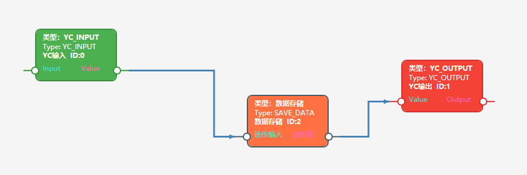
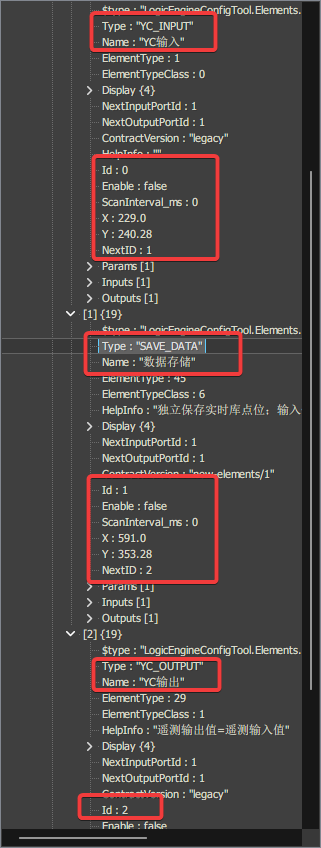
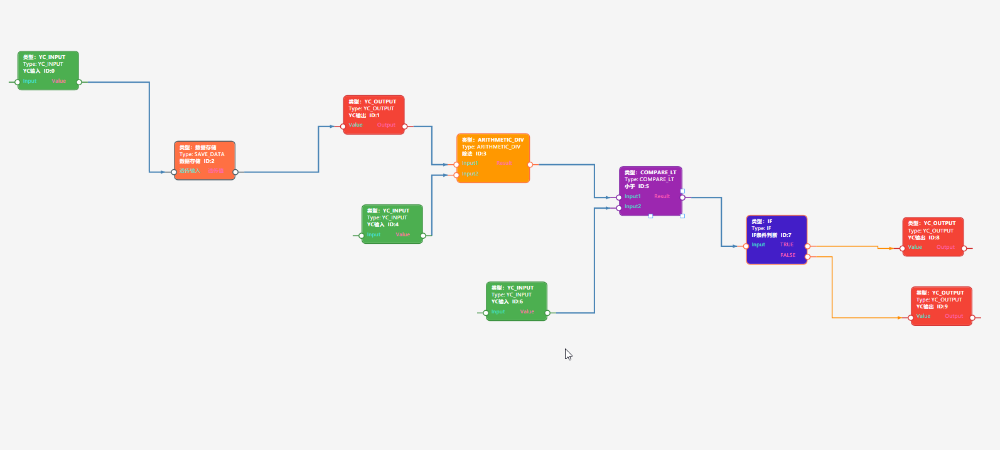
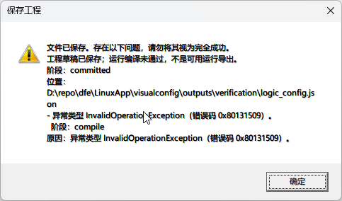

# 2026-10-24：SAVE_DATA 工程保存与控制流问题对话记录

## 一、整理范围与阅读说明

- **整理日期：**2026 年 10 月 24 日。
- **记录范围：**从“怎样把三个器件正确保存为工程，最终 `Elements` 不为空”的操作指导开始，到“为什么新版本把多路遥测输入识别为三个执行入口”的历史核对，以及本次整理文档的要求。
- **记录方式：**保留用户原问题、助手主要回答、调查中的进展说明和后续纠正，按对话先后排列。只调整标题层级、段落和代码块，便于离线阅读；不把较早的判断悄悄替换成较晚结论。
- **时间说明：**可见上下文没有每条消息的完整发送时间，因此以下以轮次排序，不编造具体时分。为保持问题起因，纳入紧邻本日截图问题之前的三器件保存指导。
- **系统消息：**自动工作流通知、Git 状态、工具原始输出不作为用户提问逐条转录；与结论有关的验证结果、提交信息和限制保留在对应回答及核验附录中。
- **前序背景：**默认目标环境和保存修复已在前一轮完成，相关提交为 `45aea69`。本记录不把前一轮的构建、完整回归或提交过程误记为本日重新执行。
- **调查边界：**本日这些追问以只读核对、Git 历史调查及内存副本编译为主。没有据此实施“保留器件 ID”“兼容旧版多输入连线”或“修复错误提示”的代码修改，也没有覆盖用户工程。整理时，工作区已有用户对 `LogicEngineConfigTool/Elements/ElementSaveData.cs` 的修改，保持不动。

### 附图目录

1. [三器件画布：编辑 ID 为 0、2、1](assets/2026-10-24-save-data/01-three-elements-canvas.png)。
2. [保存后的 Elements：运行 ID 为 0、1、2](assets/2026-10-24-save-data/02-saved-elements-ids.png)。
3. [扩展图：多路遥测输入、除法、比较和 IF](assets/2026-10-24-save-data/03-expanded-graph.png)。
4. [保存工程警告：草稿与 InvalidOperationException](assets/2026-10-24-save-data/04-save-warning.png)。

## 二、问答一：如何把三个器件保存为 Elements 非空的工程

### 用户提问（原文）

> 你来指导我，如何做才能将简单的 save_data 元器件、其输入端的遥测输入元器件、其输出端的遥测输出元器件，正确保存为工程配置，也就是最终的Elements不为空

### 助手调查前说明

我先核对当前界面的操作入口和这三个器件的必填参数，再给你一套能检查最终 `Elements` 是否非空的保存步骤。

### 助手回答

可以。**要让最终的 `LogicTasks[...].Elements` 非空，关键不只是连上两条线，还要给 SAVE_DATA 自己配置完整的存储点位，并在属性窗口点击“校验并应用”，最后点击“保存工程”。**

建议先按下面步骤新建一个最小工程验证，避免旧草稿中的空参数干扰。

#### 1. 使用修复后的程序

启动此前构建验证过的程序：

```text
D:\repo\dfe\LinuxApp\visualconfig\outputs\verification\LogicEngineConfigTool.exe
```

如果用 Visual Studio 启动，请先重新生成当前解决方案，避免运行修复前的旧 EXE。

#### 2. 设置实时库文件和目标环境

1. 通过菜单 **“实时库数据路径选择”** 设置正确的实时库文件路径。
2. 进入编辑画布，点击 **“目标运行环境”**。
3. 点击 **“恢复SAVE_DATA测试默认值”**。
4. 点击 **“校验并应用”**。

这套默认环境用于本地配置测试。普通工程保存现在不要求设备能力已确认，但设置好默认环境后，也便于进行“编译检查”和后续导出测试。

#### 3. 在同一个任务、同一层画布中放入三个器件

```text
YC_INPUT（遥测输入） → SAVE_DATA（数据存储） → YC_OUTPUT（遥测输出）
```

放入器件的先后顺序不重要，编号也不必手动调整。

#### 4. 分别配置三个器件的属性

双击器件，或右键选择 **“属性（工作副本）”**。

**遥测输入 YC_INPUT**

配置它要读取的实时库点位：

- 链路号 `Link`。
- 设备号 `Dev`。
- 寄存器号 `Reg`。

可以双击上述任意一个点位输入框，打开实时库选择窗口，选择真实存在的遥测点位。

**选完之后，要在器件属性窗口点击“校验并应用”。**

**数据存储 SAVE_DATA——这是最容易遗漏的一步**

它也需要单独配置自己的：

- 链路号 `link`。
- 设备号 `Dev`。
- 寄存器号 `Reg`。

**输入线不会自动填写这三个参数。**

当前 SAVE_DATA 的设计是：

> 输入、输出用于数据透传；实际存档的是其参数指定的实时库点位。

因此，如果你希望保存“遥测输入器件读取的那个点”，这里就选择与 YC_INPUT 相同的实时库点位。不要因为已经连了输入线，就把这三项留空。

其余参数先使用下面这组简单值：

| 参数 | 建议设置 |
|---|---|
| 存档唯一标识 `name` | 保留自动生成的名称 |
| 定时保存开关 | 勾选 |
| 定时保存周期 `SaveTime` | `60` 秒 |
| 变化保存开关 | 勾选 |
| 变化保存死区 `ChangeDeadZone` | `1` |
| 初值开关 | 勾选 |
| 初始值 `InitVal` | `0` |

最后点击 **“校验并应用”**。如果出现字段错误，先修正，不要直接关闭窗口。

> 上次检查你的工程时，SAVE_DATA 的 `link / Dev / Reg` 都是 `null`。这正是当前必须补齐的内容；“目标运行环境”中的功能链路号不能替代它们。

**遥测输出 YC_OUTPUT**

同样配置它要写入的实时库点位 `Link / Dev / Reg`，建议选择另一个适合测试的可写遥测点，避免实际运行时覆盖输入源。

然后点击 **“校验并应用”**。

#### 5. 连接两条数值线

按下面的端口连接：

```text
YC_INPUT 的“值”输出
    → SAVE_DATA 的“透传输入”

SAVE_DATA 的“透传值”输出
    → YC_OUTPUT 的“值”输入
```

**直接拖动连接，不按 Ctrl 或 Shift。** 普通拖动默认创建“数据＋控制”连接，这条简单链已按这种方式验证过。

不要按住 Ctrl：Ctrl 会请求纯控制连接，不能代替这里需要的数值输入连接。

#### 6. 检查并保存工程

1. 点击 **“编译检查”**，确认没有参数或连线错误。
2. 点击画布工具栏的 **“保存工程”**。
3. 首次测试建议另存为新文件，例如 `save_data_project.json`，不要覆盖原工程。

注意两个区别：

- **“编译检查”只是检查，不会单独把结果写入文件。**
- **“保存工程”才会生成并写入最终的 `Elements`。**

正常保存后，应看到类似：

> 文件已保存。  
> 工程结构编译通过；尚未验证设备部署条件，不代表可部署运行配置。

如果提示的是：

> 工程草稿已保存；运行编译未通过……

那么仍然存在参数或结构问题，**不能仅凭“已保存”就认为 `Elements` 已更新**。需要根据同一提示中的错误原因修正后再次保存。

#### 7. 打开 JSON，确认检查的位置正确

检查对应任务下的：

```text
LogicTasks
  └─ 对应任务
       ├─ Elements                     ← 这里应有 3 个器件
       └─ EditorMetadata
            └─ State                   ← 普通工程保存应为 "project"
```

`Elements` 中应包含：

```text
YC_INPUT
SAVE_DATA
YC_OUTPUT
```

不要只检查 `EditorMetadata` 里保存的画布元素——**画布中有三个器件，不等于最终的 `LogicTasks[...].Elements` 已生成。**

最后，重新打开这个文件，再保存一次，确认 `Elements` 仍有三个器件，就完成了这条最小链的工程保存验证。设备端实际落盘与重启恢复属于后续运行测试。

> **整理注：**“普通拖动即可”的指导针对这一条三器件单链。后文扩展为多输入图时，暴露出 `DataControl` 默认语义与单入口检查的兼容性问题；后续回答对此作了补充与纠正。

## 三、问答二：为什么保存后 SAVE_DATA 与遥测输出的 ID 互换

### 用户提问（原文）

> [Image 1] [Image 2] D:\repo\dfe\LinuxApp\visualconfig\outputs\verification\logic_config.json ，怎么我只简单配置了3个元器件，其中一个是save_data元器件，保存后，它和遥测输出的ID互换了

**用户附图 1：三器件画布。**



**用户附图 2：保存后的 Elements。**



### 助手调查前说明

我会只读核对这份工程里画布 ID、保存后的运行 ID 及引用映射，判断这是编译重编号，还是保存时串了器件身份。

### 助手回答

我核对了这份 JSON：**确实出现了你说的编号变化，但不是 SAVE_DATA 和遥测输出的类型、参数被交换，而是编译器给它们重新分配了“运行 ID”。**

#### 1. 这次保存的实际对应关系

| 器件 | 画布上的编辑 ID | 保存后外层 `Elements` 的运行 ID |
|---|---:|---:|
| 遥测输入 `YC_INPUT` | 0 | 0 |
| 数据存储 `SAVE_DATA` | 2 | 1 |
| 遥测输出 `YC_OUTPUT` | 1 | 2 |

画布上的连接是：

```text
YC_INPUT（0）→ SAVE_DATA（2）→ YC_OUTPUT（1）
```

编译后按执行顺序排列，并分配连续运行 ID：

```text
YC_INPUT（0）→ SAVE_DATA（1）→ YC_OUTPUT（2）
```

**所以，从数字上看像是两个 ID 互换，实际上是整条链在编译时重新编号。即使只有三个器件，当前实现也会这样处理。**

#### 2. 文件里的引用是否一起改了？

这份文件中，引用也同步更新了，并没有仍然指向旧编号：

- 遥测输入：`Id=0`，`NextID=1`，输出指向器件 `1`。
- SAVE_DATA：`Id=1`，输入来源是器件 `0`，`NextID=2`，输出指向器件 `2`。
- 遥测输出：`Id=2`，输入来源是器件 `1`，`NextID=-1`。

因此，从这份 JSON 看，最终仍然是：

```text
遥测输入 → 数据存储 → 遥测输出 → 结束
```

原来的画布编号保留在：

```text
LogicTasks[0].EditorMetadata.Task.Canvases[0].Elements
```

编号映射保留在：

```text
LogicTasks[0].EditorMetadata.CompilationInfo.SourceMap
```

其中明确记录了 `2 → 1` 和 `1 → 2`。具体见当时文件 `outputs/verification/logic_config.json:291`。

#### 3. 为什么程序这么做？

当前编译实现是**先确定执行顺序，再从起始编号连续分配运行 ID**，不是只调整 `Elements` 数组顺序。对应代码是：

- 分配连续运行 ID：`LogicEngineConfigTool/Services/ControlFlow/RuntimeGraphBuilder.cs:361`。
- 重写连接引用及器件 ID：`LogicEngineConfigTool/Services/ControlFlow/RuntimeGraphBuilder.cs:432`。

这里容易混淆的是：**画布只显示“ID”，没有明确标成“编辑 ID”；而你查看的外层 `Elements.Id` 已经是“运行 ID”。** 两处显示的不是同一种身份。

另外，这次文件的 `Elements` 已有三个器件，保存状态为 `"project"`，**已经不是之前 `Elements` 为空的草稿问题**。本次我只读核对了文件，没有修改你的工程或代码。

## 四、问答三：为什么引入连续重编号，能否不要，何时引入

### 用户提问（原文）

> “当前编译实现是先确定执行顺序，再从起始编号连续分配运行 ID，不是只调整 Elements 数组顺序”这个特性为什么要引入? 不引入行吗？什么时候引入的

### 助手调查前说明

我会对照 Git 历史和设计文档，查清连续重编号的引入时间、原始目的，以及不重编号会影响哪些功能；本次只调查，不改代码。

### 助手进展说明

已确认：连续重编号不是这次 SAVE_DATA 修复才新增的，最初实现来自 10 月 21 日；这次保存修复让它真正写入了非空 `Elements`，所以现在能看到了。设计中的编号范围和入口要求，并不能推出“所有器件都必须按执行顺序改成连续 ID”。

### 助手回答

查清楚了。**“编辑 ID 与运行 ID 分离”有用途，但“每次都按执行顺序把所有 ID 改成连续编号”并不是 SAVE_DATA 的必要条件。对你这三个器件，可以保留原 ID，只调整 `Elements` 排列和执行引用。**

#### 1. 为什么会引入？

它来自之前“新增器件与分层画布”的整体编译设计，不是为 SAVE_DATA 单独增加的。

当时考虑了这些情况：

- **编辑 ID 全工程唯一**，包含多个任务、子画布，编号可能超过设备允许范围。
- **运行 ID 按任务分配**，例如设计中循环协议要求目标编号在 `0～499`。
- 某些目标要求**实际入口的 ID 为 0**，但编辑时最先创建的器件未必是实际入口。
- 子过程展开后，编辑图与运行节点集合可能不同，需要建立来源映射。

因此，引入了“编辑 ID → 运行 ID”的映射。设计依据在 `documents/new.elements/新增元器件与分层画布详细设计方案.md:779`。

但是，**这些需求只说明有时需要重新映射，并不能推出每一次编译都必须给所有器件连续改号。**

当前代码采用了统一且简单的处理：

```csharp
Runtime = start + i
```

即按最终排列直接分配连续运行 ID，见 `LogicEngineConfigTool/Services/ControlFlow/RuntimeGraphBuilder.cs:361`。

**这是编译器的实现策略，目前没有实机证据证明设备一定要求“器件 ID 等于数组下标”。** 我之前解释了它如何工作，但没有充分说明这并非必然要求。

#### 2. 不引入连续重编号，行不行？

**对你这个工程：按已知约束，可以。**

保留画布 ID 后，完全可以表达为：

| `Elements` 数组位置 | 器件 | 保留的 `Id` | `NextID` |
|---:|---|---:|---:|
| 0 | YC_INPUT | 0 | 2 |
| 1 | SAVE_DATA | 2 | 1 |
| 2 | YC_OUTPUT | 1 | -1 |

执行链仍然是：

```text
0 → 2 → 1 → 结束
```

它满足：

- 真正的入口排在数组第一项。
- 入口 ID 为 `0`。
- 三个 ID 都在 `0～499` 内。
- 输入、输出和跳转引用指向正确器件。

**调整执行顺序，不等于必须改变器件身份。** 原来的平面编译路径本来就是保留 ID，重排元素并更新 `NextID` 等信息，见 `LogicEngineConfigTool/Services/ControlFlow/ControlFlowPlanApplier.cs:49`。

**但不能简单删除全部编号映射。**

如果入口原 ID 不是 `0`，或工程 ID 已超出目标范围，直接保留就可能不满足目标要求。更合理的规则可以是：

> 原 ID 满足目标要求时保留；不满足时明确报错，或者在运行导出时进行明确的编号映射。

当前没有“关闭器件重编号”的现成选项，支持这种规则需要改代码；`PortAddressing=id` 只控制**端口**寻址，不能关闭**器件**重编号。

#### 3. 什么时候引入的？

我核对了实际 Git 历史：

| 时间，均为北京时间 | 提交 | 内容 |
|---|---|---|
| **2026-10-20 22:02:28** | `afc225a` | 设计文档已提出编辑身份、运行身份分离，以及运行编号映射。 |
| **2026-10-21 08:36:19** | `a82f056` | 首次实现 `RuntimeGraphBuilder`，已经包含 `Runtime = start + i` 和重写器件 ID 的代码。**连续重编号算法在这里引入。** |
| **2026-10-23** | `45aea69` | 本次保存修复：普通工程保存改用 `CompileProject`，解除部署确认对工程保存的阻断，并完善 SAVE_DATA 数据流编译。**不是首次引入连续重编号。** |

还有一点需要准确区分：**包含新契约器件时走新编译器的保存路径，此前就存在**。本次我把该路径中的严格 `Compile` 改成了 `CompileProject`。之前编译失败、外层 `Elements` 为空；修复后成功生成了 `Elements`，于是既有的重编号策略也随之显现。

**结论：这不是保存 SAVE_DATA 必须付出的代价，而是新编译路径沿用的统一编号策略。你的三节点工程没有已知理由必须把 `0、2、1` 改成 `0、1、2`。** 本次仅调查，没有修改代码或工程文件。

### 助手后续补充

调查已结束。补充说明：工作流汇总中对引入时间保留了“未核验”的措辞，但我随后直接执行 Git 查询，已确认：

- `a82f056`（2026-10-21 08:36:19，北京时间）中已经存在 `Runtime = start + i` 及重写器件 ID 的代码。
- 保存时选择新编译路径的逻辑也早于本次修复；`45aea69` 将严格编译改为工程编译，让此前失败的保存成功，因而显现了已有的重编号行为。

因此，上一条答复的时间线成立。本轮没有修改任何文件。

## 五、问答四：扩展图保存为什么出现 InvalidOperationException

### 用户提问（原文）

> [Image 1] [Image 2] 为什么会出这个错误

**用户附图 1：扩展后的逻辑图。**



**用户附图 2：保存警告。**



截图中的主要提示为：

```text
文件已保存。存在以下问题，请勿将其视为完全成功。
工程草稿已保存；运行编译未通过，不是可用运行导出。
阶段：committed
位置：D:\repo\dfe\LinuxApp\visualconfig\outputs\verification\logic_config.json
- 异常类型 InvalidOperationException（错误码 0x80131509）。
  阶段：compile
  原因：异常类型 InvalidOperationException（错误码 0x80131509）。
```

### 助手调查前说明

我会只读检查当前工程，复现保存时的编译异常，查清是连线、参数还是编译器规则导致；不会覆盖你的文件或让你点击测试弹窗。

### 助手阶段性回答

文件中已确认这次保存状态是 `draft`，外层 `Elements` 仍保留上次成功的三个器件，不是截图里扩展后的完整图。窗口中的 `0x80131509` 只是 `InvalidOperationException` 的通用错误码；具体拒绝原因没有显示出来，我正在从实际编译异常中定位。

目前确认的是：**文件写入成功，但新图编译失败，所以保存的是草稿，外层 `Elements` 仍是上次成功的三个器件。**

提示框只显示了通用异常类型，隐藏了实际的编译拒绝原因，单凭这个错误码不能判断是哪条连线有问题。我正在只读复现具体异常，暂不建议你盲目删线或修改编号；不会覆盖你的工程，也不需要你操作测试弹窗。

诊断跟踪编号：`wf_22bd4f49-f974-497c-9c59-4c4f9e1b8931`。

### 助手定位后的进展说明

已实际复现首个原因：两路辅助遥测输入的连线都带了“控制流”，使编译器识别出 0、4、6 三个执行入口。仅在内存副本中把 `4→3`、`6→5` 改为纯数据连接后，工程编译通过；原文件未改动。

### 助手完整回答

**原因已定位：两路辅助遥测输入的连线同时带了“控制流”，使当前任务出现了三个执行入口。不是 SAVE_DATA 自身报错，也不是 ID 互换导致的。**

#### 1. 实际触发的错误

我对当前工程做了只读编译复现，取得原始异常：

> 任务必须具有唯一正常执行入口；循环回边必须连接合法结构尾回环端口。

你这张图中，下面两条线目前都是 `dataControl`，即**既传数值，又指定执行关系**：

| 连线 | 当前类型 | 这张图建议使用 |
|---|---|---|
| 遥测输入 **ID 4** → 除法 **ID 3 的 Input2** | 数据＋控制 | **仅数据** |
| 遥测输入 **ID 6** → 小于比较 **ID 5 的 Input2** | 数据＋控制 | **仅数据** |

因此，编译器看到的不是“一个执行入口，加两路辅助数值”，而是 **ID 0、4、6 三个执行入口**，违反了当前编译器的单入口规则。

#### 2. 你应该怎样操作

**只重新连接上述两条辅助输入线，不要把整张图全部改成仅数据。**

1. 右键点击 **ID 4 → ID 3 Input2** 的线，选择“删除连接”。
2. **按住 Shift**，从 ID 4 的 `Value` 拖到 ID 3 的 `Input2`，释放鼠标时仍保持 Shift。
3. 同样处理 **ID 6 → ID 5 Input2**。
4. 保留主链及 IF 分支的原连接：

   ```text
   0 → 2 → 1 → 3 → 5 → 7 → TRUE/FALSE 分支
   ```

5. 点击 **“保存工程”**。

当前界面的连线规则是：

- 不按修饰键：数据＋控制。
- **Shift：仅数据**。
- Ctrl：仅控制。

我之前让你“直接拖动、不按修饰键”，适用于最初的三器件单链。扩展为多输入运算后，这两路辅助输入需要区分出来，之前没有把这一点说明充分。

**这个操作建议已经验证过：仅在当前磁盘工程的内存副本中，将这两条线改为 `Data` 后，`CompileProject` 返回成功，异常为空。没有写回你的文件。**

#### 3. 为什么窗口没有告诉你具体原因？

这是程序提示的问题：异常格式化逻辑把这条具体的业务说明隐藏了，只留下：

```text
InvalidOperationException（错误码 0x80131509）
```

这个通用错误码无法帮助你定位连线。应该显示“存在多个执行入口”及相关器件，而不只是异常类型。对应位置为：

- 单入口检查：`LogicEngineConfigTool/Services/ControlFlow/RuntimeGraphBuilder.cs:334`。
- 异常信息被通用文案替换：`LogicEngineConfigTool/Services/UserFeedback/OperationFeedbackFormatter.cs:154`。

#### 4. 保存与后续测试的区别

这次失败后，保存的是**编辑草稿**，外层 `Elements` 保留上一次成功的三个器件；不是新图已生成完整运行配置。

另外，刚读取的磁盘工程与截图有一点不同：IF 分支目前接的是 **YC_INPUT 10、11**，截图是 **YC_OUTPUT 8、9**。上述内存验证针对磁盘版本。如果你希望分支执行遥测输出，需要再确认这两个器件的类型和点位。

本次验证只证明修改两条线后**工程编译可通过**。严格“编译检查／运行导出”还受目标能力确认约束；当前默认环境只确认了最初三个器件，不能把工程保存成功当作扩展图已经完成设备部署验证。

### 助手最终确认

最终诊断与上条结论一致：**把 `ID 4 → 除法 Input2`、`ID 6 → 小于比较 Input2` 这两条线改成 Shift 拖出的“仅数据”连接，其他主链连线保持不变，再保存工程。**

内存副本已验证这样修改后工程编译成功；你的原文件和代码均未改动。窗口未显示“存在多个执行入口”的具体原因，是异常提示本身的缺陷，本轮只定位，尚未修复。

> **整理注：**后续用户继续追问旧版为什么不需要区分这些线。下一轮核对指出：Shift 重连是适配当前新规则的办法，不能用它证明用户原有多源数据图本质不合法。

## 六、问答五：有控制输入端口，为什么还认为三个入口，9 月以前为什么没有问题

### 用户提问（原文）

> 引入了遥测输入的控制流端口，为什么会认为有3个执行入口？以前（9月份之前）也没出现过这个问题啊

### 助手调查前说明

我会核对“执行入口”的实际判定方式，并对比 9 月以前的编译逻辑，重点区分：是遥测输入的控制端口导致的，还是新增编译路径改变了普通数据连线的含义；你正在修改的 `ElementSaveData.cs` 会保持不动。

### 助手阶段性回答一：端口与入口不是同一概念

这里要区分 **“器件有控制输入端口”** 和 **“编译器把它当作执行入口”**：

- 遥测输入左侧有 `Input` 控制口，并不等于它会自动启动一条执行链。
- 当前报三个入口，是因为 **0、4、6 的 `Value` 输出连线都被记录成了 `dataControl`**。新编译器把这些线同时当作控制边，而这三个节点又都没有控制前驱，于是判定有三个入口。
- 它并不是在数“有几个遥测输入”或者“有几个空着的控制口”。

你提到“9 月以前没有这个问题”很关键：**不能因为新编译器现在要求单入口，就认定以前正常使用的多路遥测输入画法本来有错。** 上条让你按 Shift 重连，是避开当前规则的操作办法，还不能解释为什么新旧行为不同。

我正在核对 8 月版本的实际保存和调度逻辑，确认旧版如何处理多个上游数据源，以及这个单入口限制具体在哪次改动后生效。当前只读调查，未触碰你的 `ElementSaveData.cs` 修改。

### 助手阶段性回答二：数值端口也被允许承载控制流

又确认了一个关键点：**当前实现把数值端口也视为可承载控制流的端口。** 所以即使你没有使用遥测输入左侧的控制口，只连接右侧 `Value`，普通拖线仍会建立控制边。

因此，“三个入口”来自**新增连线语义＋单入口检查**，不是遥测输入有控制口就必然产生三个入口。`Shift` 重连只是适配当前规则的办法，不能据此认定旧版常用的多路输入画法不合理。

8 月版本的具体调度逻辑仍在核对中，尚未给出最终历史结论；本轮未改动任何文件。调查编号：`wf_22bd4f49-f974-497c-9c59-4c4f9e1b8931`。

### 助手历史核对后的完整回答

历史核对完成：**你说的“9 月以前没有这个问题”有源码依据。这次是新编译路径改变了普通连线的控制语义，与旧版多输入数据调度存在兼容性冲突，不是你的多路遥测输入需求不合理。**

#### 1. 遥测输入的控制口不是最近新增的

遥测输入左侧的控制 `Input` 口，至少在 **2026 年 5 月 5 日的 `22d1f9b`** 中就已经存在：

- 左侧 `Input`：控制输入。
- 右侧 `Value`：数据输出。

因此，**“有控制输入口”本身，不是现在突然报三个入口的原因。**

#### 2. 为什么新版本认为有三个入口？

真正发生变化的是下面这组规则：

1. 新界面普通拖线默认生成 **`DataControl`（数据＋控制）**。
2. 新编译器把这种线拆成一条数据边和一条控制边。
3. 再把“参与控制流、但没有控制前驱”的节点当作执行入口。
4. 要求执行入口只能有一个。

你的图在这套解释下变成：

```text
0 ─→ SAVE_DATA ─→ YC输出 ─→ 除法 ─→ 比较 ─→ IF
                           ↑        ↑
4 ─────────────────────────┘        │
6 ──────────────────────────────────┘
```

因为三路起点 `0、4、6` 都没有控制前驱，所以得到：

```text
控制流入口 = {0, 4, 6}
```

**它数的不是左侧空着的控制口，而是普通 `Value` 连线附带控制语义后，形成的三个控制根。**

对应检查在 `LogicEngineConfigTool/Services/ControlFlow/RuntimeGraphBuilder.cs:119`、`:312`；普通拖线默认类型在 `LogicEngineConfigTool/Views/Editor/EditorWorkspaceView.cs:1354`。

#### 3. 旧版本为什么能处理多路输入？

核对了 9 月以前的源码基线 `39b7a86`（2026 年 8 月 24 日）：

旧版普通数据图采用**数据依赖调度**，从消费者反向收集所有上游输入，先计算输入，再计算使用这些输入的器件，最终串成执行链。

例如：

```text
输入A ─┐
       ├→ 除法 → 比较 → 后续处理
输入B ─┘          ↑
输入C ───────────┘
```

这里 A、B、C 是**三个数据源**，并不因此被要求作为三个独立的控制执行入口。旧调度器可以将它们安排到一次任务执行中。

历史依据是：

```text
39b7a86:
LogicEngineConfigTool/Services/ControlFlow/StableDataScheduler.cs:21–49、85–100
```

#### 4. 新规则什么时候出现的？

| 变化 | 引入时间与提交 |
|---|---|
| 遥测输入左侧控制口已存在 | 至少 2026-05-05，`22d1f9b` |
| 新运行图要求唯一正常控制根 | 2026-10-21，`a82f056` |
| 新界面普通拖线默认 `DataControl` | 2026-10-22，`36c8457` |

**问题在于：普通数据线默认附带控制关系，而编译器又不再按旧方式将这些多路来源统一调度，转而直接要求控制根唯一。**

所以我需要纠正之前解释的侧重点：**Shift 重连是绕开当前冲突的办法，不是说你以前的画法一直不对。** 更合理的兼容行为，应当让普通多输入数据图继续按数据依赖安排执行，而不是仅因多个遥测数据源就报多入口；对于用户明确指定的控制流，再做相应的入口和路径校验。

本轮只做源码与历史核对，没有运行旧版程序验证这张包含新器件的完整图，也没有修改代码或触碰你正在修改的 `ElementSaveData.cs`。

> **整理补充：**上文“不再按旧方式将这些多路来源统一调度”限定于本例默认 `DataControl` 连线形成的控制图，不是说新编译器完全取消了数据依赖调度。当前实现仍会调度不参与显式控制流的数据依赖；完全没有控制参与节点时，也保留调用平面编译器的路径。本例失败的准确条件是：`0、4、6` 因连线的控制分量进入控制参与集合，又都没有正常控制前驱，从而触发唯一控制根检查。上述原回答保留，以便看到说明的形成和补充过程。

## 七、问答六：整理今日对话到 documents

### 用户要求（原文）

> 把上述所有的今天的对话，包括我的提问，和你的回答，整理成一份文档，输出到 documents 目录下

### 助手整理前说明

我会把今天关于 SAVE_DATA 保存、ID 重编号、执行入口错误及版本差异的提问和回答按时间顺序整理，并将历史内容不完整的地方明确标注，输出到 `documents` 目录。

我会按仓库现有格式整理为 Markdown，保留你的原问题、主要回答和后续纠正，并附上今天的四张截图；自动工作流通知不逐条抄录，其验证结果会归入对应问答。文档会明确区分已验证事实、历史源码结论和未实施的建议。

## 八、核验结果与结论边界

本节是整理时对前述对话的索引，不代表新增了一次代码修复或硬件验证。

### 1. 本日实际核实的事项

| 事项 | 核实结果 | 限制 |
|---|---|---|
| 三器件保存后的编号 | 编辑 ID `0、2、1` 映射为运行 ID `0、1、2`，引用同步更新；不是器件类型或参数互换 | 文件后续被用户继续编辑，各次结论对应各自读取快照 |
| 连续重编号的来源 | `a82f056` 中已存在 `Runtime = start + i` | 不能据此宣称设备必然要求 ID 等于数组下标 |
| 保留原 ID 的可行性 | 三器件例在已知本地约束下可以表达成 `0→2→1→结束` | 当前无关闭重编号的现成选项，本日未改代码实现 |
| 扩展图的首个编译错误 | 原始异常为“任务必须具有唯一正常执行入口”；控制根是 `0、4、6` | 不是以点位 `-1` 或 SAVE_DATA 参数解释这个已复现的首错 |
| 两条旁路改为纯数据 | 仅在内存副本将 `4→3.Input2`、`6→5.Input2` 改为 `Data` 后，`CompileProject.Success=True`、异常为空 | 没有执行文件保存、严格运行导出或设备部署 |
| 用户工程保护 | 该次复现前后 SHA256 一致 | 不代表用户此后没有继续修改文件 |
| 9 月前行为 | 8 月源码采用上游数据依赖调度；遥测输入控制口早已存在 | 未实际运行旧 APP 或旧设备验证包含新器件的完整图 |
| 异常提示 | 具体业务原因被通用异常文案遮蔽 | 本日只定位，未修复提示逻辑 |

扩展图只读复现时记录的用户工程 SHA256 为：

```text
5C88B33838FD008DD3CB9B4BE86EA46ED6A8BE813FF80D5D0984E30DE9DACFCA
```

它是当次调查快照的校验值，不是对当前文件内容永久不变的承诺。最初一次 PowerShell 路径检查因引号展开失败，修正后才完成实际复现；不能把失败的检查称为通过。

### 2. 工程保存、编译检查和运行导出不是一回事

- **工程保存 `CompileProject`：**验证编辑图并生成项目快照；成功时记录 `project`，不代表设备部署能力已确认。
- **编译失败后的草稿保存：**可以提交编辑元数据并记录 `draft`，保留上一次成功的外层平面任务；因此“文件已保存”不等于“新图已生成完整 Elements”。
- **界面“编译检查”和运行导出：**仍使用严格目标校验。最初提供的本地预设只确认 `YC_INPUT`、`SAVE_DATA`、`YC_OUTPUT` 三种设计契约，不能直接视为 DIV、LT、IF 等扩展器件已经完成设备能力验证。
- **实机执行：**本地工程编译成功，不等于 SAVE_DATA 实际落盘、重启恢复或扩展图的硬件执行已经验证。

### 3. 截至整理时未实施的建议

1. 目标规则允许时保留原器件 ID，而不是一律连续重编号。
2. 对普通多输入数据图恢复或兼容旧的数据依赖调度，避免默认 `DataControl` 带来多控制根冲突。
3. 把编译器可预期的业务拒绝原因，以明确器件或连线上下文显示给用户，而不是只显示异常类型和 HRESULT。

这些是对话中提出的改进方向，**不是本日已经完成的实现**。现有 Shift 重连方式仅是已验证的当前版本操作办法。

### 4. 相关源码和设计文档

以下为整理时使用的仓库相对路径；行号引用保留在前述回答中，后续源码变更可能改变行号。

- [运行图构建与编号映射](../LogicEngineConfigTool/Services/ControlFlow/RuntimeGraphBuilder.cs)。
- [分层编译与数据／控制边展开](../LogicEngineConfigTool/Services/ControlFlow/HierarchicalCompilationService.cs)。
- [工程保存与草稿处理](../LogicEngineConfigTool/Services/Editor/EditorProjectSaveService.cs)。
- [旧平面编译计划应用](../LogicEngineConfigTool/Services/ControlFlow/ControlFlowPlanApplier.cs)。
- [数据依赖调度器](../LogicEngineConfigTool/Services/ControlFlow/StableDataScheduler.cs)。
- [图连接规则](../LogicEngineConfigTool/Services/Editor/GraphConnectionService.cs)。
- [画布连线交互](../LogicEngineConfigTool/Views/Editor/EditorWorkspaceView.cs)。
- [异常提示格式化](../LogicEngineConfigTool/Services/UserFeedback/OperationFeedbackFormatter.cs)。
- [本地 SAVE_DATA 目标预设](../LogicEngineConfigTool/Services/Runtime/TargetRuntimeProfilePresets.cs)。
- [新增元器件与分层画布详细设计方案](new.elements/新增元器件与分层画布详细设计方案.md)。

### 5. 历史提交索引

以下时间已经用 Git 的 `%aI`（作者时间）和 `%cI`（提交时间）核对，统一使用北京时间（UTC+08:00）。除 `45aea69` 两个时间不同并单独列出外，其余表中提交的作者时间与提交时间相同。正文原回答中的“北京时间”按此说明理解。

| 提交 | 北京时间 | 与本次对话相关的内容 |
|---|---|---|
| `22d1f9b` | 2026-05-05 15:33:07 | 遥测输入独立实现中已有控制输入端口 |
| `39b7a86` | 2026-08-24 16:40:38 | 核对 9 月以前多输入数据调度所用源码基线 |
| `afc225a` | 2026-10-20 22:02:28 | 设计中提出编辑身份与运行身份分离 |
| `a82f056` | 2026-10-21 08:36:19 | 新运行图构建器包含连续运行 ID 分配及唯一控制根检查 |
| `36c8457` | 2026-10-22 15:05:20 | 新画布普通拖线默认 `DataControl` 的明确实现 |
| `45aea69` | 作者时间 2026-10-23 17:00:41；提交时间 17:04:48 | 分离工程编译与部署校验、修复 SAVE_DATA 保存等，不是连续重编号算法首次引入 |
| `e94e8c0` | 2026-10-23 17:07:20 | 本日调查时的仓库 HEAD，标题为“新的元器件设计文档” |

> **归档说明：**这是一份对话整理文档，不是新的需求批准、实现计划或实机验收报告。用户原问题和助手回答中的补充、限制、纠正均应结合阅读。

## 九、后续示例请求：完整工程、IF 双子过程与最终核验（追加）

本节在原历史记录之后实际追加；前八节及四张原图保留不变。早先追加节点因当时尚无最终工程而未写入，不能沿用其“未生成”的阶段结论。本节以纠正后生成节点的实际文件及独立最终核验为准。**本次交付为部分完成：工程已生成，读取、编译及父子画布工作区恢复通过，但读取后再次保存失败，不能称为完整可反复编辑保存的工程。** 这不是重新把前述已查清的编号、入口问题设为待查。

### 1. 用户本次请求与点表补充

**两条示例请求的需求摘要（非逐字引用）：**

1. 生成包含 `YC_INPUT`、`SAVE_DATA`、`YC_OUTPUT`、加减乘除、比较和 `IF` 的完整示例工程，并把配置策略追加到今日对话记录；保持旧工程不被覆盖。
2. `IF` 的真假两支分别使用实际包含多种器件的子过程，不只是给两个图标起名；保存父子层级和画布信息，打开工程后能恢复主画布、进入两个 child，再返回父画布。

**用户补充（原文）：**

> D:\repo\dfe\LinuxApp\visualconfig\outputs\verification\ltudevlib_07.json 是你需要的实时库文件，链路号是7

这里保留原话，不把助手随后提出的“所有点位 Link 都改为 7”冒充用户要求。**统一改贴 7 是助手误推断，已公开纠正并撤销。** 示例全程纯离线，不下发、不连接设备、不执行实时库写入，不修改原点表，也不覆盖已有用户工程或修改用户源码。

### 2. 最终工程入口与功能链路／点位链路区别

- **打开工程入口：**[save_data_if_subprocess_demo.json](../outputs/verification/save_data_if_subprocess_demo.json)。它是带 `EditorMetadata` 的工程文件，不是只有 support 生成器的交付。
- **原始点表：**[ltudevlib_07.json](../outputs/verification/ltudevlib_07.json)。
- **生成与核验报告：**[demo-support/report.json](../outputs/verification/demo-support/report.json)。报告已明确 `OptionalResave.Success=false`，不能只看早先的 `InitialSaveProject=true`。
- **功能链路参照：**[c0757.json](../outputs/verification/c0757.json) 中可核对 `LogicEngine.LinkNo=7` 与 `YC_INPUT` 的点位 `Link=3` 并存，说明二者概念不同。

本例 `LogicEngine.LinkNo=7`，`LogicTasks[0].EditorMetadata.TargetRuntimeProfile.LinkNo=7`：前者是功能引擎配置，后者是本地目标配置。实时库绑定则按原表完整 `(linkNo, devNo, RegNo, type=1)` 选取，映射到 `YC_INPUT/YC_OUTPUT` 的 `Link/Dev/Reg` 和 `SaveDataInf` 的小写 `link/Dev/Reg`；不能用功能链路覆盖点位链路，也不能只按 Dev、Reg 去重。

该表有 330 条 `type=1` 遥测，实际 `linkNo` 集合为 `0、1、3、6、29`，没有 7；文件名中的 `07` 不表示每一个点都属于链路 7。原表 SHA256 保持为 `1c2a9a31e396445f50a86f758390a5c20e01f66571f6fd90667ad83436a3787b`。

### 3. 实际策略、主画布与两个 child

以主输入为 A，真支独立遥测为 B，假支独立遥测为 C：

```text
z = ((A + 2) - 1) * 3 / 2
条件：z > 10
TRUE：进入真支子过程，读取 B，结果 = z + B
FALSE：进入假支子过程，读取 C，结果 = z - C
两支完成后均进入主汇合：z + 0，然后结束
```

除数为固定正数 2。比较使用 `COMPARE_GT`，精度参数为 `0.0001`。真／假支各自的 YC_INPUT 在该支明确的控制执行位置采样，不假定 B 或 C 等于 A。部分自动器件名称仍有“采样A”字样，真实绑定和公式应以本节 B／C 及参数为准。汇合节点使用公共 z，**不是合并真假结果的选择器**。

| 画布 | 实际器件／顺序 | 节点／连接 |
|---|---|---|
| 主画布 `a80ef355-10a5-48a6-9e24-001b6c326a7c` | `0 YC_INPUT → 1 SAVE_DATA → 2 YC_OUTPUT → 3 ADD → 4 SUB → 5 MUL → 6 DIV → 7 COMPARE_GT → 8 IF`；另有 `18 TRUE SUBPROCESS`、`19 FALSE SUBPROCESS`、`17 ADD` 公共汇合 | 12／15 |
| 真支 child `45bdfd42-a97e-4ab4-a8f9-d0fddbd5955b`，父图标 18 | `9 YC_INPUT → 10 ADD → 11 SAVE_DATA → 12 YC_OUTPUT` | 4／6 |
| 假支 child `fbf97205-6b6e-4fee-9ceb-49a4654cdfff`，父图标 19 | `13 YC_INPUT → 14 SUB → 15 SAVE_DATA → 16 YC_OUTPUT` | 4／6 |

共 20 个编辑节点、27 条编辑连接；编译展开后为 18 个运行节点，类型包含遥测输入／输出、数据存储、四则运算、比较和 IF。两个 SUBPROCESS 是编辑层结构图标，运行层展开而不保留为平面器件。

运行控制链已核实：`0→1→2→3→4→5→6→7→8`；IF 的 `TrueNextID=9`、`FalseNextID=13`，自身 `NextID=-1`；真支 `9→10→11→12→17`，假支 `13→14→15→16→17`，`17.NextID=-1`。IF 的 `ControlFlowInfo.JoinNextID` 实际为 `-1`，不能据图意把字段写成 17；两支尾的实际 `NextID=17` 表达了此例公共后继。18 条 SourceMap 对应真实画布、节点及端口，未发现悬空运行引用。

### 4. 逐点绑定：全部来自原表真实遥测

以下每行 `type=1`，完整四元组在原表中均恰有一条匹配；编辑元数据与外层运行元素的参数一致。这里的 61／62／64 和 120～125 是核对后的实际条目，不是猜测的 0／63／64 示例地址。

| 位置／ID | 类型 | 点表名称 | Link 或 link | Dev | Reg | type |
|---|---|---|---:|---:|---:|---:|
| 主画布 0，A | YC_INPUT | 备用遥测7 | 0 | 0 | 61 | 1 |
| 主画布 1 | SAVE_DATA | 预留遥测1 | 29 | 0 | 120 | 1 |
| 主画布 2 | YC_OUTPUT | 预留遥测2 | 29 | 0 | 121 | 1 |
| 真支 9，B | YC_INPUT | 备用遥测8 | 0 | 0 | 62 | 1 |
| 真支 11 | SAVE_DATA | 预留遥测3 | 29 | 0 | 122 | 1 |
| 真支 12 | YC_OUTPUT | 预留遥测4 | 29 | 0 | 123 | 1 |
| 假支 13，C | YC_INPUT | 备用遥测10 | 0 | 0 | 64 | 1 |
| 假支 15 | SAVE_DATA | 预留遥测5 | 29 | 0 | 124 | 1 |
| 假支 16 | YC_OUTPUT | 预留遥测6 | 29 | 0 | 125 | 1 |

三处 SAVE_DATA 均设置：`SaveByTimeEnable=1`、`SaveTime=60`、`SaveByChangeEnable=1`、`ChangeDeadZone=0.1`、`InitValEnable=0`、`InitVal=0`，且各有独立 `name`。**SAVE_DATA 输入／输出是透传，存档对象是其参数指定的实时库点位。** 因而不能宣称主 SAVE_DATA 自动把 A 写到 Reg120，也不能宣称子过程把运算结果自动存档到 Reg122／124；运算结果的显式输出绑定是 YC_OUTPUT 的 Reg123／125。这里仅验证配置结构，没有验证设备端存档和写点语义。

例如假设 A=10、B=10，纸面计算为 z=16.5、真支结果 26.5；假设 A=2、C=2，纸面计算为 z=4.5、假支结果 2.5。二者是**数学预期，不是解释器或设备实际运行结果**，也不意味着已写入 Reg123／125。

### 5. 软件手动配置与 Compose／纯 Data 的操作策略

下面是按现有软件交互复现结构的方法，不冒称本次已通过真实 WPF 鼠标操作验收；原工程请只读参考，若试作应另建新文件。

1. 在“实时库数据路径选择”中选上述原表；将功能引擎和“目标运行环境”的链路设置为 7，但每个器件仍从点表选择第 4 小节的真实完整地址，属性修改后点击“校验并应用”。四则的第二输入依次填常量 `2、1、3、2`，比较阈值 `10`，汇合 ADD 的第二输入为 `0`。
2. 主执行链普通拖线形成 `DataControl`。IF TRUE／FALSE 到对应子过程执行入口、子过程完成到汇合节点，使用 Ctrl 拖出的纯 `Control`。**不要把所有线都改成纯 Data。**
3. z（DIV 的输出）向两个子过程的数据输入、向汇合 ADD 的数值输入，均使用 Shift 拖出的纯 `Data`；它只提供值，不另加执行路径。不要将这些旁路改为默认 `DataControl`，否则会改变控制关系。
4. 真支先配置 `YC_INPUT(B)→ADD→SAVE_DATA→YC_OUTPUT`，假支配置 `YC_INPUT(C)→SUB→SAVE_DATA→YC_OUTPUT`；每支由外部控制先到该支 YC_INPUT，再执行运算。该支 YC_INPUT 的 Value 到 ADD／SUB 的第二输入是 `DataControl`，公共 z 到第一输入是纯 Data。这样支内采样有明确执行位置，而不是孤立的辅助控制根。
5. 组合前保留每支的外部执行入口、z 数据输入和正常完成出口，Ctrl 多选该支四个节点，点击工具栏 **“组合为子过程”**（`SubprocessService.Compose`）。生成节点实际调用了 Compose 事务，两个 child 是真实四节点子图，并非伪造图标。组合后检查父图标输入为控制入口 0、Data 输入 1，输出为控制完成 0；child 内分别为入口→YC_INPUT、Data→运算第一输入、末尾 YC_OUTPUT→完成出口。
6. 双击子过程或使用“打开子过程”，检查四节点及边界；返回父画布后检查两个图标及 IF 分支。当前已知的保存阻塞见下一小节，**不要把“另存／再保存一次就完成”作为这个双子过程示例的成功保证**。

目标配置 `local-arithmetic-if-subprocess-demo`／`local-offline-test-1` 使用 `arrayFirst+idZero`、节点范围 `0～499`、端口索引寻址，确认列表覆盖本例九种运行契约。这是本地测试设定，不代表设备厂商能力已经确认。

### 6. 读取、编译、保存重开证据与未完成边界

| 实际检查 | 结果／证据 | 解释 |
|---|---|---|
| 纠正后生成 | 报告 `InitialSaveProject=true`，最终工程存在 | 已不是“只有 support、无最终工程”；不能据此省略重保存验证 |
| 独立读取最终工程 | `Read.Success=True`、`IsReadOnly=False` | 文件可以读为编辑文档 |
| 独立工程编译 | `CompileProject.Success=True`，诊断 0 | 当前编辑结构通过工程编译 |
| 独立严格编译 | `Compile.Success=True`，诊断 0；运行摘要 `6e5aadb743cec4cca1aba890815089a936573e1c4c39a851a9d444376d86e57a` | 通过本地目标规则，不等于设备部署或实机执行 |
| 工作区父子导航 | `Workspace.Open(18)`、`Open(19)` 各恢复 4 节点／6 边，完整 child 序列化比对一致；各次 `Return(Discard)` 成功，完整父画布比对一致 | 实际工作区模型恢复测试，不是 WPF 控件视觉验收 |
| 逐点／控制流／来源映射 | 九处绑定完整四元组匹配、NextID／IF 目标、18 条 SourceMap 均通过独立静态断言，命令 exit 0 | 未改原点表，未把各点链路重贴为 7 |
| 读取后再次 SaveProject | **失败**：`Status=ValidationFailed`、`Stage=serialize`、`CommitSucceeded=False`，独立命令 exit 3 | `verify-final-independent-roundtrip.json` 未生成，没有第二次保存后的重开证据，roundtrip 不通过 |

再次保存的原始异常为“序列包含一个以上的匹配元素”。实际调用栈落在 [EditorSerializationService.PreserveUnknown](../LogicEngineConfigTool/Services/Editor/EditorSerializationService.cs) 第 321 行的 `SingleOrDefault`，经 `SerializeLegacy` 第 257 行至 [EditorProjectSaveService.SaveProject](../LogicEngineConfigTool/Services/Editor/EditorProjectSaveService.cs) 第 189 行。报告进一步核对：真实 Compose 创建的 child `BoundaryPorts` 中，输入控制口与输出控制口都合法使用方向内 `Id=0`；保留未知字段的匹配逻辑仅按 Id 而未区分 Direction，匹配到多项。这是**本次新增复现的序列化阻塞**，不是先前多执行入口的 compile 异常。没有通过改边界 ID、删除元数据或修改生产源码掩盖它。

最终工程 SHA256 为 `8122ca0a7dfcdcbb5aaa0e061c239f6d4744f0cf2db0d0522908df1abefc956b`，独立验证前后一致。生成报告还记录既有 `logic_config.json`、`c0757.json`、原点表、验证 EXE／PDB 的前后哈希一致；本文追加不修改这些文件。

工程的恢复来源是 `LogicTasks[0].EditorMetadata.Task.Canvases`，其中保留主画布、两个 child、父子关系、坐标、边界、连线及视图信息；外层 `LogicTasks[0].Elements` 是展开后的运行快照。**只有 runtime 平面元素而没有编辑元数据，不能据此恢复原父子画布、布局和编辑身份。** 本次入口必须使用上面的完整 project，不把运行导出当作恢复画布的替代品。

最终边界：尚未完成真实 WPF 控件、图形布局和鼠标操作视觉验收；没有运行解释器仿真、硬件接入、下发、写库、SAVE_DATA 实际落盘或断电／重启恢复测试；也未以本次文档追加冒称重新构建或跑完整回归。**已交付可读取、可编译、可恢复工作区的示例，但“保存→重开→再次保存→再重开”的完整闭环被实际 serialize 失败阻断，整体仍为部分完成。**
