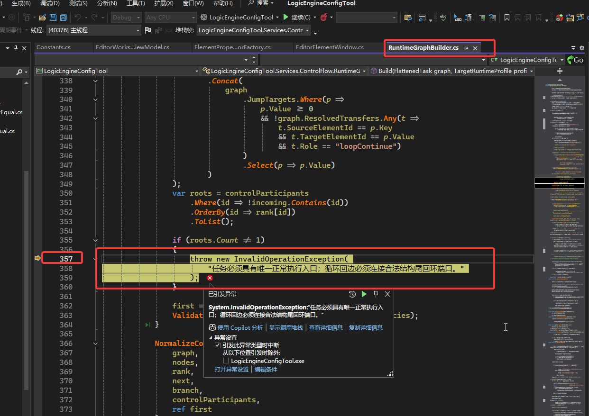
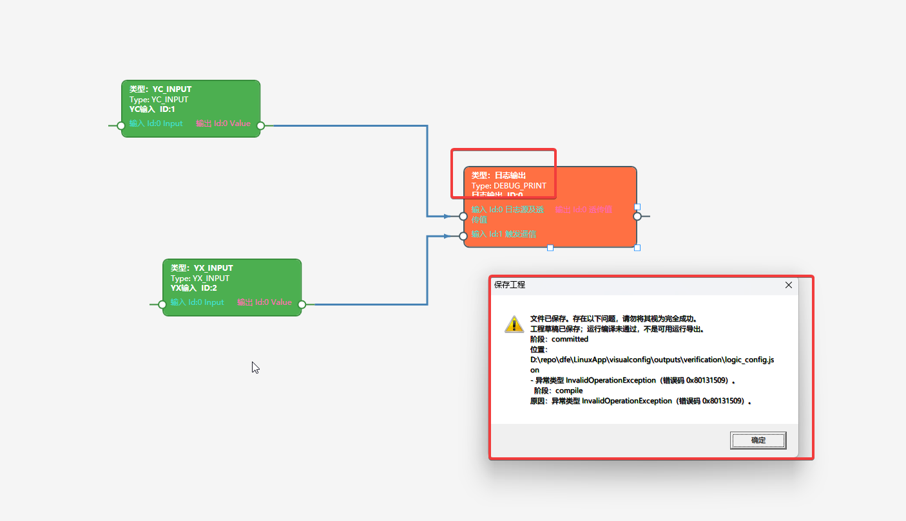

# 2026-10-24：SAVE_DATA 工程保存与控制流问题对话记录

## 一、整理范围与阅读说明

- **整理日期：**2026 年 10 月 24 日。
- **记录范围：**从“怎样把三个器件正确保存为工程，最终 `Elements` 不为空”的操作指导开始，到“为什么新版本把多路遥测输入识别为三个执行入口”的历史核对，以及本次整理文档的要求。
- **记录方式：**保留用户原问题、助手主要回答、调查中的进展说明和后续纠正，按对话先后排列。只调整标题层级、段落和代码块，便于离线阅读；不把较早的判断悄悄替换成较晚结论。
- **时间说明：**可见上下文没有每条消息的完整发送时间，因此以下以轮次排序，不编造具体时分。为保持问题起因，纳入紧邻本日截图问题之前的三器件保存指导。
- **系统消息：**自动工作流通知、Git 状态、工具原始输出不作为用户提问逐条转录；与结论有关的验证结果、提交信息和限制保留在对应回答及核验附录中。
- **前序背景：**默认目标环境和保存修复已在前一轮完成，相关提交为 `45aea69`。本记录不把前一轮的构建、完整回归或提交过程误记为本日重新执行。
- **调查边界：**本日这些追问以只读核对、Git 历史调查及内存副本编译为主。没有据此实施“保留器件 ID”“兼容旧版多输入连线”或“修复错误提示”的代码修改，也没有覆盖用户工程。整理时，工作区已有用户对 `LogicEngineConfigTool/Elements/ElementSaveData.cs` 的修改，保持不动。

### 附图目录

1. [三器件画布：编辑 ID 为 0、2、1](assets/2026-10-24-save-data/01-three-elements-canvas.png)。
2. [保存后的 Elements：运行 ID 为 0、1、2](assets/2026-10-24-save-data/02-saved-elements-ids.png)。
3. [扩展图：多路遥测输入、除法、比较和 IF](assets/2026-10-24-save-data/03-expanded-graph.png)。
4. [保存工程警告：草稿与 InvalidOperationException](assets/2026-10-24-save-data/04-save-warning.png)。

## 二、问答一：如何把三个器件保存为 Elements 非空的工程

### 用户提问（原文）

> 你来指导我，如何做才能将简单的 save_data 元器件、其输入端的遥测输入元器件、其输出端的遥测输出元器件，正确保存为工程配置，也就是最终的Elements不为空

### 助手调查前说明

我先核对当前界面的操作入口和这三个器件的必填参数，再给你一套能检查最终 `Elements` 是否非空的保存步骤。

### 助手回答

可以。**要让最终的 `LogicTasks[...].Elements` 非空，关键不只是连上两条线，还要给 SAVE_DATA 自己配置完整的存储点位，并在属性窗口点击“校验并应用”，最后点击“保存工程”。**

建议先按下面步骤新建一个最小工程验证，避免旧草稿中的空参数干扰。

#### 1. 使用修复后的程序

启动此前构建验证过的程序：

```text
D:\repo\dfe\LinuxApp\visualconfig\outputs\verification\LogicEngineConfigTool.exe
```

如果用 Visual Studio 启动，请先重新生成当前解决方案，避免运行修复前的旧 EXE。

#### 2. 设置实时库文件和目标环境

1. 通过菜单 **“实时库数据路径选择”** 设置正确的实时库文件路径。
2. 进入编辑画布，点击 **“目标运行环境”**。
3. 点击 **“恢复SAVE_DATA测试默认值”**。
4. 点击 **“校验并应用”**。

这套默认环境用于本地配置测试。普通工程保存现在不要求设备能力已确认，但设置好默认环境后，也便于进行“编译检查”和后续导出测试。

#### 3. 在同一个任务、同一层画布中放入三个器件

```text
YC_INPUT（遥测输入） → SAVE_DATA（数据存储） → YC_OUTPUT（遥测输出）
```

放入器件的先后顺序不重要，编号也不必手动调整。

#### 4. 分别配置三个器件的属性

双击器件，或右键选择 **“属性（工作副本）”**。

**遥测输入 YC_INPUT**

配置它要读取的实时库点位：

- 链路号 `Link`。
- 设备号 `Dev`。
- 寄存器号 `Reg`。

可以双击上述任意一个点位输入框，打开实时库选择窗口，选择真实存在的遥测点位。

**选完之后，要在器件属性窗口点击“校验并应用”。**

**数据存储 SAVE_DATA——这是最容易遗漏的一步**

它也需要单独配置自己的：

- 链路号 `link`。
- 设备号 `Dev`。
- 寄存器号 `Reg`。

**输入线不会自动填写这三个参数。**

当前 SAVE_DATA 的设计是：

> 输入、输出用于数据透传；实际存档的是其参数指定的实时库点位。

因此，如果你希望保存“遥测输入器件读取的那个点”，这里就选择与 YC_INPUT 相同的实时库点位。不要因为已经连了输入线，就把这三项留空。

其余参数先使用下面这组简单值：

| 参数 | 建议设置 |
|---|---|
| 存档唯一标识 `name` | 保留自动生成的名称 |
| 定时保存开关 | 勾选 |
| 定时保存周期 `SaveTime` | `60` 秒 |
| 变化保存开关 | 勾选 |
| 变化保存死区 `ChangeDeadZone` | `1` |
| 初值开关 | 勾选 |
| 初始值 `InitVal` | `0` |

最后点击 **“校验并应用”**。如果出现字段错误，先修正，不要直接关闭窗口。

> 上次检查你的工程时，SAVE_DATA 的 `link / Dev / Reg` 都是 `null`。这正是当前必须补齐的内容；“目标运行环境”中的功能链路号不能替代它们。

**遥测输出 YC_OUTPUT**

同样配置它要写入的实时库点位 `Link / Dev / Reg`，建议选择另一个适合测试的可写遥测点，避免实际运行时覆盖输入源。

然后点击 **“校验并应用”**。

#### 5. 连接两条数值线

按下面的端口连接：

```text
YC_INPUT 的“值”输出
    → SAVE_DATA 的“透传输入”

SAVE_DATA 的“透传值”输出
    → YC_OUTPUT 的“值”输入
```

**直接拖动连接，不按 Ctrl 或 Shift。** 普通拖动默认创建“数据＋控制”连接，这条简单链已按这种方式验证过。

不要按住 Ctrl：Ctrl 会请求纯控制连接，不能代替这里需要的数值输入连接。

#### 6. 检查并保存工程

1. 点击 **“编译检查”**，确认没有参数或连线错误。
2. 点击画布工具栏的 **“保存工程”**。
3. 首次测试建议另存为新文件，例如 `save_data_project.json`，不要覆盖原工程。

注意两个区别：

- **“编译检查”只是检查，不会单独把结果写入文件。**
- **“保存工程”才会生成并写入最终的 `Elements`。**

正常保存后，应看到类似：

> 文件已保存。  
> 工程结构编译通过；尚未验证设备部署条件，不代表可部署运行配置。

如果提示的是：

> 工程草稿已保存；运行编译未通过……

那么仍然存在参数或结构问题，**不能仅凭“已保存”就认为 `Elements` 已更新**。需要根据同一提示中的错误原因修正后再次保存。

#### 7. 打开 JSON，确认检查的位置正确

检查对应任务下的：

```text
LogicTasks
  └─ 对应任务
       ├─ Elements                     ← 这里应有 3 个器件
       └─ EditorMetadata
            └─ State                   ← 普通工程保存应为 "project"
```

`Elements` 中应包含：

```text
YC_INPUT
SAVE_DATA
YC_OUTPUT
```

不要只检查 `EditorMetadata` 里保存的画布元素——**画布中有三个器件，不等于最终的 `LogicTasks[...].Elements` 已生成。**

最后，重新打开这个文件，再保存一次，确认 `Elements` 仍有三个器件，就完成了这条最小链的工程保存验证。设备端实际落盘与重启恢复属于后续运行测试。

> **整理注：**“普通拖动即可”的指导针对这一条三器件单链。后文扩展为多输入图时，暴露出 `DataControl` 默认语义与单入口检查的兼容性问题；后续回答对此作了补充与纠正。

## 三、问答二：为什么保存后 SAVE_DATA 与遥测输出的 ID 互换

### 用户提问（原文）

> [Image 1] [Image 2] D:\repo\dfe\LinuxApp\visualconfig\outputs\verification\logic_config.json ，怎么我只简单配置了3个元器件，其中一个是save_data元器件，保存后，它和遥测输出的ID互换了

**用户附图 1：三器件画布。**


**用户附图 2：保存后的 Elements。**


### 助手调查前说明

我会只读核对这份工程里画布 ID、保存后的运行 ID 及引用映射，判断这是编译重编号，还是保存时串了器件身份。

### 助手回答

我核对了这份 JSON：**确实出现了你说的编号变化，但不是 SAVE_DATA 和遥测输出的类型、参数被交换，而是编译器给它们重新分配了“运行 ID”。**

#### 1. 这次保存的实际对应关系

| 器件 | 画布上的编辑 ID | 保存后外层 `Elements` 的运行 ID |
|---|---:|---:|
| 遥测输入 `YC_INPUT` | 0 | 0 |
| 数据存储 `SAVE_DATA` | 2 | 1 |
| 遥测输出 `YC_OUTPUT` | 1 | 2 |

画布上的连接是：

```text
YC_INPUT（0）→ SAVE_DATA（2）→ YC_OUTPUT（1）
```

编译后按执行顺序排列，并分配连续运行 ID：

```text
YC_INPUT（0）→ SAVE_DATA（1）→ YC_OUTPUT（2）
```

**所以，从数字上看像是两个 ID 互换，实际上是整条链在编译时重新编号。即使只有三个器件，当前实现也会这样处理。**

#### 2. 文件里的引用是否一起改了？

这份文件中，引用也同步更新了，并没有仍然指向旧编号：

- 遥测输入：`Id=0`，`NextID=1`，输出指向器件 `1`。
- SAVE_DATA：`Id=1`，输入来源是器件 `0`，`NextID=2`，输出指向器件 `2`。
- 遥测输出：`Id=2`，输入来源是器件 `1`，`NextID=-1`。

因此，从这份 JSON 看，最终仍然是：

```text
遥测输入 → 数据存储 → 遥测输出 → 结束
```

原来的画布编号保留在：

```text
LogicTasks[0].EditorMetadata.Task.Canvases[0].Elements
```

编号映射保留在：

```text
LogicTasks[0].EditorMetadata.CompilationInfo.SourceMap
```

其中明确记录了 `2 → 1` 和 `1 → 2`。具体见当时文件 `outputs/verification/logic_config.json:291`。

#### 3. 为什么程序这么做？

当前编译实现是**先确定执行顺序，再从起始编号连续分配运行 ID**，不是只调整 `Elements` 数组顺序。对应代码是：

- 分配连续运行 ID：`LogicEngineConfigTool/Services/ControlFlow/RuntimeGraphBuilder.cs:361`。
- 重写连接引用及器件 ID：`LogicEngineConfigTool/Services/ControlFlow/RuntimeGraphBuilder.cs:432`。

这里容易混淆的是：**画布只显示“ID”，没有明确标成“编辑 ID”；而你查看的外层 `Elements.Id` 已经是“运行 ID”。** 两处显示的不是同一种身份。

另外，这次文件的 `Elements` 已有三个器件，保存状态为 `"project"`，**已经不是之前 `Elements` 为空的草稿问题**。本次我只读核对了文件，没有修改你的工程或代码。

## 四、问答三：为什么引入连续重编号，能否不要，何时引入

### 用户提问（原文）

> “当前编译实现是先确定执行顺序，再从起始编号连续分配运行 ID，不是只调整 Elements 数组顺序”这个特性为什么要引入? 不引入行吗？什么时候引入的

### 助手调查前说明

我会对照 Git 历史和设计文档，查清连续重编号的引入时间、原始目的，以及不重编号会影响哪些功能；本次只调查，不改代码。

### 助手进展说明

已确认：连续重编号不是这次 SAVE_DATA 修复才新增的，最初实现来自 10 月 21 日；这次保存修复让它真正写入了非空 `Elements`，所以现在能看到了。设计中的编号范围和入口要求，并不能推出“所有器件都必须按执行顺序改成连续 ID”。

### 助手回答

查清楚了。**“编辑 ID 与运行 ID 分离”有用途，但“每次都按执行顺序把所有 ID 改成连续编号”并不是 SAVE_DATA 的必要条件。对你这三个器件，可以保留原 ID，只调整 `Elements` 排列和执行引用。**

#### 1. 为什么会引入？

它来自之前“新增器件与分层画布”的整体编译设计，不是为 SAVE_DATA 单独增加的。

当时考虑了这些情况：

- **编辑 ID 全工程唯一**，包含多个任务、子画布，编号可能超过设备允许范围。
- **运行 ID 按任务分配**，例如设计中循环协议要求目标编号在 `0～499`。
- 某些目标要求**实际入口的 ID 为 0**，但编辑时最先创建的器件未必是实际入口。
- 子过程展开后，编辑图与运行节点集合可能不同，需要建立来源映射。

因此，引入了“编辑 ID → 运行 ID”的映射。设计依据在 `documents/new.elements/新增元器件与分层画布详细设计方案.md:779`。

但是，**这些需求只说明有时需要重新映射，并不能推出每一次编译都必须给所有器件连续改号。**

当前代码采用了统一且简单的处理：

```csharp
Runtime = start + i
```

即按最终排列直接分配连续运行 ID，见 `LogicEngineConfigTool/Services/ControlFlow/RuntimeGraphBuilder.cs:361`。

**这是编译器的实现策略，目前没有实机证据证明设备一定要求“器件 ID 等于数组下标”。** 我之前解释了它如何工作，但没有充分说明这并非必然要求。

#### 2. 不引入连续重编号，行不行？

**对你这个工程：按已知约束，可以。**

保留画布 ID 后，完全可以表达为：

| `Elements` 数组位置 | 器件 | 保留的 `Id` | `NextID` |
|---:|---|---:|---:|
| 0 | YC_INPUT | 0 | 2 |
| 1 | SAVE_DATA | 2 | 1 |
| 2 | YC_OUTPUT | 1 | -1 |

执行链仍然是：

```text
0 → 2 → 1 → 结束
```

它满足：

- 真正的入口排在数组第一项。
- 入口 ID 为 `0`。
- 三个 ID 都在 `0～499` 内。
- 输入、输出和跳转引用指向正确器件。

**调整执行顺序，不等于必须改变器件身份。** 原来的平面编译路径本来就是保留 ID，重排元素并更新 `NextID` 等信息，见 `LogicEngineConfigTool/Services/ControlFlow/ControlFlowPlanApplier.cs:49`。

**但不能简单删除全部编号映射。**

如果入口原 ID 不是 `0`，或工程 ID 已超出目标范围，直接保留就可能不满足目标要求。更合理的规则可以是：

> 原 ID 满足目标要求时保留；不满足时明确报错，或者在运行导出时进行明确的编号映射。

当前没有“关闭器件重编号”的现成选项，支持这种规则需要改代码；`PortAddressing=id` 只控制**端口**寻址，不能关闭**器件**重编号。

#### 3. 什么时候引入的？

我核对了实际 Git 历史：

| 时间，均为北京时间 | 提交 | 内容 |
|---|---|---|
| **2026-10-20 22:02:28** | `afc225a` | 设计文档已提出编辑身份、运行身份分离，以及运行编号映射。 |
| **2026-10-21 08:36:19** | `a82f056` | 首次实现 `RuntimeGraphBuilder`，已经包含 `Runtime = start + i` 和重写器件 ID 的代码。**连续重编号算法在这里引入。** |
| **2026-10-23** | `45aea69` | 本次保存修复：普通工程保存改用 `CompileProject`，解除部署确认对工程保存的阻断，并完善 SAVE_DATA 数据流编译。**不是首次引入连续重编号。** |

还有一点需要准确区分：**包含新契约器件时走新编译器的保存路径，此前就存在**。本次我把该路径中的严格 `Compile` 改成了 `CompileProject`。之前编译失败、外层 `Elements` 为空；修复后成功生成了 `Elements`，于是既有的重编号策略也随之显现。

**结论：这不是保存 SAVE_DATA 必须付出的代价，而是新编译路径沿用的统一编号策略。你的三节点工程没有已知理由必须把 `0、2、1` 改成 `0、1、2`。** 本次仅调查，没有修改代码或工程文件。

### 助手后续补充

调查已结束。补充说明：工作流汇总中对引入时间保留了“未核验”的措辞，但我随后直接执行 Git 查询，已确认：

- `a82f056`（2026-10-21 08:36:19，北京时间）中已经存在 `Runtime = start + i` 及重写器件 ID 的代码。
- 保存时选择新编译路径的逻辑也早于本次修复；`45aea69` 将严格编译改为工程编译，让此前失败的保存成功，因而显现了已有的重编号行为。

因此，上一条答复的时间线成立。本轮没有修改任何文件。

## 五、问答四：扩展图保存为什么出现 InvalidOperationException

### 用户提问（原文）

> [Image 1] [Image 2] 为什么会出这个错误

**用户附图 1：扩展后的逻辑图。**


**用户附图 2：保存警告。**


截图中的主要提示为：

```text
文件已保存。存在以下问题，请勿将其视为完全成功。
工程草稿已保存；运行编译未通过，不是可用运行导出。
阶段：committed
位置：D:\repo\dfe\LinuxApp\visualconfig\outputs\verification\logic_config.json
- 异常类型 InvalidOperationException（错误码 0x80131509）。
  阶段：compile
  原因：异常类型 InvalidOperationException（错误码 0x80131509）。
```

### 助手调查前说明

我会只读检查当前工程，复现保存时的编译异常，查清是连线、参数还是编译器规则导致；不会覆盖你的文件或让你点击测试弹窗。

### 助手阶段性回答

文件中已确认这次保存状态是 `draft`，外层 `Elements` 仍保留上次成功的三个器件，不是截图里扩展后的完整图。窗口中的 `0x80131509` 只是 `InvalidOperationException` 的通用错误码；具体拒绝原因没有显示出来，我正在从实际编译异常中定位。

目前确认的是：**文件写入成功，但新图编译失败，所以保存的是草稿，外层 `Elements` 仍是上次成功的三个器件。**

提示框只显示了通用异常类型，隐藏了实际的编译拒绝原因，单凭这个错误码不能判断是哪条连线有问题。我正在只读复现具体异常，暂不建议你盲目删线或修改编号；不会覆盖你的工程，也不需要你操作测试弹窗。

诊断跟踪编号：`wf_22bd4f49-f974-497c-9c59-4c4f9e1b8931`。

### 助手定位后的进展说明

已实际复现首个原因：两路辅助遥测输入的连线都带了“控制流”，使编译器识别出 0、4、6 三个执行入口。仅在内存副本中把 `4→3`、`6→5` 改为纯数据连接后，工程编译通过；原文件未改动。

### 助手完整回答

**原因已定位：两路辅助遥测输入的连线同时带了“控制流”，使当前任务出现了三个执行入口。不是 SAVE_DATA 自身报错，也不是 ID 互换导致的。**

#### 1. 实际触发的错误

我对当前工程做了只读编译复现，取得原始异常：

> 任务必须具有唯一正常执行入口；循环回边必须连接合法结构尾回环端口。

你这张图中，下面两条线目前都是 `dataControl`，即**既传数值，又指定执行关系**：

| 连线 | 当前类型 | 这张图建议使用 |
|---|---|---|
| 遥测输入 **ID 4** → 除法 **ID 3 的 Input2** | 数据＋控制 | **仅数据** |
| 遥测输入 **ID 6** → 小于比较 **ID 5 的 Input2** | 数据＋控制 | **仅数据** |

因此，编译器看到的不是“一个执行入口，加两路辅助数值”，而是 **ID 0、4、6 三个执行入口**，违反了当前编译器的单入口规则。

#### 2. 你应该怎样操作

**只重新连接上述两条辅助输入线，不要把整张图全部改成仅数据。**

1. 右键点击 **ID 4 → ID 3 Input2** 的线，选择“删除连接”。
2. **按住 Shift**，从 ID 4 的 `Value` 拖到 ID 3 的 `Input2`，释放鼠标时仍保持 Shift。
3. 同样处理 **ID 6 → ID 5 Input2**。
4. 保留主链及 IF 分支的原连接：

   ```text
   0 → 2 → 1 → 3 → 5 → 7 → TRUE/FALSE 分支
   ```

5. 点击 **“保存工程”**。

当前界面的连线规则是：

- 不按修饰键：数据＋控制。
- **Shift：仅数据**。
- Ctrl：仅控制。

我之前让你“直接拖动、不按修饰键”，适用于最初的三器件单链。扩展为多输入运算后，这两路辅助输入需要区分出来，之前没有把这一点说明充分。

**这个操作建议已经验证过：仅在当前磁盘工程的内存副本中，将这两条线改为 `Data` 后，`CompileProject` 返回成功，异常为空。没有写回你的文件。**

#### 3. 为什么窗口没有告诉你具体原因？

这是程序提示的问题：异常格式化逻辑把这条具体的业务说明隐藏了，只留下：

```text
InvalidOperationException（错误码 0x80131509）
```

这个通用错误码无法帮助你定位连线。应该显示“存在多个执行入口”及相关器件，而不只是异常类型。对应位置为：

- 单入口检查：`LogicEngineConfigTool/Services/ControlFlow/RuntimeGraphBuilder.cs:334`。
- 异常信息被通用文案替换：`LogicEngineConfigTool/Services/UserFeedback/OperationFeedbackFormatter.cs:154`。

#### 4. 保存与后续测试的区别

这次失败后，保存的是**编辑草稿**，外层 `Elements` 保留上一次成功的三个器件；不是新图已生成完整运行配置。

另外，刚读取的磁盘工程与截图有一点不同：IF 分支目前接的是 **YC_INPUT 10、11**，截图是 **YC_OUTPUT 8、9**。上述内存验证针对磁盘版本。如果你希望分支执行遥测输出，需要再确认这两个器件的类型和点位。

本次验证只证明修改两条线后**工程编译可通过**。严格“编译检查／运行导出”还受目标能力确认约束；当前默认环境只确认了最初三个器件，不能把工程保存成功当作扩展图已经完成设备部署验证。

### 助手最终确认

最终诊断与上条结论一致：**把 `ID 4 → 除法 Input2`、`ID 6 → 小于比较 Input2` 这两条线改成 Shift 拖出的“仅数据”连接，其他主链连线保持不变，再保存工程。**

内存副本已验证这样修改后工程编译成功；你的原文件和代码均未改动。窗口未显示“存在多个执行入口”的具体原因，是异常提示本身的缺陷，本轮只定位，尚未修复。

> **整理注：**后续用户继续追问旧版为什么不需要区分这些线。下一轮核对指出：Shift 重连是适配当前新规则的办法，不能用它证明用户原有多源数据图本质不合法。

## 六、问答五：有控制输入端口，为什么还认为三个入口，9 月以前为什么没有问题

### 用户提问（原文）

> 引入了遥测输入的控制流端口，为什么会认为有3个执行入口？以前（9月份之前）也没出现过这个问题啊

### 助手调查前说明

我会核对“执行入口”的实际判定方式，并对比 9 月以前的编译逻辑，重点区分：是遥测输入的控制端口导致的，还是新增编译路径改变了普通数据连线的含义；你正在修改的 `ElementSaveData.cs` 会保持不动。

### 助手阶段性回答一：端口与入口不是同一概念

这里要区分 **“器件有控制输入端口”** 和 **“编译器把它当作执行入口”**：

- 遥测输入左侧有 `Input` 控制口，并不等于它会自动启动一条执行链。
- 当前报三个入口，是因为 **0、4、6 的 `Value` 输出连线都被记录成了 `dataControl`**。新编译器把这些线同时当作控制边，而这三个节点又都没有控制前驱，于是判定有三个入口。
- 它并不是在数“有几个遥测输入”或者“有几个空着的控制口”。

你提到“9 月以前没有这个问题”很关键：**不能因为新编译器现在要求单入口，就认定以前正常使用的多路遥测输入画法本来有错。** 上条让你按 Shift 重连，是避开当前规则的操作办法，还不能解释为什么新旧行为不同。

我正在核对 8 月版本的实际保存和调度逻辑，确认旧版如何处理多个上游数据源，以及这个单入口限制具体在哪次改动后生效。当前只读调查，未触碰你的 `ElementSaveData.cs` 修改。

### 助手阶段性回答二：数值端口也被允许承载控制流

又确认了一个关键点：**当前实现把数值端口也视为可承载控制流的端口。** 所以即使你没有使用遥测输入左侧的控制口，只连接右侧 `Value`，普通拖线仍会建立控制边。

因此，“三个入口”来自**新增连线语义＋单入口检查**，不是遥测输入有控制口就必然产生三个入口。`Shift` 重连只是适配当前规则的办法，不能据此认定旧版常用的多路输入画法不合理。

8 月版本的具体调度逻辑仍在核对中，尚未给出最终历史结论；本轮未改动任何文件。调查编号：`wf_22bd4f49-f974-497c-9c59-4c4f9e1b8931`。

### 助手历史核对后的完整回答

历史核对完成：**你说的“9 月以前没有这个问题”有源码依据。这次是新编译路径改变了普通连线的控制语义，与旧版多输入数据调度存在兼容性冲突，不是你的多路遥测输入需求不合理。**

#### 1. 遥测输入的控制口不是最近新增的

遥测输入左侧的控制 `Input` 口，至少在 **2026 年 5 月 5 日的 `22d1f9b`** 中就已经存在：

- 左侧 `Input`：控制输入。
- 右侧 `Value`：数据输出。

因此，**“有控制输入口”本身，不是现在突然报三个入口的原因。**

#### 2. 为什么新版本认为有三个入口？

真正发生变化的是下面这组规则：

1. 新界面普通拖线默认生成 **`DataControl`（数据＋控制）**。
2. 新编译器把这种线拆成一条数据边和一条控制边。
3. 再把“参与控制流、但没有控制前驱”的节点当作执行入口。
4. 要求执行入口只能有一个。

你的图在这套解释下变成：

```text
0 ─→ SAVE_DATA ─→ YC输出 ─→ 除法 ─→ 比较 ─→ IF
                           ↑        ↑
4 ─────────────────────────┘        │
6 ──────────────────────────────────┘
```

因为三路起点 `0、4、6` 都没有控制前驱，所以得到：

```text
控制流入口 = {0, 4, 6}
```

**它数的不是左侧空着的控制口，而是普通 `Value` 连线附带控制语义后，形成的三个控制根。**

对应检查在 `LogicEngineConfigTool/Services/ControlFlow/RuntimeGraphBuilder.cs:119`、`:312`；普通拖线默认类型在 `LogicEngineConfigTool/Views/Editor/EditorWorkspaceView.cs:1354`。

#### 3. 旧版本为什么能处理多路输入？

核对了 9 月以前的源码基线 `39b7a86`（2026 年 8 月 24 日）：

旧版普通数据图采用**数据依赖调度**，从消费者反向收集所有上游输入，先计算输入，再计算使用这些输入的器件，最终串成执行链。

例如：

```text
输入A ─┐
       ├→ 除法 → 比较 → 后续处理
输入B ─┘          ↑
输入C ───────────┘
```

这里 A、B、C 是**三个数据源**，并不因此被要求作为三个独立的控制执行入口。旧调度器可以将它们安排到一次任务执行中。

历史依据是：

```text
39b7a86:
LogicEngineConfigTool/Services/ControlFlow/StableDataScheduler.cs:21–49、85–100
```

#### 4. 新规则什么时候出现的？

| 变化 | 引入时间与提交 |
|---|---|
| 遥测输入左侧控制口已存在 | 至少 2026-05-05，`22d1f9b` |
| 新运行图要求唯一正常控制根 | 2026-10-21，`a82f056` |
| 新界面普通拖线默认 `DataControl` | 2026-10-22，`36c8457` |

**问题在于：普通数据线默认附带控制关系，而编译器又不再按旧方式将这些多路来源统一调度，转而直接要求控制根唯一。**

所以我需要纠正之前解释的侧重点：**Shift 重连是绕开当前冲突的办法，不是说你以前的画法一直不对。** 更合理的兼容行为，应当让普通多输入数据图继续按数据依赖安排执行，而不是仅因多个遥测数据源就报多入口；对于用户明确指定的控制流，再做相应的入口和路径校验。

本轮只做源码与历史核对，没有运行旧版程序验证这张包含新器件的完整图，也没有修改代码或触碰你正在修改的 `ElementSaveData.cs`。

> **整理补充：**上文“不再按旧方式将这些多路来源统一调度”限定于本例默认 `DataControl` 连线形成的控制图，不是说新编译器完全取消了数据依赖调度。当前实现仍会调度不参与显式控制流的数据依赖；完全没有控制参与节点时，也保留调用平面编译器的路径。本例失败的准确条件是：`0、4、6` 因连线的控制分量进入控制参与集合，又都没有正常控制前驱，从而触发唯一控制根检查。上述原回答保留，以便看到说明的形成和补充过程。

## 七、问答六：整理今日对话到 documents

### 用户要求（原文）

> 把上述所有的今天的对话，包括我的提问，和你的回答，整理成一份文档，输出到 documents 目录下

### 助手整理前说明

我会把今天关于 SAVE_DATA 保存、ID 重编号、执行入口错误及版本差异的提问和回答按时间顺序整理，并将历史内容不完整的地方明确标注，输出到 `documents` 目录。

我会按仓库现有格式整理为 Markdown，保留你的原问题、主要回答和后续纠正，并附上今天的四张截图；自动工作流通知不逐条抄录，其验证结果会归入对应问答。文档会明确区分已验证事实、历史源码结论和未实施的建议。

## 八、核验结果与结论边界

本节是整理时对前述对话的索引，不代表新增了一次代码修复或硬件验证。

### 1. 本日实际核实的事项

| 事项 | 核实结果 | 限制 |
|---|---|---|
| 三器件保存后的编号 | 编辑 ID `0、2、1` 映射为运行 ID `0、1、2`，引用同步更新；不是器件类型或参数互换 | 文件后续被用户继续编辑，各次结论对应各自读取快照 |
| 连续重编号的来源 | `a82f056` 中已存在 `Runtime = start + i` | 不能据此宣称设备必然要求 ID 等于数组下标 |
| 保留原 ID 的可行性 | 三器件例在已知本地约束下可以表达成 `0→2→1→结束` | 当前无关闭重编号的现成选项，本日未改代码实现 |
| 扩展图的首个编译错误 | 原始异常为“任务必须具有唯一正常执行入口”；控制根是 `0、4、6` | 不是以点位 `-1` 或 SAVE_DATA 参数解释这个已复现的首错 |
| 两条旁路改为纯数据 | 仅在内存副本将 `4→3.Input2`、`6→5.Input2` 改为 `Data` 后，`CompileProject.Success=True`、异常为空 | 没有执行文件保存、严格运行导出或设备部署 |
| 用户工程保护 | 该次复现前后 SHA256 一致 | 不代表用户此后没有继续修改文件 |
| 9 月前行为 | 8 月源码采用上游数据依赖调度；遥测输入控制口早已存在 | 未实际运行旧 APP 或旧设备验证包含新器件的完整图 |
| 异常提示 | 具体业务原因被通用异常文案遮蔽 | 本日只定位，未修复提示逻辑 |

扩展图只读复现时记录的用户工程 SHA256 为：

```text
5C88B33838FD008DD3CB9B4BE86EA46ED6A8BE813FF80D5D0984E30DE9DACFCA
```

它是当次调查快照的校验值，不是对当前文件内容永久不变的承诺。最初一次 PowerShell 路径检查因引号展开失败，修正后才完成实际复现；不能把失败的检查称为通过。

### 2. 工程保存、编译检查和运行导出不是一回事

- **工程保存 `CompileProject`：**验证编辑图并生成项目快照；成功时记录 `project`，不代表设备部署能力已确认。
- **编译失败后的草稿保存：**可以提交编辑元数据并记录 `draft`，保留上一次成功的外层平面任务；因此“文件已保存”不等于“新图已生成完整 Elements”。
- **界面“编译检查”和运行导出：**仍使用严格目标校验。最初提供的本地预设只确认 `YC_INPUT`、`SAVE_DATA`、`YC_OUTPUT` 三种设计契约，不能直接视为 DIV、LT、IF 等扩展器件已经完成设备能力验证。
- **实机执行：**本地工程编译成功，不等于 SAVE_DATA 实际落盘、重启恢复或扩展图的硬件执行已经验证。

### 3. 截至整理时未实施的建议

1. 目标规则允许时保留原器件 ID，而不是一律连续重编号。
2. 对普通多输入数据图恢复或兼容旧的数据依赖调度，避免默认 `DataControl` 带来多控制根冲突。
3. 把编译器可预期的业务拒绝原因，以明确器件或连线上下文显示给用户，而不是只显示异常类型和 HRESULT。

这些是对话中提出的改进方向，**不是本日已经完成的实现**。现有 Shift 重连方式仅是已验证的当前版本操作办法。

### 4. 相关源码和设计文档

以下为整理时使用的仓库相对路径；行号引用保留在前述回答中，后续源码变更可能改变行号。

- [运行图构建与编号映射](../LogicEngineConfigTool/Services/ControlFlow/RuntimeGraphBuilder.cs)。
- [分层编译与数据／控制边展开](../LogicEngineConfigTool/Services/ControlFlow/HierarchicalCompilationService.cs)。
- [工程保存与草稿处理](../LogicEngineConfigTool/Services/Editor/EditorProjectSaveService.cs)。
- [旧平面编译计划应用](../LogicEngineConfigTool/Services/ControlFlow/ControlFlowPlanApplier.cs)。
- [数据依赖调度器](../LogicEngineConfigTool/Services/ControlFlow/StableDataScheduler.cs)。
- [图连接规则](../LogicEngineConfigTool/Services/Editor/GraphConnectionService.cs)。
- [画布连线交互](../LogicEngineConfigTool/Views/Editor/EditorWorkspaceView.cs)。
- [异常提示格式化](../LogicEngineConfigTool/Services/UserFeedback/OperationFeedbackFormatter.cs)。
- [本地 SAVE_DATA 目标预设](../LogicEngineConfigTool/Services/Runtime/TargetRuntimeProfilePresets.cs)。
- [新增元器件与分层画布详细设计方案](new.elements/新增元器件与分层画布详细设计方案.md)。

### 5. 历史提交索引

以下时间已经用 Git 的 `%aI`（作者时间）和 `%cI`（提交时间）核对，统一使用北京时间（UTC+08:00）。除 `45aea69` 两个时间不同并单独列出外，其余表中提交的作者时间与提交时间相同。正文原回答中的“北京时间”按此说明理解。

| 提交 | 北京时间 | 与本次对话相关的内容 |
|---|---|---|
| `22d1f9b` | 2026-05-05 15:33:07 | 遥测输入独立实现中已有控制输入端口 |
| `39b7a86` | 2026-08-24 16:40:38 | 核对 9 月以前多输入数据调度所用源码基线 |
| `afc225a` | 2026-10-20 22:02:28 | 设计中提出编辑身份与运行身份分离 |
| `a82f056` | 2026-10-21 08:36:19 | 新运行图构建器包含连续运行 ID 分配及唯一控制根检查 |
| `36c8457` | 2026-10-22 15:05:20 | 新画布普通拖线默认 `DataControl` 的明确实现 |
| `45aea69` | 作者时间 2026-10-23 17:00:41；提交时间 17:04:48 | 分离工程编译与部署校验、修复 SAVE_DATA 保存等，不是连续重编号算法首次引入 |
| `e94e8c0` | 2026-10-23 17:07:20 | 本日调查时的仓库 HEAD，标题为“新的元器件设计文档” |

> **归档说明：**这是一份对话整理文档，不是新的需求批准、实现计划或实机验收报告。用户原问题和助手回答中的补充、限制、纠正均应结合阅读。

## 九、后续示例请求：完整工程、IF 双子过程与最终核验（追加）

本节在原历史记录之后实际追加；前八节及四张原图保留不变。早先追加节点因当时尚无最终工程而未写入，不能沿用其“未生成”的阶段结论。本节以纠正后生成节点的实际文件及独立最终核验为准。**本次交付为部分完成：工程已生成，读取、编译及父子画布工作区恢复通过，但读取后再次保存失败，不能称为完整可反复编辑保存的工程。** 这不是重新把前述已查清的编号、入口问题设为待查。

### 1. 用户本次请求与点表补充

**两条示例请求的需求摘要（非逐字引用）：**

1. 生成包含 `YC_INPUT`、`SAVE_DATA`、`YC_OUTPUT`、加减乘除、比较和 `IF` 的完整示例工程，并把配置策略追加到今日对话记录；保持旧工程不被覆盖。
2. `IF` 的真假两支分别使用实际包含多种器件的子过程，不只是给两个图标起名；保存父子层级和画布信息，打开工程后能恢复主画布、进入两个 child，再返回父画布。

**用户补充（原文）：**

> D:\repo\dfe\LinuxApp\visualconfig\outputs\verification\ltudevlib_07.json 是你需要的实时库文件，链路号是7

这里保留原话，不把助手随后提出的“所有点位 Link 都改为 7”冒充用户要求。**统一改贴 7 是助手误推断，已公开纠正并撤销。** 示例全程纯离线，不下发、不连接设备、不执行实时库写入，不修改原点表，也不覆盖已有用户工程或修改用户源码。

### 2. 最终工程入口与功能链路／点位链路区别

- **打开工程入口：**[save_data_if_subprocess_demo.json](../outputs/verification/save_data_if_subprocess_demo.json)。它是带 `EditorMetadata` 的工程文件，不是只有 support 生成器的交付。
- **原始点表：**[ltudevlib_07.json](../outputs/verification/ltudevlib_07.json)。
- **生成与核验报告：**[demo-support/report.json](../outputs/verification/demo-support/report.json)。报告已明确 `OptionalResave.Success=false`，不能只看早先的 `InitialSaveProject=true`。
- **功能链路参照：**[c0757.json](../outputs/verification/c0757.json) 中可核对 `LogicEngine.LinkNo=7` 与 `YC_INPUT` 的点位 `Link=3` 并存，说明二者概念不同。

本例 `LogicEngine.LinkNo=7`，`LogicTasks[0].EditorMetadata.TargetRuntimeProfile.LinkNo=7`：前者是功能引擎配置，后者是本地目标配置。实时库绑定则按原表完整 `(linkNo, devNo, RegNo, type=1)` 选取，映射到 `YC_INPUT/YC_OUTPUT` 的 `Link/Dev/Reg` 和 `SaveDataInf` 的小写 `link/Dev/Reg`；不能用功能链路覆盖点位链路，也不能只按 Dev、Reg 去重。

该表有 330 条 `type=1` 遥测，实际 `linkNo` 集合为 `0、1、3、6、29`，没有 7；文件名中的 `07` 不表示每一个点都属于链路 7。原表 SHA256 保持为 `1c2a9a31e396445f50a86f758390a5c20e01f66571f6fd90667ad83436a3787b`。

### 3. 实际策略、主画布与两个 child

以主输入为 A，真支独立遥测为 B，假支独立遥测为 C：

```text
z = ((A + 2) - 1) * 3 / 2
条件：z > 10
TRUE：进入真支子过程，读取 B，结果 = z + B
FALSE：进入假支子过程，读取 C，结果 = z - C
两支完成后均进入主汇合：z + 0，然后结束
```

除数为固定正数 2。比较使用 `COMPARE_GT`，精度参数为 `0.0001`。真／假支各自的 YC_INPUT 在该支明确的控制执行位置采样，不假定 B 或 C 等于 A。部分自动器件名称仍有“采样A”字样，真实绑定和公式应以本节 B／C 及参数为准。汇合节点使用公共 z，**不是合并真假结果的选择器**。

| 画布 | 实际器件／顺序 | 节点／连接 |
|---|---|---|
| 主画布 `a80ef355-10a5-48a6-9e24-001b6c326a7c` | `0 YC_INPUT → 1 SAVE_DATA → 2 YC_OUTPUT → 3 ADD → 4 SUB → 5 MUL → 6 DIV → 7 COMPARE_GT → 8 IF`；另有 `18 TRUE SUBPROCESS`、`19 FALSE SUBPROCESS`、`17 ADD` 公共汇合 | 12／15 |
| 真支 child `45bdfd42-a97e-4ab4-a8f9-d0fddbd5955b`，父图标 18 | `9 YC_INPUT → 10 ADD → 11 SAVE_DATA → 12 YC_OUTPUT` | 4／6 |
| 假支 child `fbf97205-6b6e-4fee-9ceb-49a4654cdfff`，父图标 19 | `13 YC_INPUT → 14 SUB → 15 SAVE_DATA → 16 YC_OUTPUT` | 4／6 |

共 20 个编辑节点、27 条编辑连接；编译展开后为 18 个运行节点，类型包含遥测输入／输出、数据存储、四则运算、比较和 IF。两个 SUBPROCESS 是编辑层结构图标，运行层展开而不保留为平面器件。

运行控制链已核实：`0→1→2→3→4→5→6→7→8`；IF 的 `TrueNextID=9`、`FalseNextID=13`，自身 `NextID=-1`；真支 `9→10→11→12→17`，假支 `13→14→15→16→17`，`17.NextID=-1`。IF 的 `ControlFlowInfo.JoinNextID` 实际为 `-1`，不能据图意把字段写成 17；两支尾的实际 `NextID=17` 表达了此例公共后继。18 条 SourceMap 对应真实画布、节点及端口，未发现悬空运行引用。

### 4. 逐点绑定：全部来自原表真实遥测

以下每行 `type=1`，完整四元组在原表中均恰有一条匹配；编辑元数据与外层运行元素的参数一致。这里的 61／62／64 和 120～125 是核对后的实际条目，不是猜测的 0／63／64 示例地址。

| 位置／ID | 类型 | 点表名称 | Link 或 link | Dev | Reg | type |
|---|---|---|---:|---:|---:|---:|
| 主画布 0，A | YC_INPUT | 备用遥测7 | 0 | 0 | 61 | 1 |
| 主画布 1 | SAVE_DATA | 预留遥测1 | 29 | 0 | 120 | 1 |
| 主画布 2 | YC_OUTPUT | 预留遥测2 | 29 | 0 | 121 | 1 |
| 真支 9，B | YC_INPUT | 备用遥测8 | 0 | 0 | 62 | 1 |
| 真支 11 | SAVE_DATA | 预留遥测3 | 29 | 0 | 122 | 1 |
| 真支 12 | YC_OUTPUT | 预留遥测4 | 29 | 0 | 123 | 1 |
| 假支 13，C | YC_INPUT | 备用遥测10 | 0 | 0 | 64 | 1 |
| 假支 15 | SAVE_DATA | 预留遥测5 | 29 | 0 | 124 | 1 |
| 假支 16 | YC_OUTPUT | 预留遥测6 | 29 | 0 | 125 | 1 |

三处 SAVE_DATA 均设置：`SaveByTimeEnable=1`、`SaveTime=60`、`SaveByChangeEnable=1`、`ChangeDeadZone=0.1`、`InitValEnable=0`、`InitVal=0`，且各有独立 `name`。**SAVE_DATA 输入／输出是透传，存档对象是其参数指定的实时库点位。** 因而不能宣称主 SAVE_DATA 自动把 A 写到 Reg120，也不能宣称子过程把运算结果自动存档到 Reg122／124；运算结果的显式输出绑定是 YC_OUTPUT 的 Reg123／125。这里仅验证配置结构，没有验证设备端存档和写点语义。

例如假设 A=10、B=10，纸面计算为 z=16.5、真支结果 26.5；假设 A=2、C=2，纸面计算为 z=4.5、假支结果 2.5。二者是**数学预期，不是解释器或设备实际运行结果**，也不意味着已写入 Reg123／125。

### 5. 软件手动配置与 Compose／纯 Data 的操作策略

下面是按现有软件交互复现结构的方法，不冒称本次已通过真实 WPF 鼠标操作验收；原工程请只读参考，若试作应另建新文件。

1. 在“实时库数据路径选择”中选上述原表；将功能引擎和“目标运行环境”的链路设置为 7，但每个器件仍从点表选择第 4 小节的真实完整地址，属性修改后点击“校验并应用”。四则的第二输入依次填常量 `2、1、3、2`，比较阈值 `10`，汇合 ADD 的第二输入为 `0`。
2. 主执行链普通拖线形成 `DataControl`。IF TRUE／FALSE 到对应子过程执行入口、子过程完成到汇合节点，使用 Ctrl 拖出的纯 `Control`。**不要把所有线都改成纯 Data。**
3. z（DIV 的输出）向两个子过程的数据输入、向汇合 ADD 的数值输入，均使用 Shift 拖出的纯 `Data`；它只提供值，不另加执行路径。不要将这些旁路改为默认 `DataControl`，否则会改变控制关系。
4. 真支先配置 `YC_INPUT(B)→ADD→SAVE_DATA→YC_OUTPUT`，假支配置 `YC_INPUT(C)→SUB→SAVE_DATA→YC_OUTPUT`；每支由外部控制先到该支 YC_INPUT，再执行运算。该支 YC_INPUT 的 Value 到 ADD／SUB 的第二输入是 `DataControl`，公共 z 到第一输入是纯 Data。这样支内采样有明确执行位置，而不是孤立的辅助控制根。
5. 组合前保留每支的外部执行入口、z 数据输入和正常完成出口，Ctrl 多选该支四个节点，点击工具栏 **“组合为子过程”**（`SubprocessService.Compose`）。生成节点实际调用了 Compose 事务，两个 child 是真实四节点子图，并非伪造图标。组合后检查父图标输入为控制入口 0、Data 输入 1，输出为控制完成 0；child 内分别为入口→YC_INPUT、Data→运算第一输入、末尾 YC_OUTPUT→完成出口。
6. 双击子过程或使用“打开子过程”，检查四节点及边界；返回父画布后检查两个图标及 IF 分支。当前已知的保存阻塞见下一小节，**不要把“另存／再保存一次就完成”作为这个双子过程示例的成功保证**。

目标配置 `local-arithmetic-if-subprocess-demo`／`local-offline-test-1` 使用 `arrayFirst+idZero`、节点范围 `0～499`、端口索引寻址，确认列表覆盖本例九种运行契约。这是本地测试设定，不代表设备厂商能力已经确认。

### 6. 读取、编译、保存重开证据与未完成边界

| 实际检查 | 结果／证据 | 解释 |
|---|---|---|
| 纠正后生成 | 报告 `InitialSaveProject=true`，最终工程存在 | 已不是“只有 support、无最终工程”；不能据此省略重保存验证 |
| 独立读取最终工程 | `Read.Success=True`、`IsReadOnly=False` | 文件可以读为编辑文档 |
| 独立工程编译 | `CompileProject.Success=True`，诊断 0 | 当前编辑结构通过工程编译 |
| 独立严格编译 | `Compile.Success=True`，诊断 0；运行摘要 `6e5aadb743cec4cca1aba890815089a936573e1c4c39a851a9d444376d86e57a` | 通过本地目标规则，不等于设备部署或实机执行 |
| 工作区父子导航 | `Workspace.Open(18)`、`Open(19)` 各恢复 4 节点／6 边，完整 child 序列化比对一致；各次 `Return(Discard)` 成功，完整父画布比对一致 | 实际工作区模型恢复测试，不是 WPF 控件视觉验收 |
| 逐点／控制流／来源映射 | 九处绑定完整四元组匹配、NextID／IF 目标、18 条 SourceMap 均通过独立静态断言，命令 exit 0 | 未改原点表，未把各点链路重贴为 7 |
| 读取后再次 SaveProject | **失败**：`Status=ValidationFailed`、`Stage=serialize`、`CommitSucceeded=False`，独立命令 exit 3 | `verify-final-independent-roundtrip.json` 未生成，没有第二次保存后的重开证据，roundtrip 不通过 |

再次保存的原始异常为“序列包含一个以上的匹配元素”。实际调用栈落在 [EditorSerializationService.PreserveUnknown](../LogicEngineConfigTool/Services/Editor/EditorSerializationService.cs) 第 321 行的 `SingleOrDefault`，经 `SerializeLegacy` 第 257 行至 [EditorProjectSaveService.SaveProject](../LogicEngineConfigTool/Services/Editor/EditorProjectSaveService.cs) 第 189 行。报告进一步核对：真实 Compose 创建的 child `BoundaryPorts` 中，输入控制口与输出控制口都合法使用方向内 `Id=0`；保留未知字段的匹配逻辑仅按 Id 而未区分 Direction，匹配到多项。这是**本次新增复现的序列化阻塞**，不是先前多执行入口的 compile 异常。没有通过改边界 ID、删除元数据或修改生产源码掩盖它。

最终工程 SHA256 为 `8122ca0a7dfcdcbb5aaa0e061c239f6d4744f0cf2db0d0522908df1abefc956b`，独立验证前后一致。生成报告还记录既有 `logic_config.json`、`c0757.json`、原点表、验证 EXE／PDB 的前后哈希一致；本文追加不修改这些文件。

工程的恢复来源是 `LogicTasks[0].EditorMetadata.Task.Canvases`，其中保留主画布、两个 child、父子关系、坐标、边界、连线及视图信息；外层 `LogicTasks[0].Elements` 是展开后的运行快照。**只有 runtime 平面元素而没有编辑元数据，不能据此恢复原父子画布、布局和编辑身份。** 本次入口必须使用上面的完整 project，不把运行导出当作恢复画布的替代品。

最终边界：尚未完成真实 WPF 控件、图形布局和鼠标操作视觉验收；没有运行解释器仿真、硬件接入、下发、写库、SAVE_DATA 实际落盘或断电／重启恢复测试；也未以本次文档追加冒称重新构建或跑完整回归。**已交付可读取、可编译、可恢复工作区的示例，但“保存→重开→再次保存→再重开”的完整闭环被实际 serialize 失败阻断，整体仍为部分完成。**

## 十、日志打印器件测试：为什么出现唯一执行入口异常（2026-10-26 追加）

### 用户提问（原文）

> 我在测试日志打印元器件时，出现这种异常，为什么？将你分析的结果写到 D:\repo\booknote\articles\SAVE_DATA工程保存与控制流问题对话记录\2026-10-24_SAVE_DATA工程保存与控制流问题对话记录.md 文件后面

本次核对版本为 `b54511b`（“修正日志打印元器件的属性编辑方式为ComboBox”）。本节仅追加分析，不替换前文历史结论，也不把此前示例的验证结果算作本次测试结果。





### 1. 直接原因：两条输入线同时带了执行关系

**本次失败发生在保存时的控制图编译阶段，不是设备运行日志打印时崩溃。实际工程中两条输入连线均为 `dataControl`，既传数据，又指定执行关系，因此形成两个正常执行入口。**

核对的文件为 `D:/repo/dfe/LinuxApp/visualconfig/outputs/verification/logic_config.json`。其中编辑图实际包含：

| 源器件／端口 | 目标器件／端口 | 实际连接类别 |
|---|---|---|
| `YC_INPUT`，ID 1，输出口 0 | `DEBUG_PRINT`，ID 0，输入口 0 | `dataControl` |
| `YX_INPUT`，ID 2，输出口 0 | `DEBUG_PRINT`，ID 0，输入口 1 | `dataControl` |

这里的 ID 是编辑节点 ID，不是成功编译后的运行重编号。**日志数据和触发信号来自不同器件是合理需求，两个数据输入本身并不违法。** 当前冲突在于这两条线又同时建立了独立的控制起点。这与前文多路遥测输入的控制语义问题属于同一类，不是中文 ComboBox 显示导致的枚举转换错误。

### 2. 为什么编译器算出两个入口

当前界面普通拖线默认生成 `DataControl`；Shift 拖线生成纯 `Data`，Ctrl 拖线或纯控制端口条件下生成 `Control`。数值端口也允许携带控制关系，所以不能只看连到了数值端口，就认定它是纯数据线。

展开编辑图时，连接按类别投影为：

```text
Data        → 仅数据依赖
Control     → 仅执行关系
DataControl → 同时建立数据依赖和执行关系
```

因此，本例的控制图也是：

```text
YC_INPUT（1） ──执行关系──┐
                        ├──→ DEBUG_PRINT（0）
YX_INPUT（2） ──执行关系──┘
```

`RuntimeGraphBuilder.Build` 查找的是“参与控制流、但没有正常控制前驱”的节点，不是在数空着的控制输入口。本例没有循环或跳转，计算结果为：

```text
controlParticipants = {0, 1, 2}
incoming            = {0}
roots               = {1, 2}
roots.Count          = 2
```

第 355～359 行要求 `roots.Count == 1`，否则抛出：

> 任务必须具有唯一正常执行入口；循环回边必须连接合法结构尾回环端口。

**本例命中的是“正常入口不唯一”，不是循环回边有问题。** 异常文字合并了两类约束，不能据此推断这个三节点图存在循环。

### 3. 为什么调试器停住，却又提示文件已保存

保存会先尝试编译，实际调用关系为：

```text
EditorProjectSaveService.SaveProject
  → HierarchicalCompilationService.CompileProject
    → 展开编辑图
      → RuntimeGraphBuilder.Build
        → 抛出唯一入口异常
```

`CompileProject` 不要求完成设备部署确认，但仍检查图能否编译。外层 `CompileCore` 会捕获该异常，保留异常对象并生成 `compile.failed` 诊断。

Visual Studio 开启“引发此异常类型时中断”后，即使异常后面会被业务代码捕获，也会先停在 `throw` 处。这种首次引发时的中断（first-chance）**不能单独证明发生了未处理异常崩溃**。关闭该选项只影响调试器暂停行为，不会修好控制图。

保存服务还允许保留尚不能运行的编辑草稿：编译失败后标记 `draft`，仍可继续序列化并提交磁盘。所以“文件已保存”和“运行编译未通过”并不矛盾。

| 提示／实际字段 | 含义 |
|---|---|
| 文件已保存、阶段 `committed` | 编辑工程已写盘，不代表运行编译或设备部署成功 |
| `LogicTasks[0].Elements = []` | 本文件没有可用的平面运行器件列表 |
| `LogicTasks[0].EditorMetadata.Task.Canvases[0]` 中有 3 个节点、2 条边 | 编辑器件和连接没有因编译失败丢失 |
| `State`、编译 `Status`、`CurrentReadiness` 均为 `draft` | 当前文件是编辑草稿 |
| `RuntimeDigest` 为空、`SourceMap` 为空 | 没有当前图成功生成的运行结果证据 |

**可以保留这份草稿继续修改，不能把它作为已经验证可运行的导出文件下发。**

### 4. 为什么界面只显示 InvalidOperationException 和错误码

原始异常正文包含具体的唯一入口约束，但 `OperationFeedbackFormatter.GetExceptionReasons` 不会直接显示所有异常原文，而是按已知安全规则转换。目前规则识别了部分特定的 `InvalidOperationException`，却未覆盖这一条，于是退化为：

```text
异常类型 InvalidOperationException（错误码 0x80131509）。
```

这不是 MessageBox 截掉正文，也不能靠这个通用 HRESULT 判断哪条线有问题。**这里还有独立的诊断缺陷：编译器知道入口检查失败，用户提示却没有说明相关节点和连接。**

后续应给出结构化诊断，例如“任务存在两个正常执行入口：YC_INPUT（ID 1）、YX_INPUT（ID 2），请检查其控制连线”，并保留原始异常供调试；不应为显示方便而无差别暴露所有异常消息。

### 5. 处理方向与验证边界

1. **明确日志的执行位置，再区分控制链与数据旁路。** 辅助数据／触发信号不应仅因接入数据端口就额外成为独立执行根。现有规则下可以考虑分开执行链和纯数据旁路，但具体连线方案仍需副本编译验证，不能保证“随便改一条线”就通过所有检查。
2. **不能把所有线都改成纯 Data。** `DEBUG_PRINT` 是带副作用的新器件，没有显式执行位置时可能继续触发“有副作用的新器件缺少显式执行入口”等检查。Shift 重连是选择连接语义的操作，不是通用修复。
3. **不能删除入口检查或直接取 `roots.First()`。** 任意忽略一个入口可能让另一路读取缺少正确调度。程序层面应协调默认连线语义、多源数据依赖调度与单入口规则，而不是把多数据源需求判为天然不合法。
4. **图通过后仍需配置真实点位和目标能力。** 当前文件的输入点位地址和引擎链路存在 `-1`，目标环境仍为 `unconfirmed`。它们属于后续配置／部署事项，不是本次已经命中的两个控制根异常。日志总开关和实例开关已开启，也不代表设备实际打印已验证。

本次证据来自当前源码、实际工程 JSON 与截图的本地 OCR 文本交叉核对。图片已随文保存；由于图像内容未能直接进入本次可见上下文，未完成截图逐像素视觉审查。**未重新构建、运行回归、启动 WPF 重现、修改连线后试编译或进行硬件日志测试；本节不声称修复已完成。**

本轮只追加文档与截图附件，没有修改程序代码或覆盖工程。核对时工程 JSON 的 SHA256 为 `1c179840c58fc5394a340bb633589fd6202a27d7fbc9c435e44712133bf9c715`。以下源码路径均相对于 `D:/repo/dfe/LinuxApp/visualconfig/LogicEngineConfigTool/`，行号对应 `b54511b`：

| 源码位置 | 核对内容 |
|---|---|
| `Views/Editor/EditorWorkspaceView.cs`，`SurfaceUp`，约 1365～1373 行 | 普通拖线／Shift／Ctrl 的连接类别选择 |
| `Services/ControlFlow/HierarchicalCompilationService.cs`，`CompileProject`、`CompileCore`、`Expander.Run` | 保存编译、异常捕获和连接的双图投影；catch 在 159～169 行 |
| `Services/ControlFlow/RuntimeGraphBuilder.cs`，约 120～129、332～359 行 | 控制参与节点、入边与正常执行根检查 |
| `Services/Editor/EditorProjectSaveService.cs`，约 99～136 行 | 编译失败后保留编辑草稿 |
| `Services/UserFeedback/OperationFeedbackFormatter.cs`，约 154～168 行 | 已知异常映射与类型／HRESULT 回退 |

## 十一、Input0→InputN、旧虚拟根与新旧编译流程的历史复核（2026-10-26 追加）

### 1. 本次追问、基准与证据边界

本轮继续回答用户的核心想法：普通消费者能否按 Input0→InputN 递归准备来源，再执行自身；旧版将多个来源接到虚拟根的办法为何不能直接沿用；界面上的五个算法器件是否也能统一处理；新编译流程究竟解决了什么问题。

这是对追问的归纳，不冒充缺失的逐字原话。前十节保留原样，以下补充和纠正不回写历史回答。

- 上位机基准：`b54511bdc8cebd285b6eea315a26ce67f72aab9f`。
- 固件权威树：`D:/repo/dfe/LinuxApp/linuxttu`，HEAD 为 `5acdca6d399b37dce4bdf2408c65193f9baa54c3`；最近涉及 `src/logicengine` 的记录为 `9cbc27de`，2026-09-23。仓库 HEAD 与子目录最近变更不是一回事。
- 本节综合实际 Git 导出、独立历史核验、当前源码和前述工程快照。小图均为**静态演算，不是本轮编译或设备执行结果**。
- 本轮只追加本文；没有修改程序、JSON、fixture、愿景原文，没有构建、回归、UI、设备测试或提交。

为避免源码链接在笔记目录下失效，后文统一用代码路径和以下根映射，不将源码写成 Markdown 相对链接：

| 缩写 | 绝对根目录 |
|---|---|
| H | `D:/repo/dfe/LinuxApp/visualconfig/LogicEngineConfigTool/` |
| T | `D:/repo/dfe/LinuxApp/visualconfig/LogicEngineConfigTool.RegressionTests/` |
| S | `D:/repo/dfe/LinuxApp/linuxttu/src/` |
| F | `D:/repo/dfe/LinuxApp/linuxttu/src/logicengine/` |

行号对应本轮基准；历史路径写成“提交：路径”，只对该快照有效。所有“已实现”均指源码实现，除非另有明确运行证据。

### 2. 用户的递归准备思路可以保留，但“Input 顺序”须先定清

**对普通无状态数据 DAG，先按输入顺序递归准备依赖、再发射消费者，是合理的兼容规则。** DFS 后序可以产生拓扑顺序；不能把“DFS”与“拓扑排序”说成互斥。更准确的区别是“逆向依赖 DFS 后序”与“Kahn 入度队列”等具体实现策略。

```text
准备消费者 C：
    按约定的 Input0 → InputN 顺序遍历实际输入依赖
    对每个来源递归准备其依赖，去重后发射来源
    全部输入就绪后发射 C
```

这里的“发射”是编译期生成执行链，不是固件运行时递归调用输入器件。该规则要求输入合法、无数据环、来源可在所在区域求值，并明确共享、采样、状态与副作用的约束。

| 实现阶段 | 实际顺序依据 | 不能据此声称 |
|---|---|---|
| `4126dd5` 的 UI 内 `TopologicalSortNextID` | `Inputs` 集合枚举顺序 | 当时已经按 `Order` 排序 |
| `39b7a86` 的 `StableDataScheduler` | 目标端口 ID，再来源原索引、来源 ID | 按端口显示名称或 `Input.Order` |
| 当前旧服务／无控制 fallback | 目标端口 ID；来源索引优先采用 `CompilationInputOrder`，再补当前列表 | 仍只依赖本次 `Elements` 数组位置 |
| 当前显式控制路径 `entry/collect` | 通过 PortId 找目标输入，取其 `Order`，再按来源 rank | PortId 是第一排序键，或相同 Order 时按输入 ID 破平局 |

`39b7a86` 的端口模型没有 `Order`。当前部分反序列化路径对缺失 Order 的端口按数组下标补齐；PI 新建的两个输入也没有分别设 Order，默认都为 0。因此 ID、Order、数组位置不一致时，当前显式控制路径存在**条件性的旧顺序兼容偏离**。结果稳定，不代表采样和求值次序兼容。

直接定位：H `Services/ControlFlow/StableDataScheduler.cs:27–100`、`RuntimeGraphBuilder.cs:168–197`、`GraphNormalizationService.cs:74–76,109`；H `Models/LogicEngineConfig.cs:82–107`、`Services/Editor/EditorSerializationService.cs:972–987`。历史证据为 `39b7a86:LogicEngineConfigTool/Models/ElementModel.cs:1428–1453`。

### 3. 五个“算法元件”共用输入准备规则，不共用纯函数许可

界面分组的五项是 PI、变化率、积分、日志和存储；分组不是执行效果分类，其中日志实现分类为 Output。

| 器件 | 输入、状态及副作用 | 当前隐式数据求值契约 |
|---|---|---|
| `PI_CONTROLLER` | SP/PV；积分量、翻转状态；重复调用会推进状态 | legacy 准入明确排除，须有明确执行到达 |
| `RATE_OF_CHANGE` | 数值输入；历史采样、时间窗口及翻转状态 | legacy 准入明确排除，不能按消费者数量重复采样 |
| `ALGO_INTEGRAL` | 必接数值输入、累计状态及实时库交互 | descriptor 为 `Stateful`，不开放隐式执行；设备实现另见第十二节 |
| `DEBUG_PRINT` | IN0 日志源并透传；可选 IN1 触发；边沿、周期、缓存和文件副作用 | descriptor 为 `SideEffect`，要求显式执行位置 |
| `SAVE_DATA` | 输入透传；存储点由参数指定；契约涉及首次恢复／初始化及后续存档 | `SideEffect`，但特设 `SupportsDataFlowEvaluation=true`；这是例外，不是纯净证明 |

因此应拆成两层：**依赖层决定输入何时准备；执行效果层决定来源能否隐式执行、一次到达是否推进状态或产生动作。** SAVE_DATA 的许可不能推广到其余四项，帮助文字也不能替代固件实际实现。

这不是说有状态或副作用器件不能按 Input0→InputN 准备输入。用户要求的输入先后，与每周期／每分支更新次数可以同时满足；需要额外定义的是执行到达和复用范围，而不是否定输入顺序本身。

“每周期一次”同样须限定：静态发射一次不妨碍循环多次到达；日志每次到达未必打印或刷盘；SAVE_DATA 的恢复与保存策略不同；PI、变化率、积分也各有状态与时间条件。

普通 Calculator 分类也不能整体当纯函数：F `elements/element_arithmetic.c:916–938` 的表达式器件可在求值后写实时库。执行效果证据见 H `Services/Editor/ElementDescriptorCatalog.cs:159–176`、`Services/ControlFlow/RuntimeGraphBuilder.cs:803–823`；界面分组见 H `Views/VisualEditorView.xaml:301–339`。

### 4. 旧完整流程：图规范化、结构分析、调度、线性化与保存

以下以 `39b7a86` 的服务化流程为主要历史快照，不用当前文档倒推当年实现：

```text
MainViewModel.FileManagement → VisualEditorViewModel.SaveToFile
  → 候选深拷贝、连接修复、数量／器件／IF 分支隔离校验
  → TransactionalConfigSaveService.Save
  → ControlFlowCompilationService.CompileAll（逐任务）
      Normalize：形成真实元件、数据／控制边和来源顺序
      → 提取控制描述、校验表达式
      → StructuredRegionBuilder.Build
          真实后继 + 分析虚拟入口／出口
          → 可达、支配、后支配、分支区域及 join
          → 数据依赖闭包与共享依赖分析
      → ExecutionLinearizer.Linearize
          区域内 StableDataScheduler：汇点驱动的逆向 DFS 后序
          → 递归发射分支、公共后继与 continuation
          → 普通 NextID、分支入口及控制参数
      → ValidatePlan
  → 所有任务成功后 PlanApplier 应用到真实实例
  → 临时 JSON、回读校验、磁盘替换，成功后回写编辑模型
```

旧调度先访问区域内没有数据消费者的汇点，多个汇点按原索引降序、ID 降序；之后按原索引升序扫描剩余节点。每个消费者的数据前驱按目标端口 ID 递归，后序发射并去重；数据环报 `CFG040`。

普通节点 NextID 指向发射区间下一节点，末节点指向 continuation，顶层为 `-1`。IF 的真假入口单独设置，入口可能是分支所需依赖而非物理连线目标；不能只看 JSON 数组排列判断会不会执行另一分支。

该流程完成工程保存，不代表形成了当前 `ExportRuntime` 的设备能力门禁，更不证明设备接受了工程 JSON。历史定位：`39b7a86:LogicEngineConfigTool/ViewModels/VisualEditorViewModel.cs:2381–2453`；同快照 `Services/ControlFlow/TransactionalConfigSaveService.cs:58–128`、`ExecutionLinearizer.cs:112–201,304–315`、`ControlFlowPlanApplier.cs:33–84,126–153`。

### 5. 旧虚拟根究竟做了什么

```text
              [分析虚拟入口]
                 /      \
                A        B       ← 全部无前驱真实节点
                 \      /
                  消费者 C
                     |
              [分析虚拟出口]
```

虚拟入口为 `int.MinValue + 1`，出口为 `int.MinValue`；没有无前驱节点时，分析入口才退到原顺序首节点。入口不限于纯输入类器件。

它们用于支配、后支配和区域分析，不加入最终真实 `Elements`，不成为普通 NextID 目标。**数据 DFS 的直接起点是汇点，不是此分析哨兵。** 哨兵参与结构分析，可能间接影响结果，所以也不能说“完全不影响顺序或结果”。

旧核心没有当前同名的“正常控制 roots 必须恰有一个”规则，多个数据根不会仅因此被拒绝；但 UI 必填输入、数据环、分支隔离等其他校验仍存在，不能推导任意孤立图都可保存运行。

当前定位：H `Services/ControlFlow/StructuredRegionBuilder.cs:35,49–83`、`ExecutionLinearizer.cs:72–90`。历史至少在 `4126dd5` 的该服务文件 `29–32` 行已有 syntheticEntry；这不证明当时所有保存都调用此服务，也不证明项目首次出现任何名称的虚拟根。

### 6. 当前完整流程：分层展开后分别处理控制与数据

```text
保存入口／Common.SaveToJson
  → 缺 EditorDesign 时导入补齐
  → EditorProjectSaveService.SaveProject → CompileProject
  → 克隆、端点规范化、设计／连接／资源检查
  → HierarchicalCompilationService.Expander
      展开子画布、边界、正常完成／任务结束／结构化转移
      → FlattenedTask：分别形成 DataEdges / ControlEdges
  → RuntimeGraphBuilder.Build
      数据单口单源与数据环检查；构造 controlParticipants
      → entry/collect：收集许可依赖，安排静态后继和分支
      → 无控制参与者：准入检查 → 旧 Compile + PlanApplier
      → 有控制参与者：唯一正常 root → first=entry(root)
          → 全节点可达、数据支配、回边授权
          → 计次 WHILE 辅助复位入口、再次检查
          → 静态布局、运行 ID、端口映射、SourceMap、引用重写
  → RuntimeConfigAdapter：运行契约适配
  → 成功更新运行缓存；失败可保留带 draft 状态的编辑草稿
  → 工程临时文件回读／提交

单独 ExportRuntime
  → 重新 Compile（部署口径，包含本地目标能力／点位／预算证据）
  → ToRuntimeJson：去编辑字段、投影运行参数
  → 本地 JSON 回读等价、提交运行文件
  ≠ 下装、固件接受、设备已执行
```

当前无控制分支仍用旧服务，**不是显式控制编译失败后的自动重试**。外层保存残留的旧 else 与 Build 内仍可达的 fallback 也不是同一分流。

`entry` 在处理控制边、JUMP 目标时就可能调用；数据环、副作用依赖或共享静态后继冲突可以早于 roots 检查。合法 root 的实际 first 又可以是其依赖，不必是 root 本体。

新增需求不只是“画得更复杂”：子过程展开后运行节点集合与编辑集合不同；计次 WHILE 需要生成辅助节点；运行 ID 与来源映射要独立维护。旧 PlanApplier 要求计划 ID 集合等于原任务集合，不能直接承担这些新增节点。

旧平面服务已经有区域、循环和 SWITCH 分析，不应说新分层编译才首次需要结构分析。当前 `BuildStaticLayout` 是在既定 next/branches 上安排序列化布局，不是自动解决全部控制歧义。

定位：H `Services/Editor/EditorProjectSaveService.cs:64–143,292–359,396–430`；`Services/ControlFlow/HierarchicalCompilationService.cs:25–32,96–169,277–310,361–615,675–796`；`RuntimeGraphBuilder.cs:81–363,524–765,1095–1202`。

### 7. 多源冲突不是数端口，而是 DataControl 的控制投影

默认普通拖线生成 DataControl；Shift 请求 Data；Ctrl 或纯控制端点条件请求 Control。端口允许携带控制，只代表能力，不代表用户的数据依赖必然包含执行转移意图。

```text
Data        → 仅数据图
Control     → 仅控制图
DataControl → 同时进入两图

YC(id1) --dataControl--> PRINT(id0).in0
YX(id2) --dataControl--> PRINT(id0).in1

控制参与者={0,1,2}，正常 incoming={0}，roots={1,2}
```

两源已经拥有控制位置，`collect` 会跳过控制参与来源，不会再将它们当纯依赖自动串起来。这才是本例多根的机制；单口单源检查数的是“同一目标端口有几个来源”，不是 `Inputs.Count`。

若仅在静态小图里将 YX→PRINT 改为 Data、YC 保留 DataControl，候选链可成为 `YC→YX→PRINT`；这说明“明确主执行位置＋其他数据旁路”与现机制相容，**不是本轮已验证的具体操作修复**。全改 Data 则可能因 PRINT 的副作用准入再次失败。

也不能说所有旧工程都会受影响：H `Services/Editor/LegacyProjectImporter.cs:295–314` 将普通 legacy 扇出专门解释为 dependency DAG。H `Services/Editor/GraphConnectionService.cs:1008–1018` 的能力校验也不等于把全部 Data 自动升级为 DataControl。

### 8. 用户方案的兼容边界：常量、未接、共享、分支和循环

| 场景 | 可以保留的规则 | 不能省去的约束 |
|---|---|---|
| `D→A→C.in0，B→C.in1` | 对许可来源递归；ID/Order一致时得到 `D→A→B→C` | Order 对调可能得到 `B→D→A→C`，两者拓扑合法但采样顺序不同 |
| Input0 未接 | 可选时继续准备其他实际输入 | 必接先报错；不能据无 Input0 来源认定任务入口 |
| Input0 接常量 | 常量先准备，其他输入仍递归 | 常量不是整任务控制入口声明 |
| `S→C.in0/in1` | 同次收集去重，S 发射一次 | 去重不等于任意多消费者全局调度 |
| `S→A、S→B`，A/B在不同分支 | 共享值可复用的语义值得支持 | 当前可能要求 `S.NextID=A` 又要求 `S.NextID=B`，assign 拒绝；须提升到公共位置、复制纯计算或另建语义，不能任选一个后继 |
| true 路径执行 S，false 直接到 C；C 读 S | 数据来源可达是必要条件之一 | S 不支配 C，false 可能读旧值；不可偷偷重执行显式状态／副作用来源 |
| 真正 Control/JUMP | 按控制到达安排执行 | 不由某个数值输入位置决定入口，不可随意搬到消费者前 |
| 循环 | 合法控制回边不算第二正常入口 | 数据环仍拒绝；正常进入、continue、状态更新次数分开规定 |

计次 WHILE 当前降低意图如下；不是计数器设备验收：

```text
正常进入 → [生成的复位入口 JUMP] → WHILE → Body
                                    ↑       |
                                    + continue
                         WHILE --退出--> Z
```

continue 回 WHILE 本体，不再经过复位入口。跨子画布 continue/exit 还须逐层授权、归属正确祖先结构；未接线不能一律解释成正常完成，`subprocessReturn/taskEnd/unbound` 含义不同。

### 9. 真实 Git 时间线：先统一、再兼容分流、再重新统一

日期为 Git 作者日期（+08:00），不是推测上线时间或历史动机。

| 提交 | 日期时间 | 核实结果 |
|---|---|---|
| `4126dd5` | 2026-07-14 16:37:08 | UI 内 `TopologicalSortNextID` 按 Inputs 集合做汇点 DFS 后序；服务文件同时已有分析虚拟入口。两条代码存在不等于当时保存已统一用服务 |
| `ac94421` | 2026-07-15 14:27:23 | 差异删除大量 UI 旧算法；本轮未完成该版保存路由定点追踪，不补写精确切换链 |
| `39b7a86` | 2026-08-24 16:40:38 | 已核旧事务保存、稳定端口 ID 顺序、汇点 DFS、分析哨兵与 NextID 应用 |
| `a82f056` | 2026-10-21 08:36:19 | 新分层保存首版直接 Compile；single-root 与 no-control 旧服务 fallback 已同时存在 |
| `36c8457` | 2026-10-22 15:05:20 | 增加单画布全 legacy 旧 CompileAll 兼容分流；普通拖线默认 DataControl；Common.SaveToJson 接入新保存 |
| `45aea69` | 2026-10-23 17:00:41 | 分离 CompileProject 与部署 Compile，保留兼容分流，扩展数据求值许可和静态布局 |
| `ffdf6b9` | 2026-10-25 19:33:29 | 独立 stat 核实仅一个 Markdown，282 插入、151 删除；“重新设计实现方案”不等于这次改了编译代码 |
| `0235b3c` | 2026-10-26 06:47:20 | 保存条件改为 `EditorDesign != null`，取消单画布全 legacy 实际绕行；加入计次入口规范化等 |
| `6d90f16`、`b54511b` | 本表不补未定点核实时间 | SAVE_DATA 点位默认 -1、日志 ComboBox；标题不是根因证据 |

所以，single-root **不是 0235 才新增**；0235 扩大了进入新 Build 的工程范围。a82 统一→36 分流→45 保留分流→0235 重新统一；内部纯 Data/no-control fallback 始终应另计。

有直接文本支持的动机是 `45aea69` 正文：“分离工程保存与部署校验，避免未确认目标阻断工程保存，保留编译顺序和数据流求值，并补充对应回归覆盖。”分层边界、辅助节点及状态保护是代码支持的工程解释；不能进一步断言作者“为了限制普通多源”或“为了循环必须改变输入次序”。

原始 Git 导出位于 `D:/repo/dfe/LinuxApp/visualconfig/.dfcode/build/compiler-history-20261026/`，包括 `manifest*`、`commits.txt`、metadata 和 diff。历史 UI 证据为 `4126dd5:LogicEngineConfigTool/ViewModels/VisualEditorViewModel.cs:2484–2558`；a82 的 Build 已在第98行有 no-control 分支、第118行有 single-root 拒绝。

### 10. 对旧文的显式补充纠正与后续建议

1. “旧算法不是拓扑排序”若被理解成不满足拓扑依赖，应纠正：DFS 后序是产生拓扑顺序的一种方式；7月 UI 版本与8月稳定服务版本还须分开。
2. “新编译完全替换旧服务”过于笼统：保存入口统一，但无控制图仍内部调用旧服务；失败不自动回退。
3. “新规则刚由0235引入”应改为“既有 single-root 规则的适用范围扩大”。分析虚拟根、数据汇点、真实控制 root 是三个概念。
4. 第十节实际 JSON 已确认两条 DataControl，不再只是截图推测；仍未证明文件与截图是同一秒版本。本例不是副作用完全缺入口，而是两个正常 roots。
5. 安全异常摘要在 CompileCore 生成诊断时已发生；不是 MessageBox 截断。first-chance 中断也不能单凭断点认定未处理崩溃。
6. 编辑三节点保存在 EditorMetadata；外层 Elements 空不等于编辑节点丢失。committed 是磁盘提交，不是 Git commit、编译或部署成功。
7. 模板为 null、残留旧触发开关、当前 -1 点位和 unconfirmed 环境，都不能拿来替代已经命中的根因；这些仍是后续独立配置问题。

第十节的工程哈希属于当时核对记录，保留不替换；父会话提供本轮JSON基线为`5b279a5b33895718f0d84213b573cf1b4f9a3f1c072da9a8f7b63499810909d0`。它与第十节所记`1c179840…`不同，不能把不同时点快照混称为同一字节版本；本追加者未重新读取或计算该JSON。

建议先明确 Data/Control/DataControl 默认意图，固定输入 ID/Order 的迁移契约，按纯计算／状态／副作用声明执行效果，保留支配和回边保护，并给出带任务、roots、连接种类及画布路径的诊断。**不建议 `roots.First()`、任意补控制线或一律删除检查。** 虚拟根仍可用于分析，但不能凭空补齐运行执行语义。

历史核验并非所有原始命令全绿：旧 Transactional 路径查询曾 exit 128，改用正确 `Services/ControlFlow/` 路径后 exit 0；`ac94421` grep exit 1 仅表示无匹配。独立核验还曾在 bash 误用 Select-Object（命令未找到，子步骤未单报数值），之后以 git grep 成功补证；一次 no-index 差异管道 exit 1 且输出截断，不作完整审计证据。不能以组合命令末尾成功抹掉前面失败。

## 十二、现场零代码与工业 C 式表达能力愿景的双端评估（2026-10-26 追加）

### 1. 新增要求、愿景来源及总体结论

用户本轮新增要求（原文）：

> 再给我分析一下，目前的编译流，是否支持 D:\repo\booknote\articles\可视化编程规约C语言表达能力演进方案.md 所设计的愿景，我的最终目标是，用可视化配置软件，完全实现C语言的表达能力，以实现现场的零代码配置，否则部署一个现场就要改代码，维护起来代价太大，且极易出错。嵌入式代码在 D:\repo\dfe\LinuxApp\linuxttu\src的logicengine里

> 把你的所有分析结果都写到 2026-10-24_SAVE_DATA工程保存与控制流问题对话记录.md 后面

下文将这一目标分解为接口契约、表达式与数值、类型与存储、过程抽象、控制流、运行安全及验证等维度；这是分析方法，不是用户逐项指定的清单。关于最终形态，按用户提出的现场零代码目标评估，**不替用户批准纯图形或图形＋脚本路线**。

新增来源为[《可视化编程规约 C 语言表达能力演进方案》](../可视化编程规约C语言表达能力演进方案.md)，原文199行，日期2026-09-25。本轮只读原文，以当前双端源码复核“现状”，不把原规划或旧基线直接当已实现。

**结论：方向可行，已有编译与基础执行链可复用，但当前没有闭合愿景要求的通用语言运行时和现场零代码部署链。** 应严格分开：

```text
可编辑／草稿可保存 → 工程编译通过 → 本地部署门禁通过
→ 运行 JSON 写入回读一致 → 指定固件接受 → 指定设备运行
→ 数值、周期状态、IO动作及恢复行为符合业务要求
```

前一层成功不自动证明后一层。算术—比较—IF 的必要双端链可静态接通；SAVE_DATA、DEBUG_PRINT、积分及新版控制器件在当前固件注册链有明确断点。人工填完整 profile 不会使固件获得未注册类型。

### 2. 目标边界：工业 C 式语言，不是完整 ISO C

原方案37–47行明确排除自由指针／内存别名、预处理宏、union、字符串自由处理及无界递归；目标是控制、数据、过程三层抽象，加领域 IO。不能用标题扩大成 ISO C 完全兼容。

- 数据目标包含 bool、明确位宽及符号整数、浮点、命名变量、定长数组，struct 与受限字符串后置。
- 过程目标包含传值参数、返回值、局部作用域及库复用。原文目标表允许“禁止或限深”，函数设计倾向禁递归；最终规范仍需明确。
- 有限 NextID 图可以表达更多分支、回边和状态机；增加控制器件不是理论上无效。但它不会自动提供局部槽、调用帧、数组边界、类型转换、版本验证或执行预算。
- double 能承载部分整数，不等于完整整数类型系统；端口掩码也不是语言类型语义。固定资源及预算的工业运行不能以无界图灵完备为验收目标。
- 原文“表达式接近 C 的80%”没有测量口径，本次不采用这个比例。

### 3. 双端能力矩阵：状态、证据、缺口与现场影响

“贯通”仅表示源码路径存在，未做设备验收；“未见”限定本轮主应用、回归工程、权威 logicengine 及相关 DataCalculation 范围，不推断仓库外绝对不存在。

| 领域 | 上位机／固件状态与证据 | 缺口 | 现场影响 |
|---|---|---|---|
| 保存／导出接口 | H `EditorProjectSaveService.cs:96–143,292–359`（位于 `Services/Editor/`）；F `logic_visual_programming.c:762–1055`有实际加载器；部分 | 本地 JSON 等价不调用固件 parser，无设备加载／执行回执闭环 | 草稿保存不能当可部署策略 |
| Type／ID／端口／NextID | H `Services/Runtime/RuntimeConfigAdapter.cs:252–305,435–563`；F `elements/element_base.c:259–274,322–345`；基础链贯通 | 多输出 factory、输入数组位置和动态端口须逐器件核查 | 端口映射正确不能只看导出的 Outputs |
| 版本与目标证据 | H profile、能力与资源门禁已实现；F加载链未见消费 LogicEngine.Version 的引擎分流；部分 | 本地声明不是自动设备握手；EntryElementId也未被当前固件线程消费 | 合成 profile 不能认证设备 |
| 普通数据依赖 | H旧服务与显式路径均有调度；F沿 NextID运行；部分兼容 | ID/Order差异、共享与状态准入仍待固定 | 多数据源应合法表达，不应默认变多控制根 |
| 算术／比较／IF | F `logic_engine_v2.c:70–119`注册；对应ParseConfig/Execute存在；基础贯通 | IF 为 `>0.5`，比较精度另有量化合同 | 不可按C非零真／通用容差直觉配置 |
| SWITCH／JUMP | H有Case/default、静态转移及导出；F未注册；仅上位机 | 缺实际加载和执行消费者 | 能画、能生成JSON仍不能下装此固件 |
| 循环／break／continue | H有旧循环、新WHILE降低及LoopContinue/Exit；F WHILE/FOR/DO_WHILE/JUMP未注册 | 不是完整C语句与栈展开；FOR continue先步进未证实 | 不能由安全profile让设备获得循环实现 |
| 表达式文法／AST | H AST及范围诊断，S `protocol/DataCalculation/eval.c`有真实求值；部分 | 函数参数数目、字面量、点引用格式漂移；无单一规范来源 | 界面接受不保证设备接受 |
| 短路／数值 | F有运算但不短路，折叠与运行角度处理不同；部分且有P0风险 | 精度、转换、溢出、NaN/Inf、顺序不统一；H无执行仿真 | 不能用 `&&`保护写点，常量换点值可能改变结果 |
| 类型／变量／作用域 | H类型掩码；F通用值double、部分私有float；仅基础元数据 | 无完整命名变量、位宽运算、初始化及作用域槽合同 | 不支持保真u64计数与局部状态变量 |
| 数组／结构／字符串 | 有MAX/MIN点表及既有字符串参数；目标语言能力未见 | 点表不是可索引赋值数组，无typed布局和边界语义 | 无法仅靠现有属性声明策略数组／结构 |
| 子过程／函数／库 | H子画布封装、复制、内联展开；F执行展开后基础元件；部分 | 没有运行CALL/RET、参数快照、局部帧、返回地址或共享库版本 | 能整理画布，不等于可重入用户函数 |
| 统一IR／VM／legacy | H有内部图、区域、计划与SourceMap；F仍Type→ParseConfig→Execute/NextID | 未见愿景函数表、指令、常量池、typed槽及VM版本分流 | 新IR不能只加枚举或版本字符串 |
| SCRIPT／图文往返 | H有事务、撤销和表达式TextSpan；SCRIPT未见，F无注册 | 普通TextBox不是语言编辑器，字段与Span映射未完整贯通 | 混合脚本前端尚需建设，不能假定已有 |
| IO／算法／FFI | YC/YX/YK/YT、PI、变化率及部分定时器有源码链 | 非统一FFI；品质、时间、事件、标准TON/TOF/TP不能整体宣称具备 | 未知外设／协议仍需平台扩展 |
| SAVE_DATA／日志／积分 | H端口、运行参数及部署门禁已实现；F无对应注册 | 存档恢复、日志文件与积分状态无设备实现证据 | 本轮不能承诺掉电恢复或打印可用 |
| 预算／停止／安全态 | H WHILE v2有最终图证据门禁；F逐元件检查停止 | 无全任务累计步数／deadline，无阻塞Execute抢占保证 | 回边可忙转，已有动作不会自动撤销 |
| 热加载／并发／恢复 | F稳定窗、快照、解析失败保旧、启动失败尝试恢复；部分 | 非状态无损迁移、非副作用回滚，跨任务同点同步未审完 | 不承诺任意策略无停顿安全切换 |
| 测试／三方对拍 | T有编译、保存、序列化、UI合同源码；部分 | 未见C参考/C#仿真/固件执行同向量runner闭环 | 静态断言不能证明运行语义一致 |

### 4. 从工程导出到真实固件入口的契约追踪

H `Services/ControlFlow/HierarchicalCompilationService.cs:17–32`区分Compile与CompileProject；`:121–157`适配及记录摘要。`ExportRuntime`只落盘，回读用JToken.DeepEquals；公开ToRuntimeJson是投影入口，不等价完整部署校验。

```text
运行元件 JSON
→ S main.c:138 的57号规约 VisualProgramming_Thread
→ F logic_visual_programming.c:1360–1375 计算实际配置路径
  /data/app/e9361app/root/para/c%02d57.json
→ 稳定窗／快照／候选加载
→ ParseLogicTasksFromJson：Type→工厂→派生ParseConfig
→ StartTasks→pthread VisualProg_TaskThread
→ 从 elements[0] 数组首元素执行，随后沿NextID
```

当前不是找“Id=0”再启动，也不读取EntryElementId。示例注册文件的 `/home/sysadm/` 注释不是实际路径。工厂未知Type返回NULL，加载器清理候选并失败；不可达分支里的未知器件也会解析，不能靠IF绕开。

算术—比较—IF静态链：CONST私有float→ADD读取源输出→COMPARE→IF读取条件，按`>0.5`改写nextId，线程读取新后继；必要字段能对齐，不是某张具体工程已经跑通。F `elements/element_io.c:355–413`、`element_arithmetic.c:37–128`、`element_compare.c:30–156`、`element_flow.c:64–218`。

固件拒绝Elements为空、缺失或任务数量越界；上位机工程口径可保留空任务，profile声明`task.empty`也不代表此固件支持。全部任务禁用不创建线程，与空Elements获支持不同。

### 5. 表达式：共有子集、真实漂移和副作用顺序

双端都有算术、关系、逻辑、位运算和一元 `- ! ~`；没有 `%`、一元`+`、科学计数法、`.5`、十六进制／类型后缀。三元、自增减、复合赋值、命名变量、下标、语句和函数定义尚无对应实现；`1--2`可解释为减负数，不是自减，`^`是异或不是幂。

| 差异 | 当前实际行为与定位 | 后果 |
|---|---|---|
| 小数字面量 | H接受`1.`；固件要求小数点后有数字 | 相同文本两端接收不同 |
| 函数签名 | H24个白名单只限制总参数≤2，固件逐函数精确数量且另有max/min | H可接受`abs()`、`pow(2)`、`pi(1)`，固件拒绝；max/min反向不兼容 |
| 点引用 | H三元组只接非负数字且无内部空白；固件可接空白／负整数，映射有效性另算 | 接收文本范围不同 |
| 长度与解析失败 | F表达式缓冲200字节，截至199；求值器失败时ParseConfig仍可能返回0 | 不是加载前严格拒绝，可能运行才遇NaN |
| 赋值 | 仅直接点引用可作左值，`(#1)=2`不合法；固件真实写点 | 不是纯计算表达式 |

定位：H `Services/ExpressionParser.cs:54–80,157–328,389–583`；H `Models/ExpressionSyntax.cs:65–105,118–256`；S `protocol/DataCalculation/eval.c:377–419,985–1019,1423–1605,1763–1906`；F `elements/element_arithmetic.c:744–748,847–865`。

H ParseSyntax负责解析诊断，不是C#求值器。固件customFunctions是编译进C的max/min函数指针表，不是随JSON下发的用户函数。

### 6. 已确认数值风险：不能照搬C直觉

以下是源码静态确认，**未运行危险或数值向量**：

| 风险 | 精确源码证据 | 必须明确的语义 |
|---|---|---|
| 逻辑不短路 | S `protocol/DataCalculation/eval.c:838–848`先求两侧；`:905–929`真实写点 | `0&&(#1=7)`仍写；旧行为变更需版本化 |
| 运算求值次序不统一 | 同文件`:793–929`普通二元在C操作符两侧调用；除法先右，右0时不求左；函数参数循环左到右 | 不能声称全部左到右，也不能把C未指定顺序当规范 |
| 三角函数折叠覆盖转换 | 同文件`:2309–2319`角度换算，`:2322`又无条件`res=f1(vals[0])`；运行`:882–889`保留转换 | 常量sin(30)与点值30的sin可能不一致 |
| 除零及NaN不统一 | F `elements/element_arithmetic.c:469–475,916–938` | DIV返回1不更新；表达式NaN返回-1不更新；此前副作用不回滚，Inf未统一拒绝 |
| 浮点转整数／移位 | S `protocol/DataCalculation/eval.c:793–837` | double→long、shift→int无统一范围检查；负／超宽移位和溢出可触及C未定义／实现定义行为，目标ABI未确认 |
| float写回 | 同文件`:910–926`；F `elements/element_io.c:355–407` | 返回double但写float；覆盖2^24附近，double也不能保真全部64位整数 |
| 比较量化 | S `common/common.c:1578–1612`；F `elements/element_compare.c:142–151,919–928` | precision>0是分别量化后比较，不是绝对容差；乘因子后向零截断和饱和，不是对原数四舍五入 |
| 精度接收漂移 | H `Elements/ElementBase.cs:248–317`允许更小十进制幂；固件白名单只至10^-9 | 10^-10等可能回落约10^-4；NaN转整不能当已定义策略 |

### 7. 类型、变量、数组、容量和内存

H端口bool/s/u各位宽及f32/f64是类型掩码，连线以交集检查；F仅bool/int/float/double标签，通用值double，部分私有float。没有完整整数提升、窄化、溢出、命名局部/static或语言数组合同。MAX/MIN的RealDbItems是聚合点表，不是能索引赋值的数组。

F结构容量为16入、16出、32通用参数、500元件／任务、每链路最多10任务；不能当任意私有列表统一上限。H默认10000元件／128端口也不能当固件容量。固件对>500元件截断，可能丢策略，须改为明确协议行为后验收。

**MAX/MIN越界静态风险：**F `elements/element_compare.c:1222,1298–1335,1474,1550–1587`的`RtdbNo[100]`按未经100上限检查的列表长度写入；H `Elements/ElementCompareMax.cs:55–89`、`ElementCompareMin.cs:55–89`也未查该上限。未动态复现。

当前不是静态无分配运行体系：配置、任务、元件、私有数据、Token和AST均有malloc/realloc。S `protocol/DataCalculation/eval.c:103–119,495–568`有扩容失败检查缺口；`:2411–2427,2450–2462`存在最终分配失败时再次释放已释放Token列表的静态风险，未故障注入。愿景“VM无动态分配依赖”只能作为新目标。

未来须规定变量初始化／周期保持／热加载重置、槽大小和总字节预算、点绑定转换、数组边界、跨任务原子性／快照与同点写冲突。元件缓存不能替代语言作用域。

### 8. 子过程、函数、IR与脚本：复用什么，新增什么

当前子过程是独占子画布的封装、嵌套与编译展开；输入输出边界穿透为普通数据／控制边，正常完成静态连接父后继。runtime无SUBPROCESS图标，只有展开元件和SourceMap。跨任务CopySelection克隆子树并重分身份，是复制而非共享函数定义升级。

尚缺函数签名、调用时参数快照、局部槽、独立帧、返回地址、CALL/RET、库版本与依赖协议。子画布所有权／深度限制不是调用栈，更不证明有界递归。`SubprocessReturn`不等于C的`return expr`。定位：H `Services/Editor/SubprocessService.cs:336–430,725–802,1083–1221`、`Services/ControlFlow/HierarchicalCompilationService.cs:361–615,675–796`；T `RuntimeCompilationTests.cs:42–59`只是产物断言。

现有StructuredRegion、FlattenedTask、ControlFlowMutationPlan是可复用内部IR基础，不是愿景的“函数表＋指令＋常量池＋typed槽＋FFI编号”。F仍按Type注册／ParseConfig／Execute运行，未见VM或版本选择器。新VM至少还需跳转落点／函数边界、槽位类型／范围、坏操作码、调用深度和FFI签名验证。

H已有工作副本、撤销、事务、稳定身份及TextSpan；表达式普通TextBox不等于SCRIPT编辑器。控制编译将解析诊断拼成字符串，EditorDiagnostic无文本Span，工作区转换还未完整转发FieldPath；波浪线需保留“文档／字段／Span→画布／元件”映射。工程未知扩展字段已有保留／只读机制，不应误说全部丢失；runtime剥离编辑信息后则不能恢复原图。

定位：H `Services/ControlFlow/StructuredRegions.cs:11–111`、`CompilationContracts.cs:180–276`；`Views/ElementPropertyEditorFactory.cs:484–517`；`ViewModels/Editor/EditorWorkspaceViewModel.cs:132–155`；`Services/ControlFlow/ControlFlowCompilationService.cs:446–473`；`Services/Editor/EditorSerializationService.cs:163–209,247–256,687–703`。

### 9. 控制、循环、运行预算与分支安全

H新SWITCH有稳定端口、最多8个有序Case和不可删除default；悬空Case要明确本次剔除，default须绑定，无隐含C式贯穿保证。JUMP为受限静态目标，跨画布须走接口，禁止外部进入分支／循环中段。IF所需目标未绑定不等于“空分支”；旧区域空分支可直达join，不能混写。

H WHILE v2有条件／计次模式、MaxIterations默认200范围1..100000，以及正常入口复位JUMP和continue绕过复位的降低。LoopContinue/Exit已存在，纠正愿景“双端均无”的绝对表述；但F未注册WHILE/FOR/DO_WHILE/JUMP，计数与复位没有设备消费证据。

H `Services/Runtime/LatestElementContractValidation.cs:237–297`要求最终任务SHA256、目标／固件身份、步数、WCET、阻塞／嵌套／回边预算证据；这是profile门禁，不是自动成本推导或设备watchdog，且专门门禁不能推广为所有legacy回环均受保护。

**私有IF目标风险：**F `logic_visual_programming.c:187–231`检查普通nextId和输入，未遍历IF真假私有目标；`:735`先索引`arrIdToIndex[nextId]`，`:736`才检查结果。损坏目标≥500有先越界风险；未运行破坏性配置。

**预算与停止：**同文件`:690–743`每元件检查停止标志，但无累计步数／deadline；`:726,736`是数组索引界限，不是执行次数。合法回边可忙转不进scan sleep。`:312–349`无超时pthread_join；单个阻塞Execute或长扫描休眠可拖延停止，未测延迟。不能沿用“任何真回环必无法停止”，也不能反向宣称停止有时限保证。

### 10. IO、算法状态和FFI安全

YC/YX读写、YK/YT动作、PI、变化率及delay/interval/overtime/period有双端路径，但还不是统一FFI。para_get/set有固件回调基础，logicengine所查链未见元件消费；品质、事件、rtc_now和标准TON/TOF/TP不能由相近内部功能推定已开放。

- YK首采样不执行，随后边沿动作，直接调用CommonYkOperation；YT直接调远程参数函数，部分分支未据动作返回值确认成功。只替换g_DataInterface不能完整隔离真实设备动作。
- PI按配置周期dt推进，不是按实际间隔；变化率用gettimeofday，回拨等有回退，方向不匹配电平可0而翻转仍变化。跳过分支不会Execute，输出／状态保留；“下一循环清零”须限定下一次执行。
- PI/ROC有Reset函数，不等于调度已调用；所查链未见统一Reset接入，第三输出／部分翻转状态未全清。
- delay阻塞usleep；interval未到可返回1结束本轮链；错误后不会撤销先前写点／遥控。这不是输出事务。

定位：F `elements/element_io.c:849–937,1099–1248`；`elements/element_arithmetic.c:1336–1416,1476–1500,1935–2058`；`elements/element_timer.c:153–177,344–374,541–591`；`logic_visual_programming.c:509–626,714–741`。底层实时库并发与所有外设未穷尽审计。

### 11. SAVE_DATA、日志、部署门禁及热加载恢复

H已定义SaveDataInf、日志实例／总开关、触发边沿／周期、模板及引用投影。点位默认-1仍须真实绑定；日志引用用运行输出或真实库号。F当前注册表无SAVE_DATA、DEBUG_PRINT、ALGO_INTEGRAL；KSH_DEBUG_PRINT宏不是可配置日志元件。

H本地SAVE_DATA预设Purpose=local-test，明确拒绝部署；测试device-confirmed也可用offline-synthetic-target构造，不能冒充真机认证。点位类型／比例、键名冲突、UTF-8长度、日志资源预算都是上位机门禁，不是设备实测分配。定位：H `Services/Runtime/LatestElementContractValidation.cs:118–230,313–360,388–447`、`TargetRuntimeProfilePresets.cs:11–38`、`RuntimeConfigAdapter.cs:608–684`。

F热加载链为inotify→稳定窗→快照→上下文锁→MD5→候选解析→停旧→装新／启动；解析失败保旧，启动失败尝试恢复旧对象和线程，成功才更新生效MD5。保留旧对象可能保留部分私有状态，但不是时间点状态快照；成功换装创建新对象也可能清掉PI积分。

**恢复不是副作用回滚：**F `logic_visual_programming.c:406–411,437–455`没有撤销写点／遥控。新线程启动后先动作、后其他线程启动失败时，恢复指针也无法撤销动作；停止新任务失败时的追踪／所有权仍有静态风险，未故障复现。

其他静态风险：F `logic_engine_v2.c:47–51`注册表满分支持锁直接返回，正常`:57`才解锁；是否实际触满未证实。F `logic_visual_programming.c:75–175,1444–1539`显示MD5只检测变化，不是签名；快照fsync返回值未检查；初次加载在watch建立前，watch重建失败未见定时兜底。上下文→任务锁→join所查路径未见反向锁环，不能仅凭注释掉端口锁就宣称必有竞争；跨任务共享库同步仍未知。

### 12. 现场零代码边界与未经批准的前端选项

**现场零代码指在已认证平台能力、资源和构件范围内，不改宿主／固件代码即可配置策略。** 不等于任何未知外设、协议、品质来源或硬件时序都无需平台开发；图形、脚本和IR均不能凭空产生驱动或动作原语。

| 待选形态 | 收益 | 必须接受的边界 |
|---|---|---|
| 纯图形＋typed构件／函数库 | 现场不写文本，交互统一 | 要补数据／函数抽象和诊断，复杂图仍可能拥挤 |
| 图形＋受限脚本 | 专家表达复杂逻辑更紧凑 | 不属字面“完全不写代码”；需语言、安全及往返工具 |
| 专家预制库＋现场参数化组装 | 现场零代码，复杂实现集中审计 | 超出库能力仍需平台／专家扩展和版本管理 |

三者可共享统一语义IR。原方案推荐混合前端不是用户已批准；采用IR也不必要求现场写脚本。生成C可作离线参考／后端，不在本轮擅改为现场编译主路线。

### 13. 按优先级的落地路线（建议，未实施）

| 阶段 | 交付重点 | 验收门槛 |
|---|---|---|
| P0 契约、兼容与运行安全 | 固定输入顺序／连接／副作用合同；双端文法与数值规范；补真实注册／参数链、版本能力确认、全部跳转校验、容量拒绝及累计预算／停止／安全态 | 基础图导出至指定设备行为可追溯；未知类型／版本拒绝；预算和动作可观测 |
| P1 统一语义IR＋类型变量 | typed AST/IR、符号作用域、转换、命名变量、静态槽、source map、legacy版本分流；前端按最终选择建设 | 不同视图不改变语义；初始化、资源、类型与版本错误可提前拒绝 |
| P2 函数数组＋完整仿真 | 传值、返回、局部帧、库版本、一维定长数组；扩大C参考／C#仿真／固件三方对拍 | 帧／调用／数组预算、状态隔离及动作顺序一致；递归策略明确 |
| P3 结构与受限字符串 | struct、定长缓冲、按需二维数组、紧凑格式及可选离线C后端 | 静态内存、编码、边界与兼容性明确，不扩成自由指针 |

与原分期区别：原P0称“补齐控制流、低风险起步”，本次因注册断点及安全风险先扩大为契约／兼容／预算，不能整体称低风险；原P1直接选SCRIPT＋最小VM，本次不替用户选前端。数组仍在P2，P1预留布局不等于提前交付。原要求每期三方黄金向量应保留，从P0建最小集，不能到P2才验证基础语义。

### 14. 可执行验收向量与观测方式（全部待执行）

“可执行”指后续能据输入、预期及观测构造自动测试，不表示本轮已经运行。危险配置先放隔离影子环境／故障注入runner，不能直接上设备。

| 向量组 | 输入／操作 | 必须核对的结果 |
|---|---|---|
| 输入兼容 | ID、Order、数组位置分别不一致；同Order；普通多源；共享源 | 约定次序、去重、采样及动作顺序；源图不变；非法共享有具体诊断 |
| 分支／支配 | true生产S、false直达C读S；嵌套IF；空分支／TaskEnd | 缺值路径拒绝；合法join只执行所选分支；IF对-1/0/0.5/1符合版本语义 |
| 选择／跳转 | 重叠Case、RANGE边界、default、跨画布直跳／授权接口 | 首匹配或明确约定、默认完整、非法跨区拒绝；旧固件明确拒绝未注册Type |
| 循环 | 计次7轮连续两周期；continue；外部重入；嵌套3×4；FOR continue | 次数与复位一致、continue不重置；FOR按约定先步进；非法祖先转移拒绝 |
| 词法／签名 | `1.`、`1e3`、`+1`、`5%2`、`abs()`、`pow(2)`、`pi(1)`、`max(1,2)`、带空白三元组、199/200字节 | 同版本接收／拒绝、诊断位置一致，不静默截断 |
| 短路／赋值 | `0&&(#1=7)`、`1\|\|(#1=7)`、右结合赋值、除法右0及有副作用函数实参 | 依锁定版本比较返回值、写点与顺序；不直接把C默认行为当答案 |
| 数值／比较 | 常量sin(30)与点值30；asin；2^24±1、2^53±1；负／超宽移位；NaN/Inf／除零；precision=10^-10及正负阈值 | 常量／动态一致或明确拒绝；转换／量化／溢出／保留旧输出与错误策略一致 |
| 容量／内存 | MAX/MIN100/101项、500/501元件；Token扩容、最终分配失败；注册表满 | 边界明确拒绝，无越界、截断丢策略、重复释放、漏解锁；失败保旧 |
| 函数／数组 | 两任务同名局部；多调用点；下标-1/N；未初始化；递归、超帧／超深、坏CALL/RET、未知FFI | 独立帧、正确返回、明确边界／预算拒绝；版本依赖可追踪 |
| 状态／IO | 首次高、0→1、跳过三周期再恢复；PI饱和；ROC方向不匹配／时钟回拨；YK/YT失败；动作后下游失败 | 输出、状态、时间与动作确认一致；已发生副作用边界明确 |
| 存储／日志 | 真点YC→SAVE_DATA→输出；首次／重启／断电、两策略关闭；UTF-8模板128/129字节；总／实例开关；跨分支来源 | 恢复、写失败、容量、格式与来源支配符合已落地契约；未实现固件先拒绝 |
| 热加载／预算 | 非法JSON／未知版本；第N线程启动失败；长睡眠／阻塞Execute；回边超预算；先动作后恢复 | 旧新版本、线程退出时限、资源与状态可查；累计预算不被回边重置；不声称动作回滚 |
| 图文／编辑事务 | 改签名、取消、撤销重做；图→文本→图；未知扩展；重开／缓存失效 | 稳定身份与结构不丢；不支持非结构化文本明确拒绝或保留脚本，不静默降级 |

三方共用版本化向量至少记录：程序／IR、初始点表／变量／品质、影子时钟、周期输入、预期输出、点写入顺序、设备动作、日志、错误、步数、状态快照和加载版本，并区分f32/f64容差。C参考须显式实现选定的位宽、顺序、短路、角度和错误语义，不能用C未定义或未指定行为作黄金答案。

影子隔离必须覆盖g_DataInterface、直接实时库调用、CommonYkOperation、远程参数函数、时钟和睡眠；只换一个数据回调不足。之后才进入有明确安全条件的设备验收。

### 15. 本轮检查范围、未完成项及交付界限

T `Program.cs:25–75`、`LatestLoopCompilationTests.cs:17–89,133–190`、`LatestRuntimeContractTests.cs:30–35,46–175`、`LatestAtomicSaveTests.cs:20–80`有真实测试组织和断言；合成目标／固件与预算证据是离线测试数据，非设备认证。源码还存在分组执行入口，仓库AGENTS“无single-test选择器”的说明不能替代当前入口复核；本轮未运行任何组。

所查范围未见C#运行仿真、影子时钟／点表runner、C参考runner及固件黄金向量执行闭环；生产pthread与get_result不是仿真测试。未发现限于检索范围，不能说全仓库外绝不存在。

本轮未验证部署二进制与所读源码一致、编译宏／ABI／规约配置已启用、文件已下装或设备实际执行；未穷尽全仓网络下装通道、所有动态端口factory、实时库并发、全部外设和恢复交错。没有构建、测试、UI、设备、危险配置运行或代码修复；静态演算、源码已实现与未来验收建议已分别标注。

本文只追加两节，不覆盖第十节及更早调查，不修改愿景原文／程序／JSON／fixture，不创建提交。追加前原文件基线为57846字节，SHA256=`6339b76901248543a3a53daf692260cd420c5c17b6cbf1b6e43370a0a1fdf3b9`；交付检查应核验该前缀逐字节保持、UTF-8无BOM／LF、围栏配对、真实相对链接及全部领域覆盖。**文档回读和格式检查不是构建、运行或设备验收。**
